<style>
  @import url("https://fonts.googleapis.com/css2?family=Play:wght@400;700&display=swap");
  @import url("https://cdnjs.cloudflare.com/ajax/libs/latin-modern/1.1.0/css/latinmodern-math.min.css");

  :root {
    --la-ink: #3f6386;
    --la-teal: #3f6386;
    --la-teal-soft: #e8f6f7;
    --la-coral: #9333ea;
    --la-coral-soft: #fff1ed;
    --la-cdf: #17283a;
    --la-line: #5b5c5c;
    --la-surface: #f7faf9;
    --la-text: #c9c9c9;
    --la-panel: #00070e;
    --la-chip: #17283a;
    --la-amber: #9a6b16;
    --la-amber-soft: #fff8e6;
  }

  *,
  *::before,
  *::after {
    font-family: "Play", sans-serif !important;
  }

  pre,
  pre code {
    font-family: Consolas, "Courier New", monospace !important;
  }

  body,
  .markdown-body,
  p,
  li {
    color: var(--la-text) !important;
  }

  h1 {
    color: var(--la-ink);
    border-bottom: 4px solid var(--la-teal);
    padding-bottom: 0.35em;
  }

  h2 {
    color: var(--la-teal);
    border-left: 6px solid var(--la-teal);
    padding-left: 0.55em;
    margin-top: 2em;
  }

  h3,
  h4 {
    color: var(--la-coral);
  }

  a {
    color: var(--la-coral);
    text-decoration: none;
  }

  a:hover {
    text-decoration: underline;
  }

  blockquote {
    background: var(--la-panel);
    border-left: 5px solid var(--la-cdf) !important;
    border-radius: 6px;
    color: var(--la-text);
    padding: 0.75em 1em;
  }

  code {
    background: var(--la-chip);
    border-radius: 4px;
    color: var(--la-text);
    padding: 0.1em 0.3em;
  }

  pre {
    background: var(--la-panel);
    border: 1px solid var(--la-line);
    border-radius: 8px;
    overflow-x: auto;
    padding: 1em;
  }

  table {
    border: 1px solid var(--la-line);
    border-collapse: collapse;
    border-radius: 8px;
    overflow: hidden;
    width: 100%;
  }

  th {
    background: var(--la-panel);
    color: var(--la-text);
    padding: 0.7em 0.8em;
    text-align: left;
  }

  td {
    color: var(--la-text);
    padding: 0.7em 0.8em;
  }

  tr:nth-child(even) {
    background: var(--la-chip);
  }

  hr {
    border: 0;
    border-top: 2px solid var(--la-line);
    margin: 2.2em 0;
  }

  .summary-grid,
  .ml-grid,
  .intuition-grid {
    display: flex;
    gap: 1em;
    margin: 1.25em 0;
  }

  .summary-card,
  .ml-card,
  .intuition-card {
    background: var(--la-panel);
    border-radius: 7px;
    color: var(--la-text);
    flex: 1 1 0;
    min-width: 0;
    padding: 1em;
  }

  .summary-card {
    border-top: 5px solid var(--la-teal);
  }

  .summary-card.pdf,
  .ml-card.diagnostics,
  .intuition-card.pdf {
    border-top-color: var(--la-coral);
  }

  .summary-card.cdf,
  .intuition-card.cdf {
    border-top-color: var(--la-cdf);
  }

  .summary-card h3,
  .ml-card h3,
  .intuition-card h3 {
    margin-top: 0;
  }

  .summary-tag,
  .panel-kicker {
    color: var(--la-teal);
    font-size: 0.82em;
    font-weight: 700;
    letter-spacing: 0.04em;
    text-transform: uppercase;
  }

  .relationship-banner,
  .ml-workflow {
    align-items: center;
    background: var(--la-panel);
    border: 1px solid var(--la-teal);
    border-radius: 7px;
    color: var(--la-text);
    display: flex;
    flex-wrap: wrap;
    gap: 0.6em;
    justify-content: center;
    margin: 1.25em 0;
    padding: 0.85em 1em;
    text-align: center;
  }

  .relationship-banner strong,
  .ml-workflow strong,
  .relationship-item strong,
  .insight-item strong {
    color: var(--la-coral);
  }

  .relationship-banner .arrow {
    color: var(--la-teal);
    font-size: 1.2em;
  }

  .relationship-item,
  .insight-item {
    background: var(--la-panel);
    border-left: 5px solid var(--la-teal);
    border-radius: 5px;
    color: var(--la-text);
    margin: 0.65em 0;
    padding: 0.55em 0.85em;
  }

  .insight-item {
    border-left-color: var(--la-coral);
  }

  .insight-list,
  .feature-chips {
    display: flex;
    flex-wrap: wrap;
    gap: 0.55em;
    list-style: none;
    margin: 0.5em 0 1em;
    padding: 0;
  }

  .insight-list li,
  .feature-chips li {
    background: var(--la-chip);
    border: 1px solid var(--la-teal);
    border-radius: 999px;
    color: var(--la-text);
    padding: 0.35em 0.75em;
  }

  .feature-chips li {
    border-radius: 4px;
    border-left: 3px solid var(--la-coral);
    border-right: none;
    border-top: none;
    border-bottom: none;
    flex: 1 1 calc(50% - 0.45em);
  }

  .concept-flow {
    align-items: center;
    display: flex;
    flex-direction: column;
    margin: 1.25em 0;
  }

  .concept-flow .flow-step {
    background: var(--la-panel);
    border: 1px solid var(--la-teal);
    border-radius: 7px;
    color: var(--la-text);
    max-width: 22em;
    padding: 0.7em 1.2em;
    text-align: center;
    width: 100%;
  }

  .concept-flow .flow-step strong {
    color: var(--la-coral);
  }

  .concept-flow .flow-arrow {
    color: var(--la-teal);
    font-size: 1.35em;
    line-height: 1.25;
  }

  .percentile-callout {
    background: var(--la-panel);
    border-left: 5px solid var(--la-cdf);
    border-radius: 7px;
    color: var(--la-text);
    margin: 1.25em 0;
    padding: 1em;
  }

  .percentile-callout strong {
    color: var(--la-cdf);
  }

  .katex-display,
  .math,
  .math-block {
    background: #00070e;
    border-left: 6px solid #2f005c;
    border-radius: 6px;
    padding: 0.6em 0.8em;
    overflow-x: auto;
    color: #c9c9c9 !important;
    font-family: "Latin Modern Math", "Cambria Math", "STIX Two Math", serif !important;
  }

  .katex,
  .katex * {
    color: #9b9a9a !important;
    font-family: "Latin Modern Math", "Cambria Math", "STIX Two Math", serif !important;
  }

  @media (max-width: 700px) {
    .summary-grid,
    .ml-grid,
    .intuition-grid {
      flex-direction: column;
    }
  }
</style>

# Linear Algebra

## Table of Contents

[01. Why Learn It](#01-why-learn-it)

[02. Introduction to Vectors (2-D, 3-D, n-D), Row Vector and Column Vector](#02-introduction-to-vectors-2-d-3-d-n-d-row-vector-and-column-vector)

[03. Dot Product and Angle Between 2 Vectors](#03-dot-product-and-angle-between-2-vectors)

[04. Projection and Unit Vector](#04-projection-and-unit-vector)

[05. Equation of a Line (2-D), Plane (3-D) and Hyperplane (n-D), Plane Passing](#05-equation-of-a-line-2-d-plane-3-d-and-hyperplane-n-d-plane-passing)

[06. Intercept form of Equation of a Plane](#06-intercept-form-of-equation-of-a-plane)

[07. Distance of a Point from a Plane/Hyperplane, Half-Spaces](#07-distance-of-a-point-from-a-planehyperplane-half-spaces)

[08. Equation of a Circle (2-D), Sphere (3-D) and Hypersphere (n-D)](#08-equation-of-a-circle-2-d-sphere-3-d-and-hypersphere-n-d)

[09. Equation of an Ellipse (2-D), Ellipsoid (3-D) and Hyperellipsoid (n-D)](#09-equation-of-an-ellipse-2-d-ellipsoid-3-d-and-hyperellipsoid-n-d)

[10. Square, Rectangle](#10-square-rectangle)

[11. Hyper Cube, Hyper Cuboid](#11-hyper-cube-hyper-cuboid)

[12. Revision Questions](#10-hyper-cube-hyper-cuboid)

## 01. Why Learn It

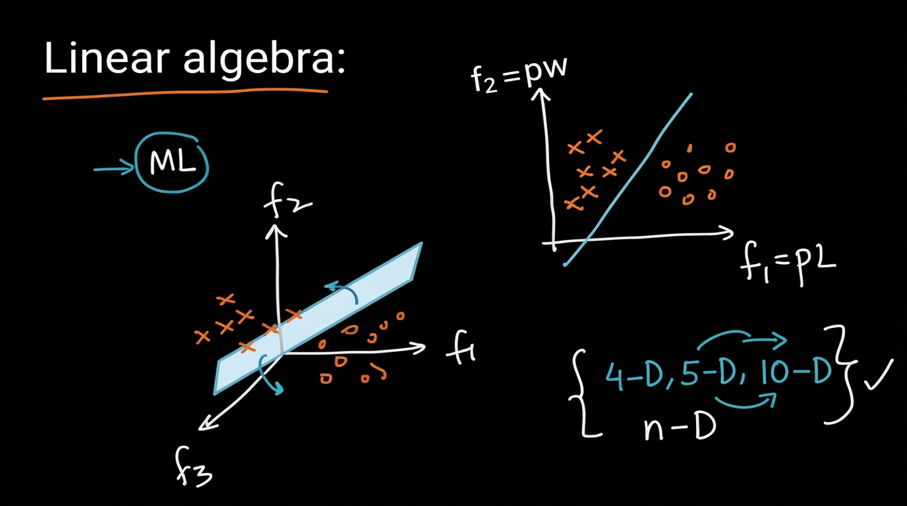

### Overview

Linear Algebra is a foundational tool in Machine Learning.  
Most ML problems can be viewed geometrically in a **feature space**.

### Feature Space View

#### 2-Dimensional Feature Space

- Features:  
  - $ f_1 = $ length (pl)  
  - $ f_2 = $ width (pw)

- Data points of two classes:  
  - Class 1 → $\times$  
  - Class 0 → $\circ$

A **linear decision boundary** (a line) separates the two classes.

#### 3-Dimensional Feature Space

When we have three features ($f_1, f_2, f_3$), the decision boundary becomes a **plane**.

### Higher Dimensions

The same idea extends to any number of dimensions:

| Dimension | Decision Boundary |
|-----------|-------------------|
| 2-D       | Line              |
| 3-D       | Plane             |
| 4-D, 5-D, 10-D, … n-D | Hyperplane |

In general, for an $n$-dimensional feature space, a linear classifier learns an **$(n-1)$-dimensional hyperplane**.

### Key Takeaway

> Linear Algebra gives us the language to describe:
> - Points (data vectors)
> - Lines / Planes / Hyperplanes (decision boundaries)
> - Distances, projections, angles, etc.

This geometric view is extremely useful for understanding many ML algorithms (Linear Regression, Logistic Regression, SVMs, PCA, etc.).

## 02. Introduction to Vectors (2-D, 3-D, n-D), Row Vector and Column Vector

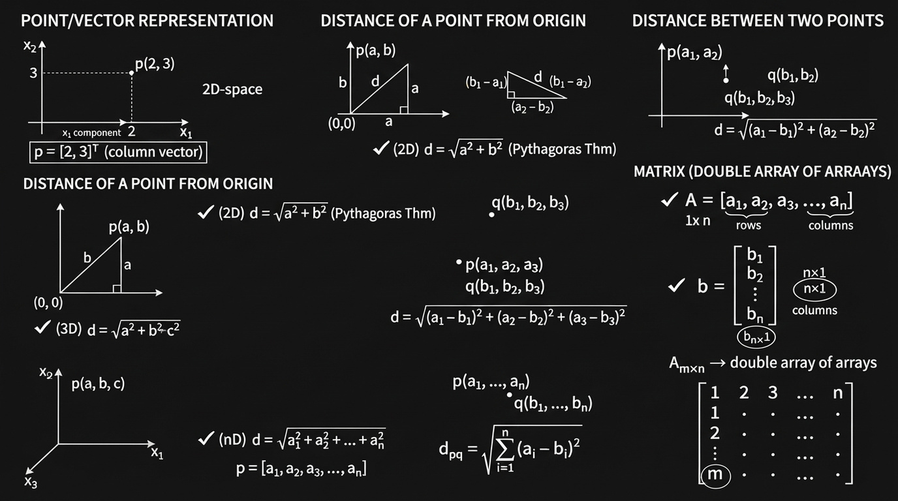

**(2-D, 3-D, n-D), Row Vector & Column Vector**

#### 1. Point / Vector
- **2D**: $ p = [2, 3] $
- **3D**: $ q = [2, 3, 5] $
- **nD**: $ x = [2, 3, 4, 1, 5, \dots] $

#### 2. Distance from Origin
- **2D**: $ d = \sqrt{a^2 + b^2} $
- **3D**: $ d = \sqrt{a^2 + b^2 + c^2} $
- **nD**: $ d = \sqrt{a_1^2 + a_2^2 + \dots + a_n^2} $

#### 3. Distance Between Two Points
- **General**: $ d_{pq} = \sqrt{\sum_{i=1}^{n} (a_i - b_i)^2} $

#### 4. Row Vector vs Column Vector
- **Row Vector**: $ A = [a_1, a_2, \dots, a_n] $ → shape $ 1 \times n $
- **Column Vector**: $ b = \begin{bmatrix} b_1 \\ b_2 \\ \vdots \\ b_n \end{bmatrix} $ → shape $ n \times 1 $
- **Matrix**: shape $ m \times n $

## 03. Dot Product and Angle Between 2 Vectors

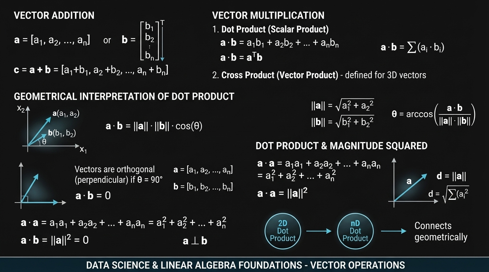

## Vector Operations  
**Addition, Dot Product & Geometric Meaning**

### 1. Vector Addition

Given two vectors of the same dimension:

$$
\mathbf{a} = [a_1,\ a_2,\ \dots,\ a_n]
$$

$$
\mathbf{b} = [b_1,\ b_2,\ \dots,\ b_n]
$$

Their sum is:

$$
\mathbf{c} = \mathbf{a} + \mathbf{b} = [a_1 + b_1,\ a_2 + b_2,\ \dots,\ a_n + b_n]
$$

**Component-wise addition.**

### 2. Dot Product (Scalar Product)

#### Definition

$$
\mathbf{a} \cdot \mathbf{b} = a_1 b_1 + a_2 b_2 + \dots + a_n b_n = \sum_{i=1}^{n} a_i b_i
$$

In matrix notation:

$$
\mathbf{a} \cdot \mathbf{b} = \mathbf{a}^T \mathbf{b}
$$

where:
- $\mathbf{a}^T$ is a **row vector** ($1 \times n$)
- $\mathbf{b}$ is a **column vector** ($n \times 1$)

### 3. Geometric Interpretation of Dot Product

$$
\mathbf{a} \cdot \mathbf{b} = \|\mathbf{a}\| \|\mathbf{b}\| \cos\theta
$$

Where:
- $\|\mathbf{a}\|$ = length (norm) of $\mathbf{a}$
- $\|\mathbf{b}\|$ = length of $\mathbf{b}$
- $\theta$ = angle between $\mathbf{a}$ and $\mathbf{b}$

#### Length (Norm) of a Vector

$$
\|\mathbf{a}\| = \sqrt{a_1^2 + a_2^2 + \dots + a_n^2}
$$

(This is the same as the distance of the point from the origin.)

#### Finding the Angle

$$
\theta = \cos^{-1} \left( \frac{\mathbf{a} \cdot \mathbf{b}}{\|\mathbf{a}\| \|\mathbf{b}\|} \right)
$$

### 4. Special Case: Orthogonal Vectors

If two vectors are **perpendicular** (\(\theta = 90^\circ\)):

$$
\cos 90^\circ = 0 \quad \Rightarrow \quad \mathbf{a} \cdot \mathbf{b} = 0
$$

**Rule:**

$$
\mathbf{a} \cdot \mathbf{b} = 0 \quad \Longleftrightarrow \quad \mathbf{a} \perp \mathbf{b}
$$

This holds in any dimension (2D, 3D, … nD).

### 5. Dot Product of a Vector with Itself

$$
\mathbf{a} \cdot \mathbf{a} = a_1^2 + a_2^2 + \dots + a_n^2 = \|\mathbf{a}\|^2
$$

Therefore:

$$
\|\mathbf{a}\| = \sqrt{\mathbf{a} \cdot \mathbf{a}}
$$


### Summary Table

| Operation              | Formula                                      | Result Type |
|------------------------|----------------------------------------------|-------------|
| Addition               | $\mathbf{a} + \mathbf{b}$                  | Vector      |
| Dot Product            | $\sum a_i b_i = \|\mathbf{a}\|\|\mathbf{b}\|\cos\theta$ | Scalar |
| Norm (Length)          | $\|\mathbf{a}\| = \sqrt{\mathbf{a}\cdot\mathbf{a}}$ | Scalar |
| Angle between vectors  | $\theta = \cos^{-1}\left(\dfrac{\mathbf{a}\cdot\mathbf{b}}{\|\mathbf{a}\|\|\mathbf{b}\|}\right)$ | Angle |
| Orthogonality test     | $\mathbf{a}\cdot\mathbf{b} = 0$             | True/False  |

### Key Geometric Insights

- Dot product measures **how much two vectors point in the same direction**.
- Positive dot product → acute angle  
- Zero dot product → perpendicular  
- Negative dot product → obtuse angle  

These ideas work the same way in **2D, 3D, and n-D**.


## 04. Projection and Unit Vector

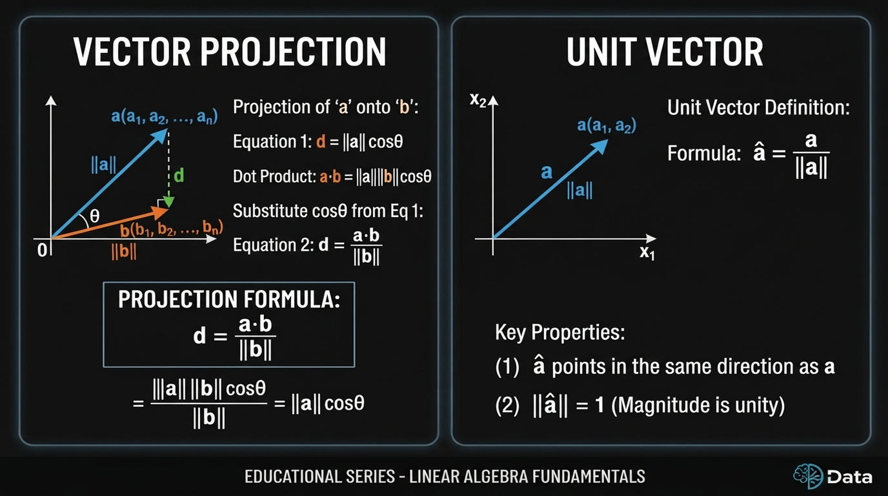

### 1. Projection of a Vector

**Projection of vector $\mathbf{a}$ onto vector $\mathbf{b}$** is the length of the shadow of $\mathbf{a}$ on the direction of $\mathbf{b}$.

#### Geometric Definition
$$
d = \|\mathbf{a}\| \cos\theta
$$

#### Using Dot Product
We know:
$$
\mathbf{a} \cdot \mathbf{b} = \|\mathbf{a}\| \|\mathbf{b}\| \cos\theta
$$

Therefore, the **scalar projection** of \(\mathbf{a}\) onto \(\mathbf{b}\) is:

$$
\text{proj}_{\mathbf{b}} \mathbf{a} = d = \dfrac{\mathbf{a} \cdot \mathbf{b}}{\|\mathbf{b}\|}
$$

Or equivalently:

$$
d = \dfrac{\mathbf{a} \cdot \mathbf{b}}{\|\mathbf{b}\|} = \|\mathbf{a}\| \cos\theta
$$

### 2. Unit Vector

A **unit vector** in the direction of \(\mathbf{a}\) is obtained by dividing the vector by its own length:

$$
\hat{\mathbf{a}} = \dfrac{\mathbf{a}}{\|\mathbf{a}\|}
$$

### Properties of Unit Vector

1. $\hat{\mathbf{a}}$ has the **same direction** as $\mathbf{a}$
2. $\|\hat{\mathbf{a}}\| = 1$ (its length is exactly 1)

```
        x₂
         ↑
         |     ↗ a (a₁, a₂)
         |   ↗  ||a||
         | ↗
         +--------→ x₁
        0
```

### Quick Summary

| Concept              | Formula                                      | Meaning                          |
|----------------------|----------------------------------------------|----------------------------------|
| Scalar Projection    | $\dfrac{\mathbf{a} \cdot \mathbf{b}}{\|\mathbf{b}\|}$ | Length of shadow of $\mathbf{a}$ on $\mathbf{b}$ |
| Unit Vector          | $\hat{\mathbf{a}} = \dfrac{\mathbf{a}}{\|\mathbf{a}\|}$ | Vector of length 1 in direction of $\mathbf{a}$ |

## 05. Equation of a Line (2-D), Plane (3-D) and Hyperplane (n-D), Plane Passing

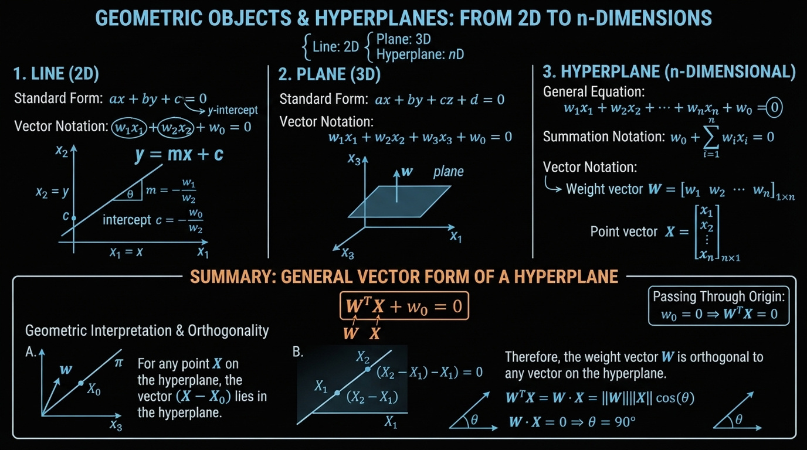

### 1. Basic Idea

| Dimension | Geometric Object | Equation Form |
|-----------|------------------|---------------|
| 2D        | Line             | $ ax + by + c = 0 $ |
| 3D        | Plane            | $ ax + by + cz + d = 0 $ |
| nD        | Hyperplane       | $ w_0 + w_1 x_1 + \dots + w_n x_n = 0 $ |

### 2. Equation of a Line (2D)

**Slope-intercept form:**
$$
y = mx + c
$$

**General form:**
$$
ax + by + c = 0
$$

Can also be written as:
$$
w_1 x_1 + w_2 x_2 + w_0 = 0
$$

Solving for $ x_2 $:
$$
x_2 = -\frac{w_0}{w_2} - \frac{w_1}{w_2} x_1
$$

- Slope $ m = -\dfrac{w_1}{w_2} $
- Intercept $ c = -\dfrac{w_0}{w_2} $

### 3. Equation of a Plane (3D)

$$
ax + by + cz + d = 0
$$

or

$$
w_1 x_1 + w_2 x_2 + w_3 x_3 + w_0 = 0
$$

### 4. Hyperplane in n-Dimensions

**General equation:**
$$
w_0 + w_1 x_1 + w_2 x_2 + \dots + w_n x_n = 0
$$

**Compact forms:**

**Summation form:**
$$
w_0 + \sum_{i=1}^{n} w_i x_i = 0
$$

**Vector form:**
$$
w_0 + \mathbf{w}^T \mathbf{x} = 0
$$

where
$$
\mathbf{w} = \begin{bmatrix} w_1 \\ w_2 \\ \vdots \\ w_n \end{bmatrix}, \quad
\mathbf{x} = \begin{bmatrix} x_1 \\ x_2 \\ \vdots \\ x_n \end{bmatrix}
$$

### 5. Hyperplane Passing Through the Origin

When the hyperplane passes through the origin, the bias term is zero:

$$
\mathbf{w}^T \mathbf{x} = 0
$$

| Object       | Equation (through origin)      |
|--------------|--------------------------------|
| Line (2D)    | $ w_1 x_1 + w_2 x_2 = 0 $    |
| Plane (3D)   | $ w_1 x_1 + w_2 x_2 + w_3 x_3 = 0 $ |
| Hyperplane   | $ \mathbf{w}^T \mathbf{x} = 0 $ |

### 6. Geometric Meaning of $\mathbf{w}$

- $\mathbf{w}$ is the **normal vector** to the hyperplane $\pi$.
- For any point $\mathbf{x}$ lying on the hyperplane:
  $$
  \mathbf{w} \cdot \mathbf{x} = 0 \quad \Rightarrow \quad \mathbf{w} \perp \mathbf{x}
  $$

That is, the angle between $\mathbf{w}$ and any vector lying on the hyperplane is $ 90^\circ $.

**Unit normal vector:**
$$
\hat{\mathbf{w}} = \dfrac{\mathbf{w}}{\|\mathbf{w}\|}
$$

### Summary

- A **hyperplane** is the generalization of a line (2D) and a plane (3D) to higher dimensions.
- The most useful form in Machine Learning is:

$$
\boxed{w_0 + \mathbf{w}^T \mathbf{x} = 0}
$$

- When the hyperplane passes through the origin:

$$
\boxed{\mathbf{w}^T \mathbf{x} = 0}
$$

- $\mathbf{w}$ is always **perpendicular** to the hyperplane.

## 06. Intercept form of Equation of a Plane

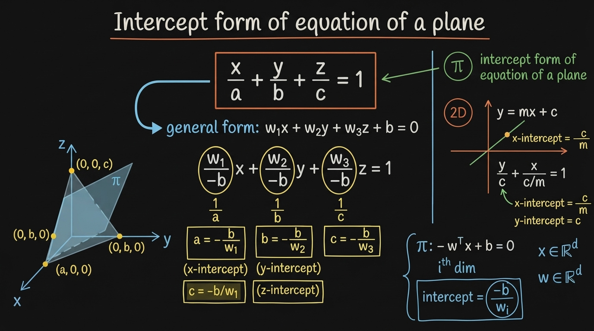


**General form (3D):** $w_1x + w_2y + w_3z + b = 0$, where $\mathbf{w}$ is the normal to the plane and $b$ is the bias.

**Intercept form:** if the plane cuts the axes at $(a,0,0)$, $(0,b,0)$, $(0,0,c)$:

$$\frac{x}{a} + \frac{y}{b} + \frac{z}{c} = 1$$

**Derivation (filling in the board's algebra):** divide the general form by $-b$:

$$\underbrace{\left(-\frac{w_1}{b}\right)}_{1/a}x + \underbrace{\left(-\frac{w_2}{b}\right)}_{1/b}y + \underbrace{\left(-\frac{w_3}{b}\right)}_{1/c}z - 1 = 0$$

which gives the intercepts:

$$a = -\frac{b}{w_1}, \qquad b_{int} = -\frac{b}{w_2}, \qquad c = -\frac{b}{w_3}$$

**Pattern:** every intercept is $-\dfrac{\text{bias}}{\text{corresponding weight}}$.

**2D check (your line example):** from $y = mx + c$, rewrite as $\frac{y}{c} + \left(-\frac{m}{c}\right)x - 1 = 0$:
- y-intercept $= c$
- x-intercept $= -\dfrac{c}{m}$ ✓ (matches the board)

**n-D generalization:** for hyperplane $\mathbf{w}^T\mathbf{x} + b = 0$, the intercept along the $i$-th axis is:

$$x_i^{\text{intercept}} = -\frac{b}{w_i}$$

**Two caveats worth noting** (not stated on the board): intercept form requires $b \neq 0$ (plane can't pass through the origin) and $w_i \neq 0$ (plane can't be parallel to axis $i$) — otherwise that intercept doesn't exist.


## 07. Distance of a Point from a Plane/Hyperplane, Half-Spaces

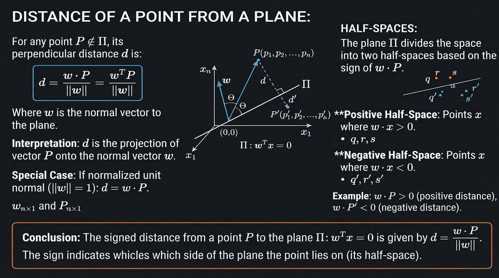

### 1. Distance of a Point from a Hyperplane

Consider a hyperplane passing through the origin:

$$
\mathbf{w}^T \mathbf{x} = 0
$$

For a point $\mathbf{p} = (p_1, p_2, \dots, p_n)$, the **signed distance** from the point to the hyperplane is:

$$
d = \dfrac{\mathbf{w}^T \mathbf{p}}{\|\mathbf{w}\|} = \dfrac{\mathbf{w} \cdot \mathbf{p}}{\|\mathbf{w}\|}
$$

#### Special Case (when $\mathbf{w}$ is a unit vector)

If $\|\mathbf{w}\| = 1$, then the formula simplifies to:

$$
d = \mathbf{w}^T \mathbf{p}
$$

### 2. Geometric Interpretation

- The vector $\mathbf{w}$ is **perpendicular** (normal) to the hyperplane $\pi$.
- The distance $d$ is the length of the perpendicular dropped from the point $\mathbf{p}$ onto the hyperplane.

```
              p
              •
              | d
              |
    ----------+----------  π  (hyperplane)
              ↑
              w (normal)
```

### 3. Signed Distance & Half-Spaces

The sign of the distance tells us **which side** of the hyperplane the point lies on:

| Distance | Meaning                        |
|----------|--------------------------------|
| $ d > 0 $ | Point lies on the same side as the direction of $\mathbf{w}$ |
| $ d < 0 $ | Point lies on the opposite side of $\mathbf{w}$ |
| $ d = 0 $ | Point lies **on** the hyperplane |

#### Example

$$
d = \dfrac{\mathbf{w} \cdot \mathbf{p}}{\|\mathbf{w}\|} = +ve
$$

$$
d' = \dfrac{\mathbf{w} \cdot \mathbf{p}'}{\|\mathbf{w}\|} = -ve
$$

- Points with **positive** signed distance → one half-space  
- Points with **negative** signed distance → the other half-space  

### 4. Half-Spaces

A hyperplane divides the entire space into **two half-spaces**:

- In **2D** → a line divides the plane into two half-planes  
- In **3D** → a plane divides the space into two half-spaces  
- In **nD** → a hyperplane divides $\mathbb{R}^n$ into two half-spaces  

### Summary

- **Distance formula**:
  $$
  d = \dfrac{\mathbf{w} \cdot \mathbf{p}}{\|\mathbf{w}\|}
  $$

- The **sign** of $d$ indicates which side of the hyperplane the point is on.
- This idea is extremely important in Machine Learning (e.g., SVM, Logistic Regression, Perceptron) for deciding class labels based on which side of the decision boundary a point lies.

## 08. Equation of a Circle (2-D), Sphere (3-D) and Hypersphere (n-D)

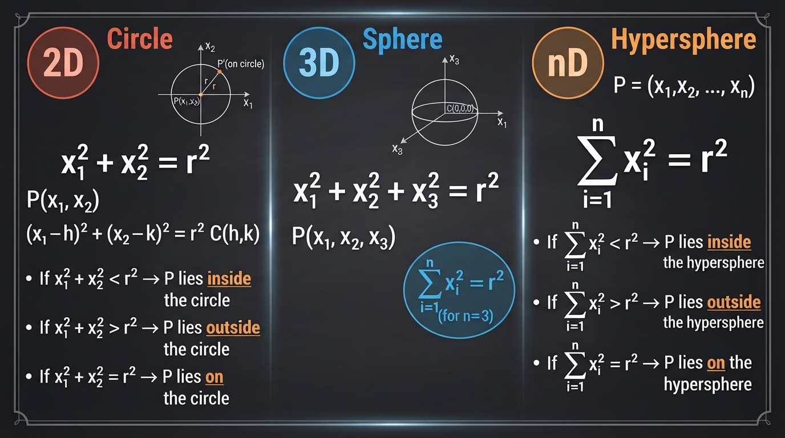

### 1. Circle (2D)

**Equation of a circle centered at the origin:**

$$
x^2 + y^2 = r^2
$$

or

$$
x_1^2 + x_2^2 = r^2
$$

**General circle** (center at $(h, k)$):

$$
(x - h)^2 + (y - k)^2 = r^2
$$

#### Position of a Point $ p(x_1, x_2) $

| Condition                  | Location of Point          |
|---------------------------|----------------------------|
| $ x_1^2 + x_2^2 < r^2 $ | Inside the circle          |
| $ x_1^2 + x_2^2 > r^2 $ | Outside the circle         |
| $ x_1^2 + x_2^2 = r^2 $ | On the circle              |

### 2. Sphere (3D)

**Equation of a sphere centered at the origin:**

$$
x_1^2 + x_2^2 + x_3^2 = r^2
$$

### 3. Hypersphere (n-D)

**Equation of a hypersphere centered at the origin:**

$$
x_1^2 + x_2^2 + \dots + x_n^2 = r^2
$$

or in summation form:

$$
\sum_{i=1}^{n} x_i^2 = r^2
$$

#### Position of a Point $ p = (x_1, x_2, \dots, x_n) $

| Condition                        | Location of Point              |
|----------------------------------|--------------------------------|
| $ \sum_{i=1}^{n} x_i^2 < r^2 $ | Inside the hypersphere         |
| $ \sum_{i=1}^{n} x_i^2 > r^2 $ | Outside the hypersphere        |
| $ \sum_{i=1}^{n} x_i^2 = r^2 $ | On the hypersphere             |

### Summary

| Dimension | Object       | Equation (centered at origin)      |
|-----------|--------------|------------------------------------|
| 2D        | Circle       | $ x_1^2 + x_2^2 = r^2 $          |
| 3D        | Sphere       | $ x_1^2 + x_2^2 + x_3^2 = r^2 $  |
| nD        | Hypersphere  | $ \sum_{i=1}^{n} x_i^2 = r^2 $   |

- The value of $ \sum x_i^2 $ compared to $ r^2 $ tells us whether a point lies **inside**, **outside**, or **on** the hypersphere.
- This idea is useful in Machine Learning (e.g., RBF kernels, anomaly detection, nearest neighbor methods, etc.).

## 09. Equation of an Ellipse (2-D), Ellipsoid (3-D) and Hyperellipsoid (n-D)

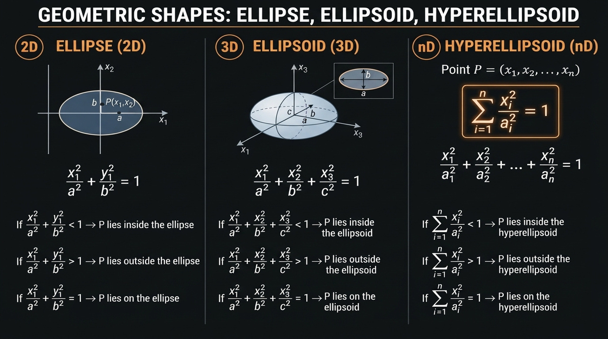

### 1. Ellipse (2D)

**Standard equation** (centered at origin, axes aligned with coordinate axes):

$$
\frac{x^2}{a^2} + \frac{y^2}{b^2} = 1
$$

or

$$
\frac{x_1^2}{a^2} + \frac{x_2^2}{b^2} = 1
$$

- $ a $ = semi-major / semi-minor axis along $ x_1 $
- $ b $ = semi-major / semi-minor axis along $ x_2 $

#### Position of a Point $ p(x_1, x_2) $

| Condition                              | Location of Point     |
|----------------------------------------|-----------------------|
| $ \dfrac{x_1^2}{a^2} + \dfrac{x_2^2}{b^2} < 1 $ | Inside the ellipse    |
| $ \dfrac{x_1^2}{a^2} + \dfrac{x_2^2}{b^2} > 1 $ | Outside the ellipse   |
| $ \dfrac{x_1^2}{a^2} + \dfrac{x_2^2}{b^2} = 1 $ | On the ellipse        |

### 2. Ellipsoid (3D)

**Standard equation** (centered at origin):

$$
\frac{x_1^2}{a^2} + \frac{x_2^2}{b^2} + \frac{x_3^2}{c^2} = 1
$$

- $ a, b, c $ are the semi-axes lengths along $ x_1, x_2, x_3 $ respectively.

### 3. Hyperellipsoid (n-D)

**General equation** (centered at origin, axes-aligned):

$$
\frac{x_1^2}{a_1^2} + \frac{x_2^2}{a_2^2} + \dots + \frac{x_n^2}{a_n^2} = 1
$$

#### Position of a Point

| Condition | Location |
|---------|----------|
| $ \sum_{i=1}^{n} \dfrac{x_i^2}{a_i^2} < 1 $ | Inside the hyperellipsoid |
| $ \sum_{i=1}^{n} \dfrac{x_i^2}{a_i^2} > 1 $ | Outside the hyperellipsoid |
| $ \sum_{i=1}^{n} \dfrac{x_i^2}{a_i^2} = 1 $ | On the hyperellipsoid |

### Summary

| Dimension | Object          | Equation (centered at origin) |
|-----------|-----------------|--------------------------------|
| 2D        | Ellipse         | $ \dfrac{x_1^2}{a^2} + \dfrac{x_2^2}{b^2} = 1 $ |
| 3D        | Ellipsoid       | $ \dfrac{x_1^2}{a^2} + \dfrac{x_2^2}{b^2} + \dfrac{x_3^2}{c^2} = 1 $ |
| nD        | Hyperellipsoid  | $ \sum_{i=1}^{n} \dfrac{x_i^2}{a_i^2} = 1 $ |

- When $ a = b $ (2D) or $ a = b = c $ (3D), the shape becomes a **circle** or **sphere**.
- Hyperellipsoids appear in Machine Learning in contexts such as Mahalanobis distance, Gaussian distributions, and certain kernel methods.

## 10. Square, Rectangle

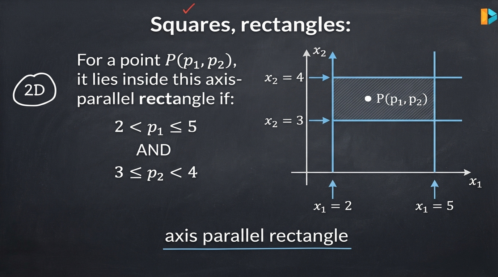

### 1. Axis-Parallel Rectangle in 2D

An **axis-parallel rectangle** is defined by simple bounds on each coordinate.

#### Example

A rectangle defined by:

- $ 2 < x_1 < 5 $
- $ 3 < x_2 < 4 $

**Condition for a point $ p = (p_1, p_2) $ to lie inside the rectangle:**

$$
\begin{cases}
p_1 > 2 \quad \text{and} \quad p_1 < 5 \\
p_2 > 3 \quad \text{and} \quad p_2 < 4
\end{cases}
$$

Or written compactly:

$$
\text{if } (p_1 > 2 \land p_1 < 5) \land (p_2 > 3 \land p_2 < 4) \quad \Rightarrow \quad p \text{ lies inside the rectangle}
$$

### 2. Geometric View

```
x₂
      ↑
   4 |     ┌─────────────┐
       |     │                                        │
   3 |     └─────────────┘
       |         
       +----------------------------------→ x₁
            2           5
```

- The sides of the rectangle are parallel to the coordinate axes.
- Each side can be represented as a vertical or horizontal line (which is a special case of a linear equation $ w_0 + w_1 x_1 + w_2 x_2 = 0 $).

### 3. Representation using Linear Inequalities

Each boundary of the rectangle is a linear constraint:

| Boundary     | Equation          | Inequality side |
|--------------|-------------------|-----------------|
| Left side    | $ x_1 = 2 $     | $ x_1 > 2 $   |
| Right side   | $ x_1 = 5 $     | $ x_1 < 5 $   |
| Bottom side  | $ x_2 = 3 $     | $ x_2 > 3 $   |
| Top side     | $ x_2 = 4 $     | $ x_2 < 4 $   |

### Summary

- Axis-parallel rectangles (and squares) are defined by **independent range constraints** on each feature.
- Checking whether a point lies inside such a rectangle is very efficient (just a few comparisons).
- This idea is used in Machine Learning in:
  - Decision Trees / Decision Stumps
  - Range queries
  - Some forms of rule-based models
  - Axis-aligned bounding boxes

## 11. Hyper Cube, Hyper Cuboid

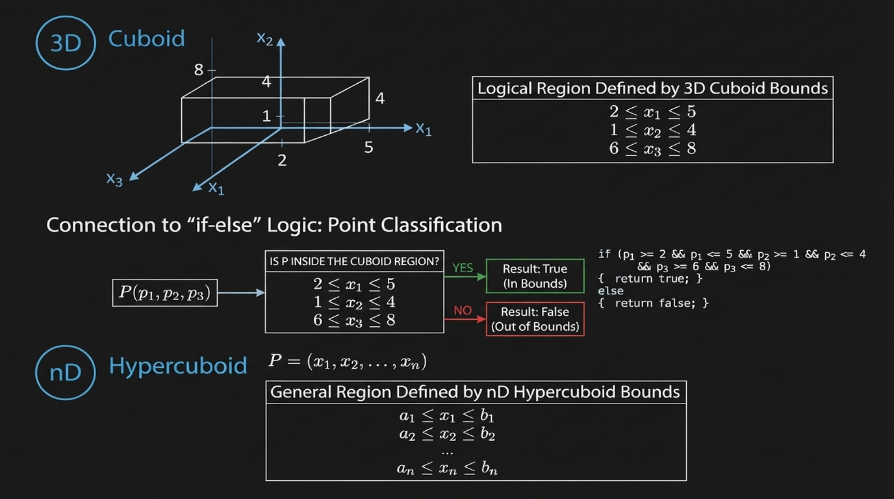

### 1. Cuboid (3D)

A **cuboid** (also called a rectangular box) is the 3-dimensional version of a rectangle.

It is defined by independent range constraints on each of the three coordinates.

**Example:**

$$
\begin{align*}
2 &< x_1 < 5 \\
1 &< x_2 < 4 \\
0 &< x_3 < 6
\end{align*}
$$

A point $ p = (p_1, p_2, p_3) $ lies **inside** the cuboid if it satisfies all three inequalities.

### 2. Hypercuboid (n-Dimensional)

A **hypercuboid** (also called a hyper-rectangle or axis-aligned bounding box) is the generalization of a rectangle/cuboid to $ n $ dimensions.

It is defined by a set of independent interval constraints:

$$
\begin{align*}
l_1 &< x_1 < u_1 \\
l_2 &< x_2 < u_2 \\
&\vdots \\
l_n &< x_n < u_n
\end{align*}
$$

where $ l_i $ and $ u_i $ are the lower and upper bounds for the $ i $-th dimension.

#### Checking Membership

To test whether a point lies inside a hypercuboid, we simply check whether **every** coordinate satisfies its corresponding range constraint (a series of `if-else` or logical AND conditions).

### Summary

| Dimension | Object       | Defined by                          |
|-----------|--------------|-------------------------------------|
| 2D        | Rectangle    | Two interval constraints            |
| 3D        | Cuboid       | Three interval constraints          |
| nD        | Hypercuboid  | $ n $ independent interval constraints |

- Hypercuboids are extremely common in Machine Learning and Data Science:
  - Decision Trees (axis-aligned splits)
  - Range search / filtering
  - Bounding boxes in computer vision
  - Feature scaling / normalization regions

## 12. Revision Questions

**Questions**

[1. Define Point/Vector (2-D, 3-D, n-D)?](#1-define-pointvector-2-d-3-d-n-d)  
[2. How to calculate Dot product and angle between 2 vectors?](#2-how-to-calculate-dot-product-and-angle-between-2-vectors)  
[3. Define Projection, unit vector?](#3-define-projection-unit-vector)  
[4. Equation of a line (2-D), plane (3-D) and hyperplane (n-D)?](#4-equation-of-a-line-2-d-plane-3-d-and-hyperplane-n-d)  
[5. Distance of a point from a plane/hyperplane, half-spaces?](#5-distance-of-a-point-from-a-planehyperplane-half-spaces)  
[6. Equation of a circle (2-D), sphere (3-D) and hypersphere (n-D)?](#6-equation-of-a-circle-2-d-sphere-3-d-and-hypersphere-n-d)  
[7. Equation of an ellipse (2-D), ellipsoid (3-D) and hyperellipsoid (n-D)?](#7-equation-of-an-ellipse-2-d-ellipsoid-3-d-and-hyperellipsoid-n-d)  
[8. Square, Rectangle, Hyper-cube and Hyper-cuboid?](#8-square-rectangle-hyper-cube-and-hyper-cuboid)  

### 1. Define Point/Vector (2-D, 3-D, n-D)?

A **point** represents a location in space.  
A **vector** represents both magnitude and direction (usually from the origin to that point).

- **2-D**: $ \mathbf{x} = (x_1, x_2) $ or $ \begin{bmatrix} x_1 \\ x_2 \end{bmatrix} $
- **3-D**: $ \mathbf{x} = (x_1, x_2, x_3) $
- **n-D**: $ \mathbf{x} = (x_1, x_2, \dots, x_n) \in \mathbb{R}^n $

In machine learning, every data point is treated as a vector in $ \mathbb{R}^d $ where $ d $ is the number of features.

### 2. How to calculate Dot product and angle between 2 vectors?

**Dot Product** of two vectors $ \mathbf{a} $ and $ \mathbf{b} $:

$ \mathbf{a} \cdot \mathbf{b} = a_1 b_1 + a_2 b_2 + \dots + a_n b_n = \|\mathbf{a}\| \|\mathbf{b}\| \cos\theta $

**Angle** between them:

$ \cos\theta = \frac{\mathbf{a} \cdot \mathbf{b}}{\|\mathbf{a}\| \|\mathbf{b}\|} $

$ \theta = \cos^{-1}\left( \frac{\mathbf{a} \cdot \mathbf{b}}{\|\mathbf{a}\| \|\mathbf{b}\|} \right) $

**Special cases**:
- $ \theta = 0^\circ $ → vectors point in the same direction
- $ \theta = 90^\circ $ → vectors are orthogonal ($ \mathbf{a} \cdot \mathbf{b} = 0 $)
- $ \theta = 180^\circ $ → vectors point in opposite directions

### 3. Define Projection, unit vector?

**Unit Vector**:
A vector with length 1.

$ \hat{\mathbf{u}} = \frac{\mathbf{u}}{\|\mathbf{u}\|} $

**Projection** of vector $ \mathbf{a} $ onto vector $ \mathbf{b} $:

$ \text{proj}_{\mathbf{b}} \mathbf{a} = \left( \frac{\mathbf{a} \cdot \mathbf{b}}{\|\mathbf{b}\|^2} \right) \mathbf{b} $

The **scalar projection** (signed length) is:

$ \frac{\mathbf{a} \cdot \mathbf{b}}{\|\mathbf{b}\|} $

Projection is heavily used when computing the distance of a point from a hyperplane.

### 4. Equation of a line (2-D), plane (3-D) and hyperplane (n-D)?

**Line in 2-D**:
$ w_1 x_1 + w_2 x_2 + b = 0 $  
or $ \mathbf{w}^T \mathbf{x} + b = 0 $

**Plane in 3-D**:
$ w_1 x_1 + w_2 x_2 + w_3 x_3 + b = 0 $

**Hyperplane in n-D**:
$ \mathbf{w}^T \mathbf{x} + b = 0 $

where $ \mathbf{w} $ is the normal vector to the hyperplane.

This is the fundamental equation used in Logistic Regression and Linear SVM.

### 5. Distance of a point from a plane/hyperplane, half-spaces?

**Distance** of a point $ \mathbf{x}_0 $ from the hyperplane $ \mathbf{w}^T \mathbf{x} + b = 0 $:

$ d = \frac{|\mathbf{w}^T \mathbf{x}_0 + b|}{\|\mathbf{w}\|} $

**Signed distance**:
$ \frac{\mathbf{w}^T \mathbf{x}_0 + b}{\|\mathbf{w}\|} $

**Half-spaces**:
- $ \mathbf{w}^T \mathbf{x} + b > 0 $ → one side of the hyperplane
- $ \mathbf{w}^T \mathbf{x} + b < 0 $ → the other side

These half-spaces are used to define the positive and negative regions in linear classifiers.

### 6. Equation of a circle (2-D), sphere (3-D) and hypersphere (n-D)?

**Circle (2-D)**:
$ (x_1 - c_1)^2 + (x_2 - c_2)^2 = r^2 $

**Sphere (3-D)**:
$ (x_1 - c_1)^2 + (x_2 - c_2)^2 + (x_3 - c_3)^2 = r^2 $

**Hypersphere (n-D)**:
$ \|\mathbf{x} - \mathbf{c}\|^2 = r^2 $

or $ (\mathbf{x} - \mathbf{c})^T (\mathbf{x} - \mathbf{c}) = r^2 $

where $ \mathbf{c} $ is the center and $ r $ is the radius.

### 7. Equation of an ellipse (2-D), ellipsoid (3-D) and hyperellipsoid (n-D)?

**Ellipse (2-D)**:
$ \frac{(x_1 - c_1)^2}{a^2} + \frac{(x_2 - c_2)^2}{b^2} = 1 $

**Ellipsoid (3-D)**:
$ \frac{(x_1 - c_1)^2}{a^2} + \frac{(x_2 - c_2)^2}{b^2} + \frac{(x_3 - c_3)^2}{c^2} = 1 $

**Hyperellipsoid (n-D)**:
$ (\mathbf{x} - \mathbf{c})^T A (\mathbf{x} - \mathbf{c}) = 1 $

where $ A $ is a positive definite matrix that controls the shape and orientation.

Ellipsoids appear in Mahalanobis distance and Gaussian distributions.

### 8. Square, Rectangle, Hyper-cube and Hyper-cuboid?

**Square (2-D)**:
All sides equal, all angles $ 90^\circ $.  
Side length $ a $ → volume (area) = $ a^2 $

**Rectangle (2-D)**:
Opposite sides equal, all angles $ 90^\circ $.  
Sides $ a, b $ → area = $ a \times b $

**Hypercube (n-D)**:
Generalization of a square/cube.  
All sides equal to length $ a $.  
Volume = $ a^n $

**Hyper-cuboid (n-D)** (also called hyperrectangle):
Generalization of a rectangle.  
Sides of lengths $ a_1, a_2, \dots, a_n $.  
Volume = $ a_1 \times a_2 \times \dots \times a_n $

These shapes are useful when thinking about axis-aligned decision boundaries and feature space partitioning.

