

# Support Vector Machines (SVM)

## Table of Contents

[01. Geometric Intuition](#01-geometric-intuition)

[02. Mathematical Derivation](#02-mathematical-derivation)

[03. Why We Take Values +1 and -1 for Support Vector Planes](#03-why-we-take-values-1-and--1-for-support-vector-planes)

[04. Loss Function (Hinge Loss) Based Interpretation](#04-loss-function-hinge-loss-based-interpretation)

[05. Dual Form of SVM Formulation](#05-dual-form-of-svm-formulation)

[06. Kernel Trick](#06-kernel-trick)

[07. Polynomial Kernel](#07-polynomial-kernel)

[08. RBF Kernel](#08-rbf-kernel)

[09. Domain-Specific Kernels](#09-domain-specific-kernels)

[10. Train and Run Time Complexities](#10-train-and-run-time-complexities)

[11. Nu-SVM: Control Errors and Support Vectors](#11-nu-svm-control-errors-and-support-vectors)

[12. SVM Regression](#12-svm-regression)

[13. Cases](#13-cases)

[14. Code Sample](#14-code-sample)

[15. Assignment-7: Apply SVM](#15-assignment-7-apply-svm)

[16. Revision Questions](#16-revision-questions)

# Support Vector Machines (SVM)

## 01. Geometric Intuition

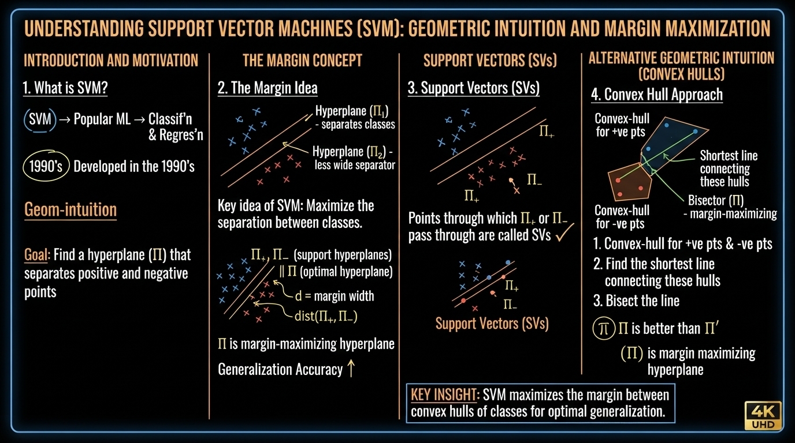

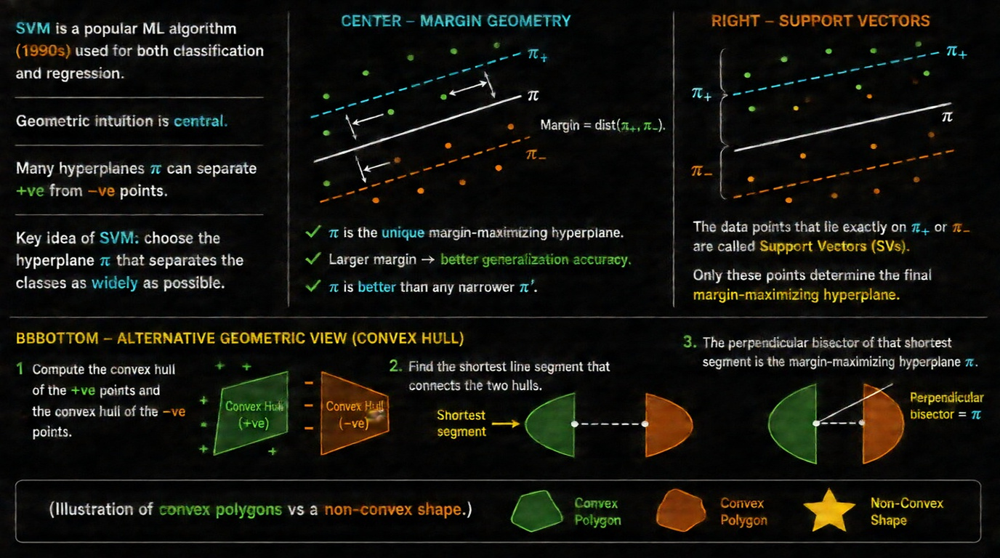

> **Support Vector Machines (SVM)**

SVM is a popular Machine Learning algorithm used for both **classification** and **regression**.

It became popular in the 1990s.

We will first develop the **geometric intuition**.

### Geometric Intuition

There are many hyperplanes $\pi$ that can separate the positive points from the negative points.

**Key idea of SVM**:

Find the hyperplane $\pi$ that separates the positive points from the negative points **as widely as possible**.

(The probabilistic view $P(y_i=1)=\sigma(\mathbf{w}^\top\mathbf{x}_i)$ is the Logistic Regression view; SVM has a different geometric motivation.)

### Margin

Draw two parallel hyperplanes $\pi_+$ and $\pi_-$ that just touch the positive and negative points respectively:

- $\pi_+$ is parallel to $\pi$
- $\pi_-$ is parallel to $\pi$
- $\pi_+$ and $\pi_-$ are also parallel to each other

The distance between $\pi_+$ and $\pi_-$ is called the **margin**:

$$
d = \text{margin} = \operatorname{dist}(\pi_+,\pi_-)
$$

$\pi$ is the **margin-maximising hyperplane**.  
$\pi$ is better than any other separating hyperplane $\pi'$.

### Goal of SVM

SVM tries to find a hyperplane $\pi$ that **maximises the margin**

$$
\text{margin} = \operatorname{dist}(\pi_+,\pi_-)
$$

Larger margin $\Rightarrow$ better generalisation accuracy.

### Support Vectors (SV)

The points through which $\pi_+$ or $\pi_-$ pass are called **Support Vectors**.

These are the only points that influence the position of the margin-maximising hyperplane.

### Alternative Geometric Intuition of SVM (Convex Hull View)

1. Compute the **convex hull** of the positive points and the convex hull of the negative points.
2. Find the **shortest line** connecting these two hulls.
3. The hyperplane $\pi$ that **bisects** this shortest line is the margin-maximising hyperplane.

(A convex hull is the smallest convex polygon that contains all the points of a class. A non-convex shape is not a convex hull.)

## 02. Mathematical Derivation

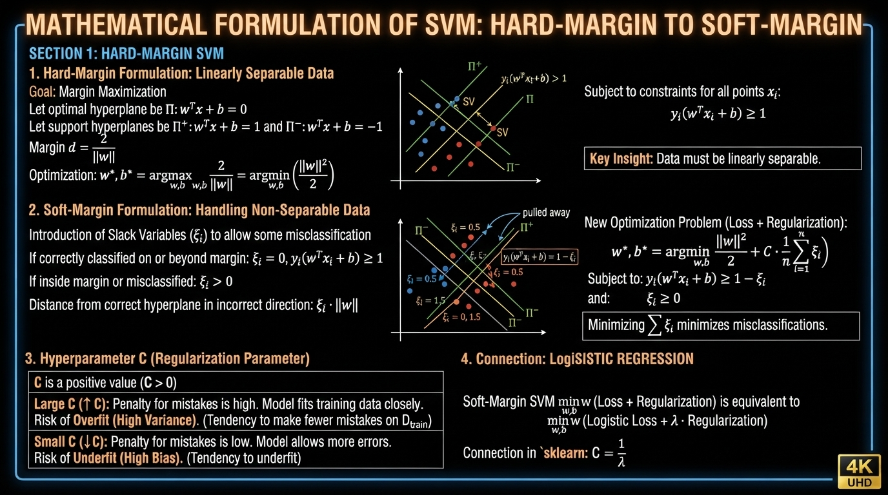

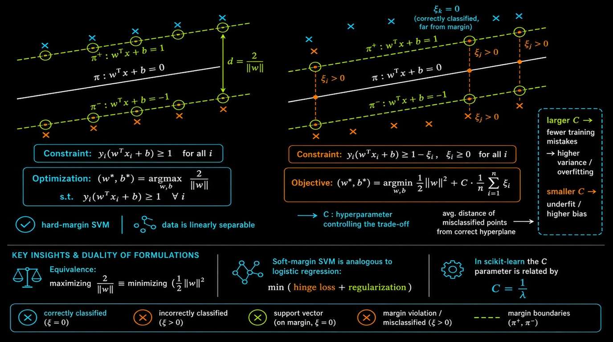

> **Mathematical Formulation of SVM**

### Hard-Margin SVM (Linearly Separable Case)

Let the hyperplane be

$$
\pi:\ \mathbf{w}^\top\mathbf{x}+b=0
$$

The two parallel supporting hyperplanes are

$$
\begin{align*}
\pi^+&:\ \mathbf{w}^\top\mathbf{x}+b=1 \\
\pi^-&:\ \mathbf{w}^\top\mathbf{x}+b=-1
\end{align*}
$$

The margin (distance between $\pi^+$ and $\pi^-$) is

$$
d=\frac{2}{\|\mathbf{w}\|}
$$

**Optimization problem**

$$
(\mathbf{w}^*,b^*)=\arg\max_{\mathbf{w},b}\ \frac{2}{\|\mathbf{w}\|}
\quad\text{subject to}\quad
y_i(\mathbf{w}^\top\mathbf{x}_i+b)\ge 1\quad\text{for all }i
$$

This is a constrained optimization problem with $n$ constraints.

It is called **Hard-Margin SVM** and assumes the data is linearly separable.

### Soft-Margin SVM (Non-linearly Separable / Almost Linearly Separable)

When the data is not linearly separable we introduce **slack variables** $\xi_i\ge 0$.

- $\xi_i=0$ → point is correctly classified and lies on the correct side of $\pi^+$ or $\pi^-$
- $\xi_i>0$ → point is on the wrong side; $\xi_i$ measures how far (in functional distance) the point is from the correct hyperplane

The constraint becomes

$$
y_i(\mathbf{w}^\top\mathbf{x}_i+b)\ge 1-\xi_i,\qquad\xi_i\ge 0
$$

### Turning Max into Min

$$
\arg\max_{\mathbf{w},b}\frac{2}{\|\mathbf{w}\|}
=\arg\min_{\mathbf{w},b}\frac{\|\mathbf{w}\|}{2}
$$

(because maximising $f$ is the same as minimising $1/f$).

### Soft-Margin Optimization Problem

$$
(\mathbf{w}^*,b^*)
=\arg\min_{\mathbf{w},b}
\frac{\|\mathbf{w}\|}{2}
+C\cdot\frac{1}{n}\sum_{i=1}^{n}\xi_i
$$

subject to

$$
y_i(\mathbf{w}^\top\mathbf{x}_i+b)\ge 1-\xi_i,\qquad\xi_i\ge 0\quad\forall i
$$

- $\dfrac{\|\mathbf{w}\|}{2}$ → maximises the margin (regularisation term)
- $\dfrac{1}{n}\sum\xi_i$ → average distance of misclassified points from the correct hyperplanes (hinge-loss term)
- $C>0$ is a hyper-parameter that controls the trade-off

This is **Soft-Margin SVM**.

It can also be written in the familiar regularised form

$$
\min_{\mathbf{w},b}\quad
\underbrace{C\cdot\text{hinge-loss}}_{\text{loss}}
+\underbrace{\frac{\|\mathbf{w}\|}{2}}_{\text{regularisation}}
$$

which is analogous to Logistic Regression:

$$
\min_{\mathbf{w}}\quad\text{logistic-loss}+\lambda\cdot\text{regularisation}
$$

### Effect of the Hyper-parameter $C$

- $C\uparrow$ → tendency to make fewer mistakes on the training data → **overfitting** (high variance)
- $C\downarrow$ → more mistakes allowed → **underfitting** (high bias)

In sklearn the relationship with the usual regularisation strength is

$$
C=\frac{1}{\lambda}
$$

## 03. Why We Take Values +1 and -1 for Support Vector Planes

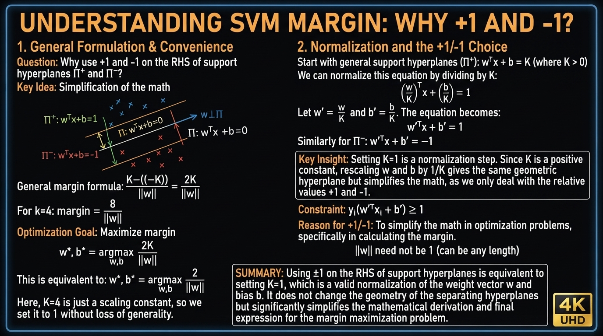

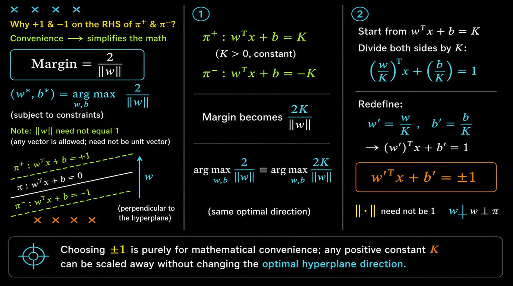

> **Why +1 and –1 on the RHS of $\pi^+$ and $\pi^-$?**

### Question

Why do we write

$$
\begin{align*}
\pi^+&:\ \mathbf{w}^\top\mathbf{x}+b=+1 \\
\pi^-&:\ \mathbf{w}^\top\mathbf{x}+b=-1
\end{align*}
$$

instead of some other constants?

### Convenience / Scaling Argument

The margin is

$$
d=\frac{2}{\|\mathbf{w}\|}
$$

and the optimisation problem is

$$
(\mathbf{w}^*,b^*)=\arg\max_{\mathbf{w},b}\frac{2}{\|\mathbf{w}\|}
$$

**Important observation**

- $\mathbf{w}$ need **not** be a unit vector.
- $\|\mathbf{w}\|$ can be any positive number.

### General Case

Suppose we write the supporting hyperplanes with an arbitrary positive constant $K$:

$$
\begin{align*}
\pi^+&:\ \mathbf{w}^\top\mathbf{x}+b=K \\
\pi^-&:\ \mathbf{w}^\top\mathbf{x}+b=-K
\end{align*}
\quad(K>0)
$$

Then the margin becomes

$$
d=\frac{2K}{\|\mathbf{w}\|}
$$

and the optimisation problem is

$$
\arg\max_{\mathbf{w},b}\frac{2K}{\|\mathbf{w}\|}
$$

### Rescaling

We can always rescale the variables:

$$
\mathbf{w}'=\frac{\mathbf{w}}{K},\qquad b'=\frac{b}{K}
$$

Then

$$
\pi^+\!:\ (\mathbf{w}')^\top\mathbf{x}+b'=1
$$

and the problem reduces exactly to the standard form

$$
\arg\max\frac{2}{\|\mathbf{w}'\|}
$$

### Conclusion

Choosing the constants $+1$ and $-1$ is purely a **convenience**.

It simplifies the mathematics without changing the geometry of the solution (the direction of $\mathbf{w}$ and the location of the hyperplane stay the same).

## 04. Loss Function (Hinge Loss) Based Interpretation

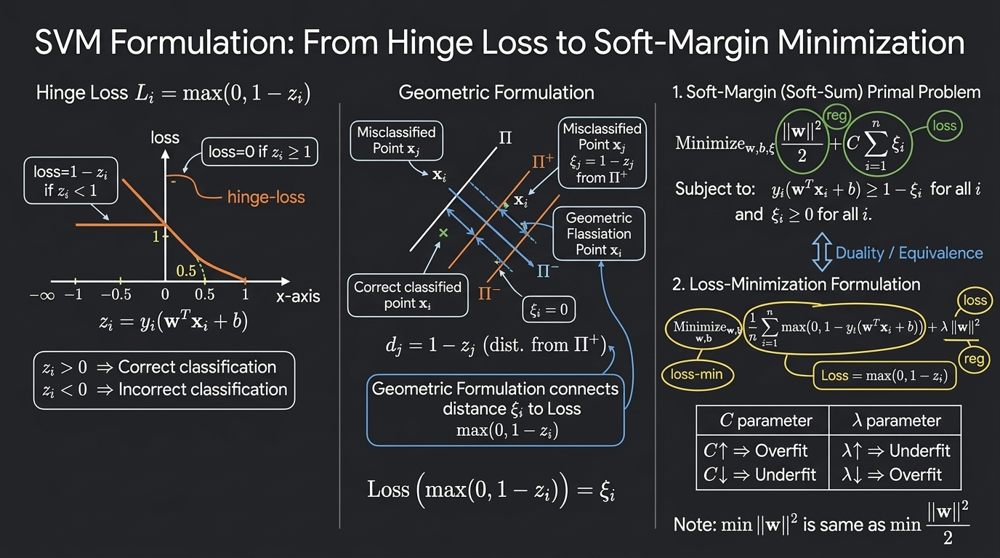

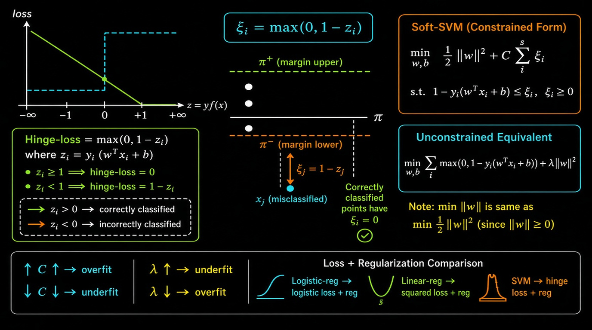

> **Loss-Minimization View: Hinge-Loss**

### Comparison of Loss Functions

- Logistic Regression → logistic-loss + regularisation
- Linear Regression → squared-loss + regularisation
- SVM → **hinge-loss + regularisation**

Define the signed quantity

$$
z_i = y_i\,f(\mathbf{x}_i) = y_i(\mathbf{w}^\top\mathbf{x}_i + b)
$$

- $z_i > 0$ → $\mathbf{x}_i$ is correctly classified
- $z_i < 0$ → $\mathbf{x}_i$ is incorrectly classified

### Definition of Hinge-Loss

$$
\text{hinge-loss} =
\begin{cases}
0 & \text{if } z_i \ge 1 \\
1 - z_i & \text{if } z_i < 1
\end{cases}
= \max\bigl(0,\ 1 - z_i\bigr)
$$

- Case 1: $z_i \ge 1$ → $1-z_i$ is negative → $\max(0,1-z_i)=0$
- Case 2: $z_i < 1$ → $1-z_i > 0$ → $\max(0,1-z_i)=1-z_i$

### Geometric Formulation ↔ Loss-Minimization

For a correctly classified point we have $\xi_i = 0$.

For a point $\mathbf{x}_j$ that lies on the wrong side of $\pi^+$ (or $\pi^-$):

$$
d_j = 1 - y_j(\mathbf{w}^\top\mathbf{x}_j + b) = 1 - z_j
$$

$\xi_j$ is exactly the distance of $\mathbf{x}_j$ from the correct supporting hyperplane:

$$
\xi_j = 1 - z_j \qquad\text{(when the point is misclassified)}
$$

Therefore

$$
\max(0,\ 1-z_i) = \xi_i
$$

### Soft-Margin SVM (Loss-Minimization Form)

$$
\min_{\mathbf{w},b}\
\frac{\|\mathbf{w}\|}{2}
+ C\sum_{i=1}^{n}\xi_i
$$

subject to

$$
1 - y_i(\mathbf{w}^\top\mathbf{x}_i + b) \le \xi_i,\qquad
\xi_i \ge 0
$$

Equivalently (unconstrained form)

$$
\min_{\mathbf{w},b}\
\sum_{i=1}^{n}\max\bigl(0,\ 1 - y_i(\mathbf{w}^\top\mathbf{x}_i + b)\bigr)
+ \lambda\|\mathbf{w}\|^2
$$

(Note: minimising $\|\mathbf{w}\|$ is the same as minimising $\|\mathbf{w}\|^2$ because $\|\mathbf{w}\|\ge 0$.)

### Effect of the Hyper-parameter

- $C\uparrow$ → overfitting
- $C\downarrow$ → underfitting

(or equivalently $\lambda\uparrow$ → underfitting, $\lambda\downarrow$ → overfitting)

## 05. Dual Form of SVM Formulation

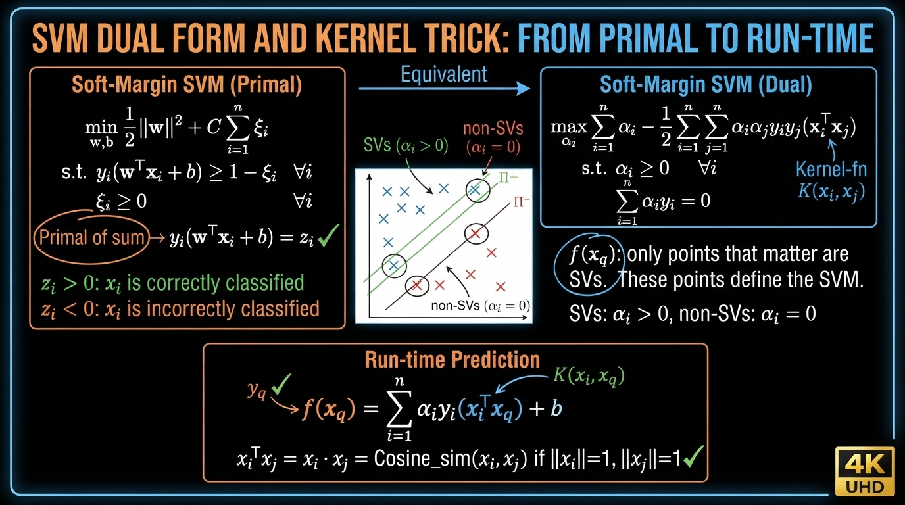

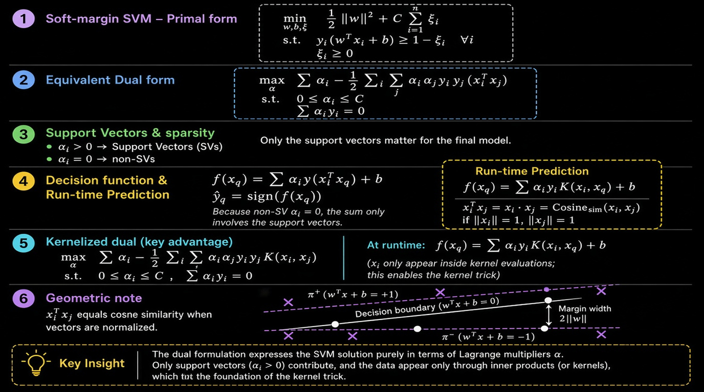

> **Dual Form of SVM**

### Primal (Soft-Margin SVM)

$$
\begin{align*}
\min_{\mathbf{w},b}\quad
&\frac12\|\mathbf{w}\| + C\sum_{i=1}^{n}\xi_i \\
\text{s.t.}\quad
&y_i(\mathbf{w}^\top\mathbf{x}_i + b)\ge 1-\xi_i,\qquad\xi_i\ge 0\quad\forall i
\end{align*}
$$

This is the **primal** formulation of SVM.

### Dual Formulation (Equivalent)

$$
\begin{align*}
\max_{\alpha_i}\quad
&\sum_{i=1}^{n}\alpha_i
-\frac12\sum_{i=1}^{n}\sum_{j=1}^{n}
\alpha_i\alpha_j y_i y_j\,(\mathbf{x}_i^\top\mathbf{x}_j) \\
\text{s.t.}\quad
&\alpha_i\ge 0,\qquad
\sum_{i=1}^{n}\alpha_i y_i = 0
\end{align*}
$$

### Important Observations from the Dual

1. Each training point $\mathbf{x}_i$ gets a dual variable $\alpha_i$.
2. The data points $\mathbf{x}_i$ appear **only** in the form of inner products $\mathbf{x}_i^\top\mathbf{x}_j$.
3. The decision function becomes

$$
f(\mathbf{x}_q)
= \sum_{i=1}^{n}\alpha_i y_i\,(\mathbf{x}_i^\top\mathbf{x}_q) + b
$$

4.

- $\alpha_i > 0$ → $\mathbf{x}_i$ is a **Support Vector**
- $\alpha_i = 0$ → $\mathbf{x}_i$ is a **non-Support Vector**

Only the Support Vectors matter for the final classifier.

### Kernel Trick

Because the dual depends on the data only through inner products, we can replace

$$
\mathbf{x}_i^\top\mathbf{x}_j \quad\text{by a kernel}\quad K(\mathbf{x}_i,\mathbf{x}_j)
$$

$$
\max_{\alpha_i}
\sum_{i=1}^{n}\alpha_i
-\frac12\sum_{i=1}^{n}\sum_{j=1}^{n}
\alpha_i\alpha_j y_i y_j\,K(\mathbf{x}_i,\mathbf{x}_j)
$$

subject to the same constraints.

$K(\mathbf{x}_i,\mathbf{x}_j)$ is any valid similarity / kernel function (e.g. cosine similarity when the vectors are normalised).

### Runtime Prediction

At test time we only need

$$
f(\mathbf{x}_q)
= \sum_{i=1}^{n}\alpha_i y_i\,K(\mathbf{x}_i,\mathbf{x}_q) + b
$$

(Only terms with $\alpha_i > 0$ survive.)

## 06. Kernel Trick

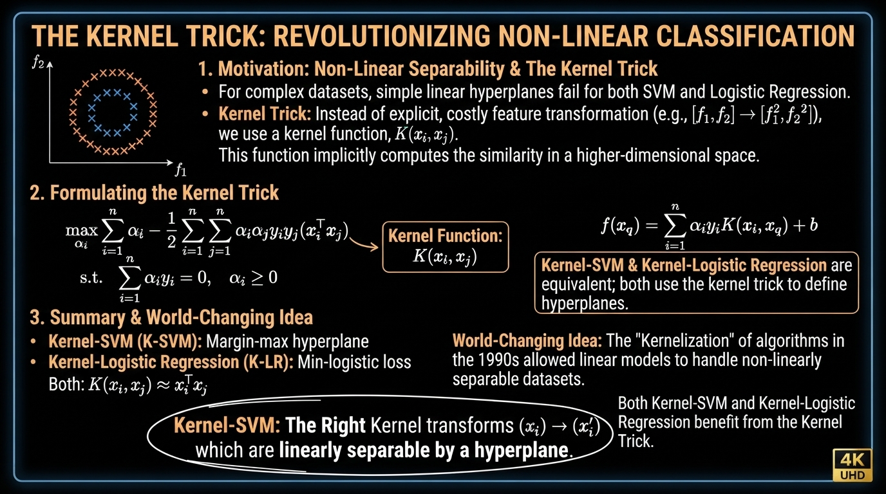

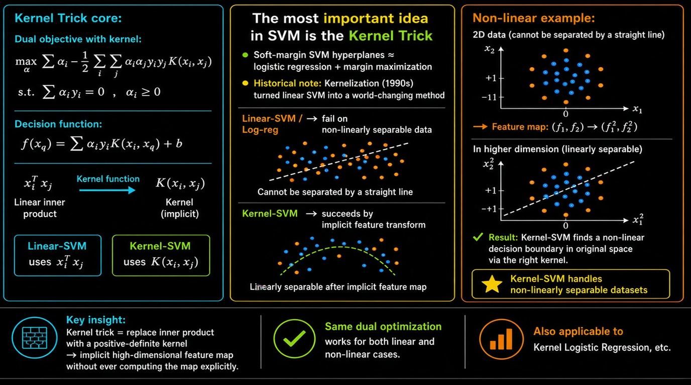

> **Kernel Trick**

### From Linear SVM to Kernel SVM

The dual of Linear SVM is

$$
\begin{align*}
\max_{\alpha_i}\quad
&\sum_{i=1}^{n}\alpha_i
-\frac12\sum_{i=1}^{n}\sum_{j=1}^{n}
\alpha_i\alpha_j y_i y_j\,(\mathbf{x}_i^\top\mathbf{x}_j) \\
\text{s.t.}\quad
&\sum_{i=1}^{n}\alpha_i y_i=0,\qquad\alpha_i\ge 0
\end{align*}
$$

The only place the data appears is the inner product $\mathbf{x}_i^\top\mathbf{x}_j$, which can be viewed as a **similarity** $\operatorname{Sim}(\mathbf{x}_i,\mathbf{x}_j)$.

We simply replace it by a **kernel function**:

$$
\mathbf{x}_i^\top\mathbf{x}_j \quad\longrightarrow\quad K(\mathbf{x}_i,\mathbf{x}_j)
$$

and obtain **Kernel SVM**:

$$
f(\mathbf{x}_q)
= \sum_{i=1}^{n}\alpha_i y_i\,K(\mathbf{x}_i,\mathbf{x}_q)+b
$$

### Why the Kernel Trick is Important

- Soft-margin Linear SVM (hyperplanes) ≈ Logistic Regression (both try to find a good linear separator; SVM additionally maximises the margin).
- The **most important idea** in SVM is the **kernel trick**.

$$
\begin{align*}
\text{Linear SVM:}&\quad K(\mathbf{x}_i,\mathbf{x}_j)=\mathbf{x}_i^\top\mathbf{x}_j \\
\text{Kernel SVM:}&\quad K(\mathbf{x}_i,\mathbf{x}_j)=\text{any valid kernel}
\end{align*}
$$

### Handling Non-Linearly Separable Data

When the data is not linearly separable in the original space:

- Linear SVM fails
- Logistic Regression fails

Two successful approaches:

1. Explicit feature transform (e.g. $(f_1,f_2)\to(f_1^2,f_2^2)$) + Logistic Regression / Linear SVM
2. **Kernel SVM** – chooses the right kernel so that the data becomes linearly separable in a higher-dimensional feature space (without ever computing the explicit mapping).

Kernel SVM is therefore the natural way to handle non-linearly separable data sets.

### World-Changing Idea

**Kernelization** (1990s) – the idea of replacing inner products by kernels – turned Linear SVM into a powerful non-linear classifier and later inspired Kernel Logistic Regression as well:

$$
\mathbf{x}_i^\top\mathbf{x}_j \quad\longrightarrow\quad K(\mathbf{x}_i,\mathbf{x}_j)
$$

## 07. Polynomial Kernel

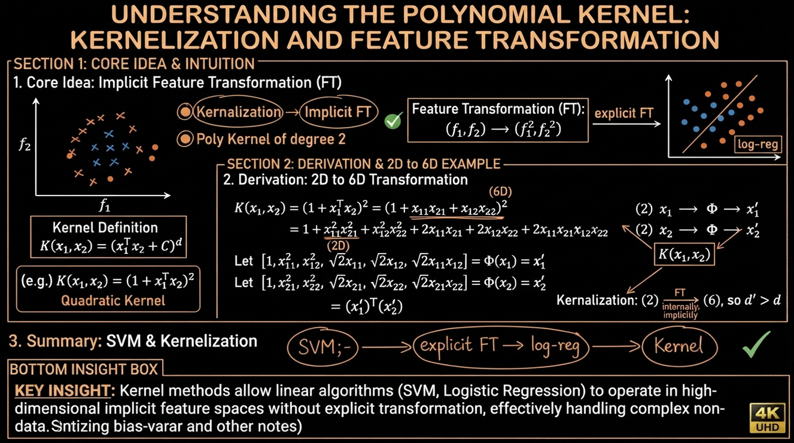

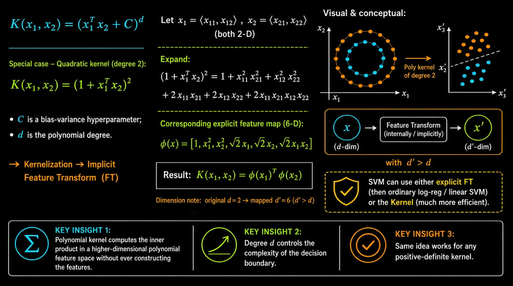

> **Polynomial Kernel**

### Kernelization = Implicit Feature Transform

Kernelization performs an **implicit feature transform**.

The polynomial kernel of degree $d$ is

$$
K(\mathbf{x}_1,\mathbf{x}_2) = \bigl(\mathbf{x}_1^\top\mathbf{x}_2 + C\bigr)^d
$$

(Example – Quadratic kernel, $d=2$, $C=1$)

$$
K(\mathbf{x}_1,\mathbf{x}_2) = (1 + \mathbf{x}_1^\top\mathbf{x}_2)^2
$$

$C$ is a bias / constant term (bias-variance related hyper-parameter).

### Explicit Mapping for the Quadratic Kernel

Let $\mathbf{x}_1=\langle x_{11},x_{12}\rangle$ and $\mathbf{x}_2=\langle x_{21},x_{22}\rangle$ (2-dimensional).

$$
\begin{align*}
K(\mathbf{x}_1,\mathbf{x}_2)
&= (1 + x_{11}x_{21} + x_{12}x_{22})^2 \\
&= 1 + x_{11}^2 x_{21}^2 + x_{12}^2 x_{22}^2
+ 2x_{11}x_{21} + 2x_{12}x_{22} + 2x_{11}x_{21}x_{12}x_{22}
\end{align*}
$$

This is exactly the inner product of the 6-dimensional vectors

$$
\begin{align*}
\mathbf{x}_1'
&= \bigl[1,\ x_{11}^2,\ x_{12}^2,\ \sqrt{2}\,x_{11},\ \sqrt{2}\,x_{12},\ \sqrt{2}\,x_{11}x_{12}\bigr] \\
\mathbf{x}_2'
&= \bigl[1,\ x_{21}^2,\ x_{22}^2,\ \sqrt{2}\,x_{21},\ \sqrt{2}\,x_{22},\ \sqrt{2}\,x_{21}x_{22}\bigr]
\end{align*}
$$

i.e.

$$
K(\mathbf{x}_1,\mathbf{x}_2) = (\mathbf{x}_1')^\top(\mathbf{x}_2')
$$

### Geometric Picture

- Original space: 2-D (non-linearly separable)
- After the implicit feature transform: 6-D (linearly separable)
- Polynomial kernel of degree 2 realises this mapping **without ever writing the 6-D vectors**.

### Key Idea of Kernelization

$$
\begin{align*}
\text{dimension }d
&\ \xrightarrow{\text{Feature Transform (internally / implicitly)}}
\ \text{dimension }d' \quad(d'>d)
\end{align*}
$$

We never compute $\mathbf{x}'$ explicitly; we only evaluate the kernel $K(\mathbf{x}_i,\mathbf{x}_j)$.

### Two Ways to Obtain a Non-Linear Classifier

**SVM** can be made non-linear in two ways:

1. Explicit feature transform + Linear SVM / Logistic Regression
2. Kernel trick (implicit feature transform)

Both approaches succeed on data that are not linearly separable in the original space.

## 08. RBF Kernel

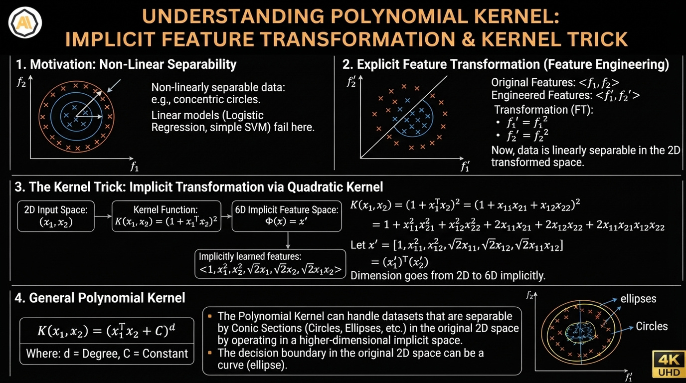

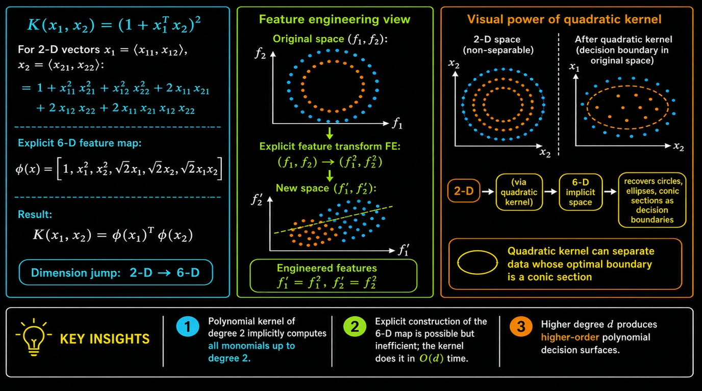

> **Polynomial Kernel – Detailed Expansion & Geometric Effect**

### Quadratic Kernel Expansion (again)

$$
K(\mathbf{x}_1,\mathbf{x}_2) = (1 + \mathbf{x}_1^\top\mathbf{x}_2)^2
$$

For 2-D vectors $\mathbf{x}_1=\langle x_{11},x_{12}\rangle$, $\mathbf{x}_2=\langle x_{21},x_{22}\rangle$:

$$
\begin{align*}
K(\mathbf{x}_1,\mathbf{x}_2)
&= (1 + x_{11}x_{21} + x_{12}x_{22})^2 \\
&= 1 + x_{11}^2 x_{21}^2 + x_{12}^2 x_{22}^2
+ 2x_{11}x_{21} + 2x_{12}x_{22} + 2x_{11}x_{21}x_{12}x_{22}
\end{align*}
$$

This equals the inner product of the explicitly mapped 6-D vectors

$$
\begin{align*}
\mathbf{x}_1'
&= \bigl[1,\ x_{11}^2,\ x_{12}^2,\ \sqrt{2}\,x_{11},\ \sqrt{2}\,x_{12},\ \sqrt{2}\,x_{11}x_{12}\bigr] \\
\mathbf{x}_2'
&= \bigl[1,\ x_{21}^2,\ x_{22}^2,\ \sqrt{2}\,x_{21},\ \sqrt{2}\,x_{22},\ \sqrt{2}\,x_{21}x_{22}\bigr]
\end{align*}
$$

i.e. $K(\mathbf{x}_1,\mathbf{x}_2)=(\mathbf{x}_1')^\top(\mathbf{x}_2')$.

### Non-linearly Separable Data & Feature Engineering

Classic example: two concentric circles (or ellipses) in 2-D.

- Original features: $\langle f_1,f_2\rangle$
- Data is **not** linearly separable.

**Explicit feature transform** (Feature Engineering):

$$
\begin{align*}
f_1' &= f_1^2 \\
f_2' &= f_2^2
\end{align*}
$$

In the new $(f_1',f_2')$ space the two classes become linearly separable.

### What the Quadratic Kernel Does

1. Starts with 2-D points $\mathbf{x}_1,\mathbf{x}_2$.
2. Implicitly maps them to 6-D vectors $\mathbf{x}_1',\mathbf{x}_2'$.
3. Finds a linear separator in that 6-D space.
4. The decision boundary, when pulled back to the original 2-D plane, becomes a **quadratic curve** (circle / ellipse / conic section).

Thus a Polynomial Kernel of degree 2 can separate data that lie on concentric circles or ellipses.

### Summary Picture

$$
\begin{align*}
\text{2-D (non-linear)}
&\ \xrightarrow{\text{Quadratic Kernel (implicit FT)}}
\ \text{6-D (linearly separable)} \\
&\ \xrightarrow{\text{pull back}}
\ \text{quadratic decision boundary in 2-D}
\end{align*}
$$

This is exactly why Kernel SVM succeeds on data sets that Linear SVM and ordinary Logistic Regression fail on.

## 09. Domain-Specific Kernels

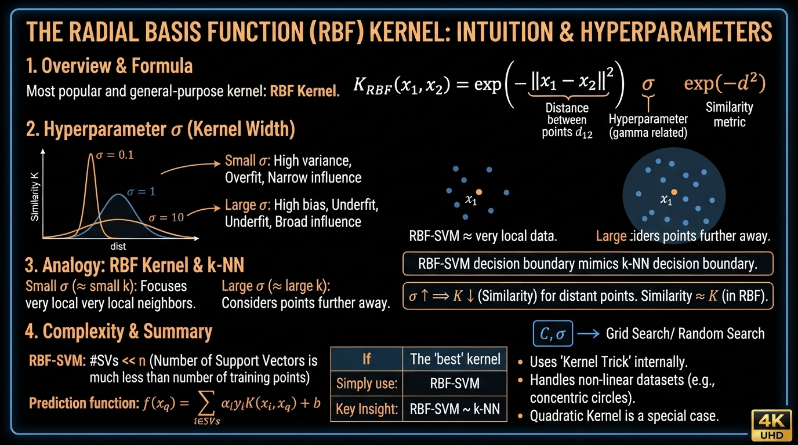

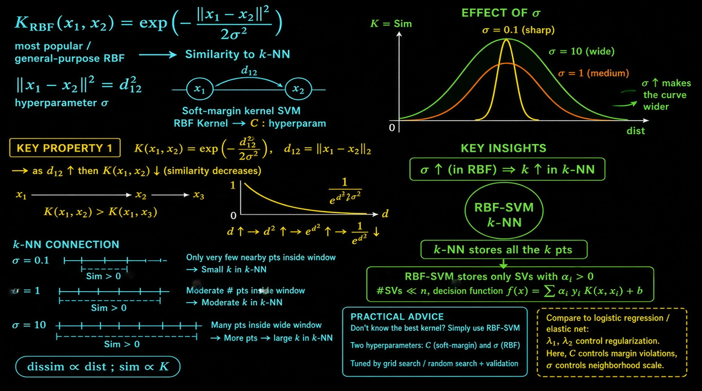

> **Radial Basis Function (RBF) Kernel**

### Most Popular / General-Purpose Kernel

For Soft-margin Kernel SVM the **most popular** and general-purpose kernel is the **RBF kernel** (also called Gaussian kernel).

$$
K_{\text{RBF}}(\mathbf{x}_1,\mathbf{x}_2)
= \exp\left(-\frac{\|\mathbf{x}_1-\mathbf{x}_2\|^2}{2\sigma^2}\right)
$$

- $\|\mathbf{x}_1-\mathbf{x}_2\|^2 = d_{12}^2$ (squared Euclidean distance)
- $\sigma > 0$ is a hyper-parameter

RBF kernel measures **similarity** (exactly as $k$-NN does).

### Behaviour with Distance

$$
K(\mathbf{x}_1,\mathbf{x}_2) = \exp\left(-\frac{d_{12}^2}{2\sigma^2}\right)
$$

1. As $d_{12}$ increases, $K(\mathbf{x}_1,\mathbf{x}_2)$ decreases  
   (similarity falls when points are farther apart).

   $$
   K(\mathbf{x}_1,\mathbf{x}_2) > K(\mathbf{x}_1,\mathbf{x}_3)
   \quad\text{when}\quad d_{12} < d_{13}
   $$

### Effect of the Hyper-parameter $\sigma$

Typical values examined: $\sigma=1$, $\sigma=0.1$, $\sigma=10$.

- Small $\sigma$ (e.g. $0.1$) → very peaked similarity curve → only nearest neighbours have high similarity → behaves like **small-$k$ in $k$-NN**.
- Large $\sigma$ (e.g. $10$) → wide similarity curve → many points receive non-zero similarity → behaves like **large-$k$ in $k$-NN**.

### RBF-SVM ≈ $k$-NN

- $k$-NN stores **all** training points and looks at the $k$ nearest ones at test time ($O(nd)$).
- RBF-SVM keeps only the **Support Vectors** ($\alpha_i>0$).  
  Number of SVs $\ll n$.

Decision function still uses only the SVs:

$$
f(\mathbf{x}_q) = \sum_{i:\alpha_i>0}\alpha_i y_i\,K_{\text{RBF}}(\mathbf{x}_i,\mathbf{x}_q)+b
$$

Hence **RBF-SVM ≈ $k$-NN**, but with a much smaller set of prototypes (the Support Vectors).

### Practical Advice

When we do **not** know which kernel is best:

- Simply use **RBF-SVM**.
- Tune the two hyper-parameters $C$ (soft-margin) and $\sigma$ (RBF width) by grid-search or random-search.

(Compare with Logistic Regression + Elastic-Net which also has two hyper-parameters $\lambda_1,\lambda_2$.)

## 10. Train and Run Time Complexities

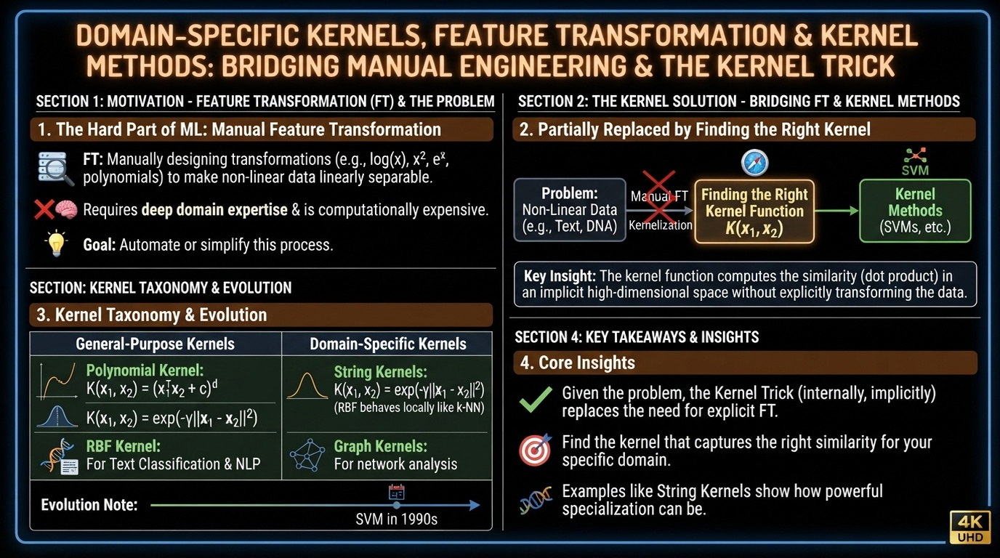

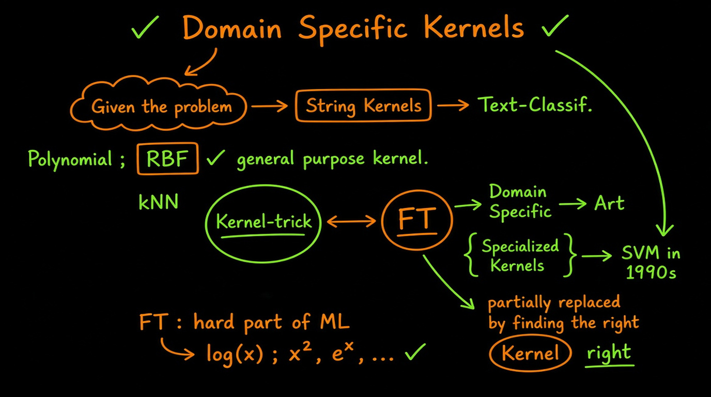

> **Domain-Specific Kernels**

### General-Purpose vs Domain-Specific

- **General-purpose kernels**
  - Polynomial
  - RBF (most popular) → behaves like $k$-NN

- **Domain-specific kernels**  
  Designed for a particular type of data / problem.

Kernel-trick ≈ Feature Transform (FT).  
When we have a concrete problem we can design a specialised kernel instead of inventing an explicit feature transform.

### Example

**String Kernels** → used for Text Classification.

### Historical Note

SVM became extremely popular in the 1990s precisely because people could invent specialised kernels for many different domains.

### Feature Transform vs Kernel

Explicit Feature Transform ($\log(x)$, $x^2$, $e^x$, …) has always been one of the hardest parts of Machine Learning.

Kernel methods partially replace that hard work by the simpler task of  
**“finding the right kernel”**.

## 11. Nu-SVM: Control Errors and Support Vectors

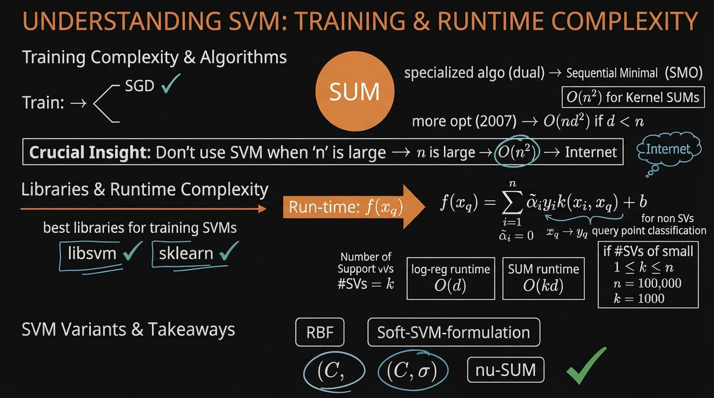

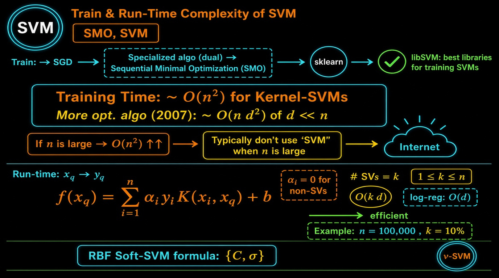

> **Train & Run-time Complexity of SVM**

### Training

Two common ways to train an SVM:

- Stochastic Gradient Descent (SGD) on the primal
- Specialised dual algorithms → **Sequential Minimal Optimization (SMO)**

Best practical libraries:

- **libSVM** (classic, very solid)
- scikit-learn (uses libSVM / similar solvers under the hood)

### Training-time Complexity

- Kernel SVM (with SMO-style solvers): roughly $O(n^2)$
- More optimised algorithms (around 2007): $O(nd^2)$ when $d < n$

**Practical rule**

If $n$ is very large (Internet-scale data), $O(n^2)$ becomes prohibitive.  
→ Typically **do not use SVM** when $n$ is huge.

### Run-time (Prediction) Complexity

Decision function:

$$
f(\mathbf{x}_q)
= \sum_{i=1}^{n}\alpha_i y_i\,K(\mathbf{x}_i,\mathbf{x}_q)+b
$$

- $\alpha_i=0$ for all non-Support Vectors
- Only the Support Vectors contribute.

Let $K = $ number of Support Vectors ($1\le K\le n$).

Then prediction cost is $O(Kd)$  
(compare with Logistic Regression which is always $O(d)$).

When the number of SVs stays small, prediction is fast even if $n$ is large  
(e.g. $n=100\,000$ but $K=10$).

### Soft-margin RBF-SVM Hyper-parameters

The usual practical formulation is Soft-margin RBF-SVM controlled by the pair $(C,\sigma)$.  
(There is also the $\nu$-SVM formulation that directly controls the fraction of Support Vectors.)

## 12. SVM Regression

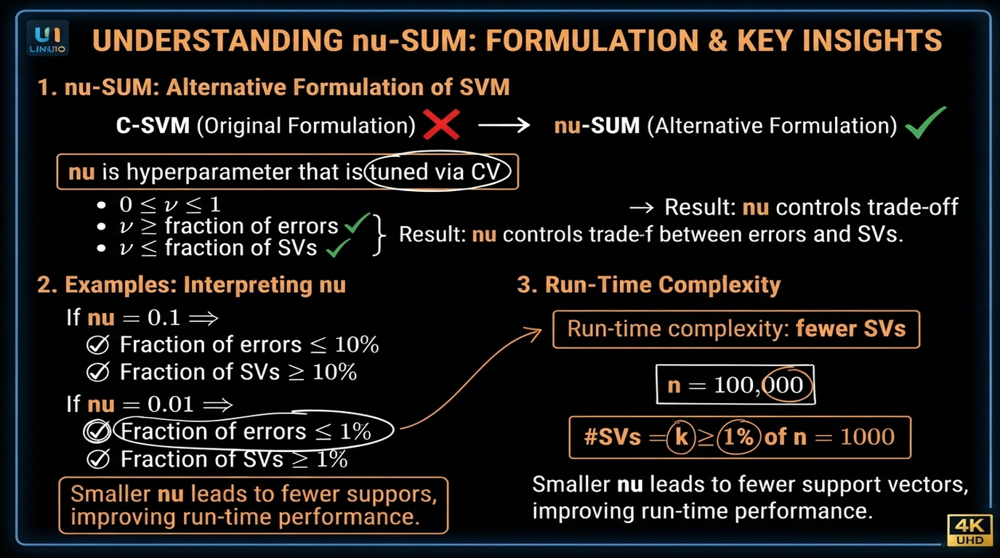

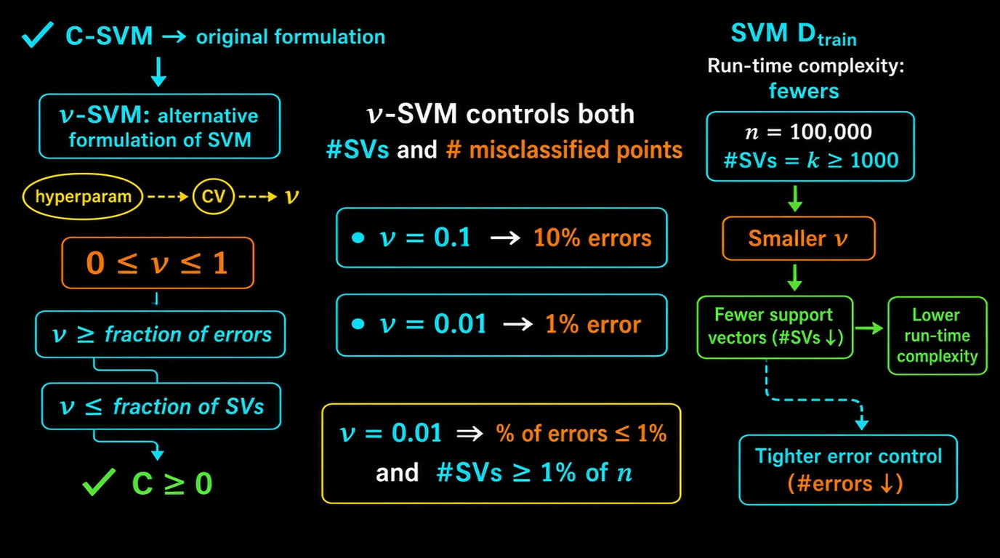

> **ν-SVM**

### Two Formulations of Soft-Margin SVM

1. **C-SVM** (original / classic formulation)
   - Hyper-parameter $C \ge 0$
   - Controls the trade-off between margin size and number of training errors.

2. **ν-SVM** (alternative formulation)
   - Hyper-parameter $\nu$ with $0\le\nu\le 1$
   - Has a more direct interpretation:

$$
\begin{align*}
\nu &\ge \text{fraction of training errors} \\
\nu &\le \text{fraction of Support Vectors}
\end{align*}
$$

### Practical Meaning of ν

Example:

$$
\nu = 0.01
\quad\Longrightarrow\quad
\begin{cases}
\text{percentage of errors} &\le 1\% \\
\text{number of SVs} &\ge 1\%\text{ of }n
\end{cases}
$$

If $n=100\,000$ then

$$
K = \#\text{SVs} \ge 1\,000
$$

### Why ν-SVM is Useful

- Gives direct control over the **number of Support Vectors** (and therefore over run-time complexity).
- Fewer SVs → faster prediction.
- Still needs cross-validation to choose a good value of $\nu$.

(Both C-SVM and ν-SVM are available in standard libraries; C-SVM is more commonly used by default.)

## 13. Cases

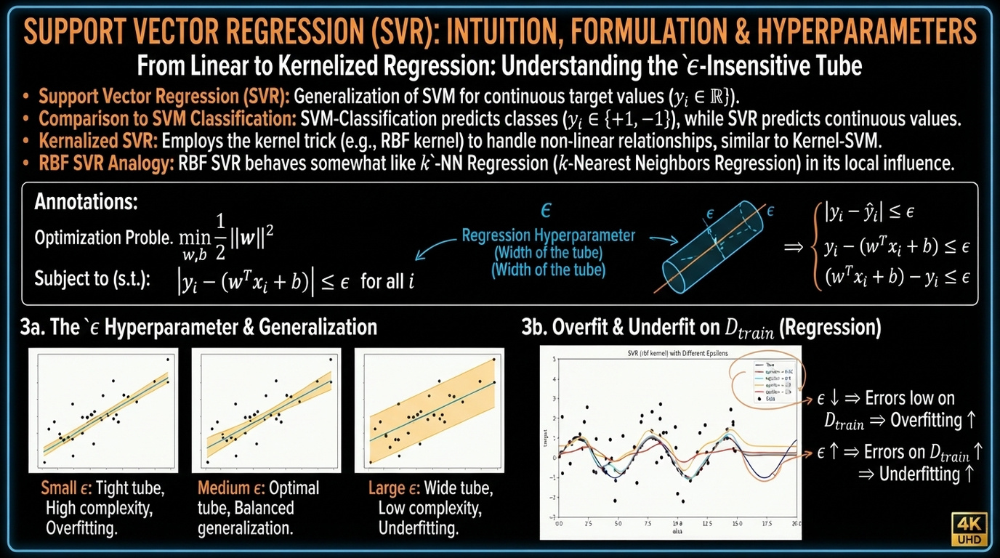

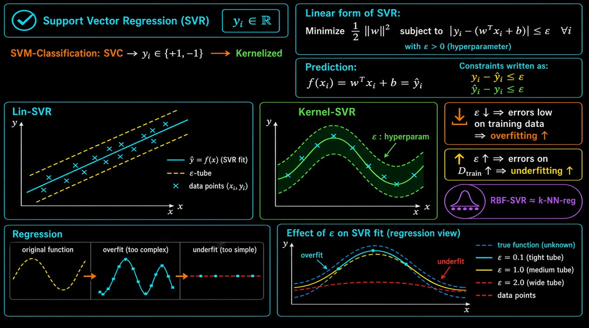

> **Support Vector Regression (SVR)**

### From Classification to Regression

- SVM Classification (SVC) → $y_i\in\{+1,-1\}$
- Support Vector Regression (SVR) → $y_i\in\mathbb{R}$

Both can be kernelized.

### Linear Formulation of SVR

$$
\begin{align*}
\min_{\mathbf{w},b}\quad
&\frac12\|\mathbf{w}\|^2 \\
\text{s.t.}\quad
&y_i - (\mathbf{w}^\top\mathbf{x}_i + b) \le\varepsilon \\
&(\mathbf{w}^\top\mathbf{x}_i + b) - y_i \le\varepsilon
\quad\forall i
\end{align*}
$$

- $\varepsilon>0$ is a hyper-parameter (the width of the ε-tube).
- Prediction: $\hat{y}_i = f(\mathbf{x}_i) = \mathbf{w}^\top\mathbf{x}_i + b$
- The constraints force $|y_i - \hat{y}_i|\le\varepsilon$.

### Geometric Picture

- **Linear SVR**: finds a linear function that stays inside an ε-tube around the data.
- **Kernel SVR**: the same idea in a higher-dimensional feature space → non-linear regression curve.

### Effect of ε

- $\varepsilon\downarrow$ → errors on training data become smaller → **overfitting** increases.
- $\varepsilon\uparrow$ → more training points are allowed to lie outside the tube → **underfitting** increases.

RBF-SVR behaves similarly to $k$-NN regression.

### Visual Example (RBF Kernel)

Different values of ε produce different fits:

- Very small ε (e.g. 0.01) → tight fit → overfitting
- Larger ε (e.g. 2.0) → smoother / flatter fit → underfitting

The true underlying function lies between the extreme over-fit and under-fit curves.

## 14. Code Sample

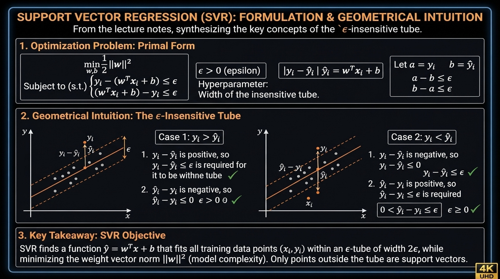

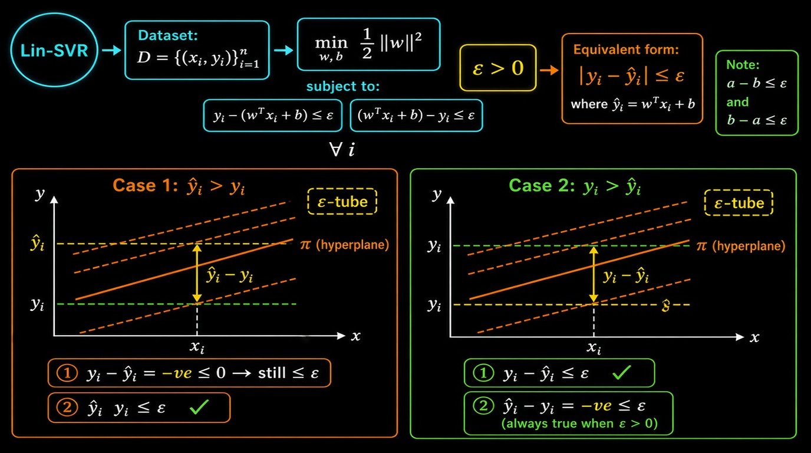

**Linear SVR – Optimization Problem & Constraints**

### Dataset

$$
D = \{(\mathbf{x}_i,y_i)\}_{i=1}^{n},\qquad y_i\in\mathbb{R}
$$

### Optimization Problem (Linear SVR)

$$
\begin{align*}
\min_{\mathbf{w},b}\quad
&\frac12\|\mathbf{w}\|^2 \\
\text{s.t.}\quad
&y_i - (\mathbf{w}^\top\mathbf{x}_i + b) \le\varepsilon \\
&(\mathbf{w}^\top\mathbf{x}_i + b) - y_i \le\varepsilon
\quad\forall i
\end{align*}
$$

with hyper-parameter $\varepsilon>0$.

These two inequalities are simply

$$
|y_i - \hat{y}_i| \le\varepsilon
$$

where $\hat{y}_i = \mathbf{w}^\top\mathbf{x}_i + b$.

### Geometric Meaning of the Constraints

The regression line $\pi$ is surrounded by a tube of width $2\varepsilon$.

**Case 1:** $\hat{y}_i > y_i$ (prediction above the true value)

$$
\begin{align*}
y_i - \hat{y}_i &= -\text{ve} \le 0 \le\varepsilon \\
\hat{y}_i - y_i &\le\varepsilon
\end{align*}
$$

**Case 2:** $y_i > \hat{y}_i$ (true value above the prediction)

$$
\begin{align*}
y_i - \hat{y}_i &\le\varepsilon \\
\hat{y}_i - y_i &= -\text{ve} \le 0 \le\varepsilon
\end{align*}
$$

In both cases the point lies inside (or on the boundary of) the $\varepsilon$-tube.

## 15. Assignment-7: Apply SVM

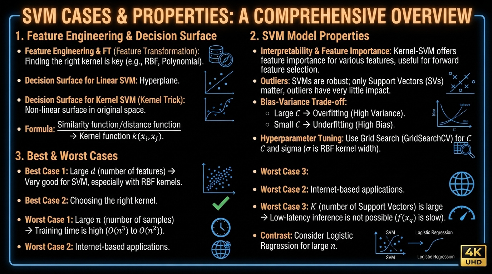

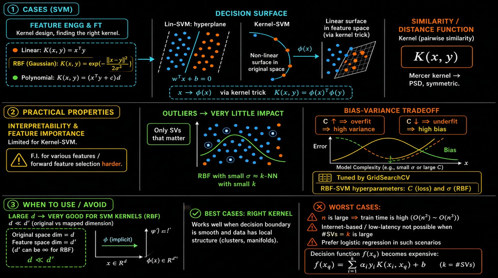

> **Cases: SVM**

### Feature Engineering & Feature Transform

Kernel design / finding the right kernel (RBF is the most common general-purpose choice).

### Decision Surface

- Linear SVM → hyperplane
- Kernel SVM → non-linear surface  
  (original points $\mathbf{x}_i$ are implicitly mapped to $\mathbf{x}_i'$ where a linear surface is found; the kernel trick realises this mapping).

### Similarity / Distance Function

Kernel $K(\mathbf{x}_i,\mathbf{x}_j)$ plays the role of a similarity (or inverse-distance) function.

### Interpretability & Feature Importance

- Kernel SVM itself is hard to interpret.
- Feature importance for original features can still be estimated (e.g. by forward feature selection).

### Outliers

- Very little impact.
- Only the Support Vectors matter.
- RBF with a small $\sigma$ behaves like $k$-NN with a small $k$.

### Bias–Variance

- $C\uparrow$ → overfitting → high variance
- $C\downarrow$ → underfitting → high bias
- RBF-SVM hyper-parameters: $C$ (loss) and $\sigma$ (RBF width)
- Tuned by grid-search / cross-validation.

### Dimensionality

Large $d$ is very good for SVM (especially with RBF).  
Kernel methods map $d\to d'$ with $d'\ge d$.

### Best Cases

When we can find the **right kernel**.

### Worst Cases

- $n$ is very large → training time becomes high (Internet-scale data).
- Number of Support Vectors $K$ is large → low-latency prediction is not possible.
- In such situations Logistic Regression is often preferred.

## 16. Revision Questions

**Questions**

[1. Explain About SVM?](#1-explain-about-svm)
[2. What is Hinge Loss?](#2-what-is-hinge-loss)  
[3. Dual form of SVM formulation?](#3-dual-form-of-svm-formulation)  
[4. What is Kernel trick?](#4-what-is-kernel-trick)  
[5. What is Polynomial kernel?](#5-what-is-polynomial-kernel)  
[6. What is RBF-Kernel?](#6-what-is-rbf-kernel)  
[7. Explain about Domain specific Kernels?](#7-explain-about-domain-specific-kernels)  
[8. Find Train and run time complexities for SVM?](#8-find-train-and-run-time-complexities-for-svm)  
[9. Explain about SVM Regression?](#9-explain-about-svm-regression)

### 1. Explain About SVM?

**Support Vector Machine (SVM)** is a powerful supervised learning algorithm mainly used for classification (and also regression).

**Geometric Intuition**:

- SVM finds the **optimal hyperplane** that best separates the two classes.
- It maximizes the **margin** (distance between the hyperplane and the nearest points from each class).
- The nearest points are called **Support Vectors**.

**Key ideas**:

- Hard-margin SVM → data is perfectly linearly separable
- Soft-margin SVM → allows some misclassifications using a slack variable (more practical)
- Can handle non-linear data using the **Kernel Trick**

SVM is both a geometric method (maximum margin hyperplane) and can be viewed through a loss-function lens (Hinge Loss).

### 2. What is Hinge Loss?

**Hinge Loss** is the loss function used by Support Vector Machines.

For a single point with label $ y_i \in \{-1, +1\} $:

$ L = \max\big(0,\ 1 - y_i (w^T x_i + b)\big) $

**Interpretation**:

- If the point is correctly classified **and** lies outside the margin → loss = 0
- If the point is inside the margin or misclassified → loss increases linearly

**Why it is used**:

- Encourages a large margin
- Only support vectors (and misclassified points) contribute to the loss
- Convex and suitable for optimization

The overall SVM objective becomes:

$ \min*{w,b} \frac{1}{2}\|w\|^2 + C \sum*{i=1}^{n} \max\big(0,\ 1 - y_i (w^T x_i + b)\big) $

### 3. Dual form of SVM formulation?

The **Primal form** of hard-margin SVM is:

$ \min\_{w,b} \frac{1}{2}\|w\|^2 $  
subject to $ y_i (w^T x_i + b) \geq 1 $ for all $ i $

Using Lagrange multipliers $ \alpha_i \geq 0 $, we get the **Dual form**:

$ \max*{\alpha} \sum*{i=1}^{n} \alpha*i - \frac{1}{2} \sum*{i=1}^{n} \sum\_{j=1}^{n} \alpha_i \alpha_j y_i y_j (x_i^T x_j) $

subject to $ \alpha_i \geq 0 $ and $ \sum \alpha_i y_i = 0 $

**Advantages of Dual form**:

- Depends only on the **inner product** $ x_i^T x_j $
- Enables the **Kernel Trick**
- Only support vectors have $ \alpha_i > 0 $

### 4. What is Kernel trick?

The **Kernel Trick** allows SVM to work in a high-dimensional feature space **without explicitly computing the transformation**.

Instead of mapping data to a higher dimension using $ \phi(x) $ and then computing $ \phi(x_i)^T \phi(x_j) $, we directly replace the inner product with a **kernel function**:

$ K(x_i, x_j) = \phi(x_i)^T \phi(x_j) $

**Benefits**:

- Can handle non-linearly separable data
- Computationally efficient (never computes $ \phi(x) $ explicitly)
- Works with the dual formulation of SVM

Common kernels: Linear, Polynomial, RBF (Gaussian), Sigmoid, etc.

### 5. What is Polynomial kernel?

The **Polynomial Kernel** is defined as:

$ K(x_i, x_j) = (x_i^T x_j + c)^d $

where:

- $ d $ = degree of the polynomial
- $ c $ = constant (usually 1)

**Properties**:

- Maps data into a higher-dimensional space of polynomial features
- Can model polynomial decision boundaries
- When $ d = 1 $, it reduces to the linear kernel

Useful when the relationship between features is polynomial in nature.

### 6. What is RBF-Kernel?

The **RBF (Radial Basis Function) Kernel**, also called Gaussian Kernel, is:

$ K(x_i, x_j) = \exp\big(-\gamma \|x_i - x_j\|^2\big) $

where $ \gamma > 0 $ controls the width of the Gaussian.

**Properties**:

- Most popular and widely used kernel
- Can create highly flexible, non-linear decision boundaries
- Corresponds to an **infinite-dimensional** feature space
- $ \gamma $ is an important hyperparameter:
  - Large $ \gamma $ → more complex boundary (risk of overfitting)
  - Small $ \gamma $ → smoother boundary (risk of underfitting)

### 7. Explain about Domain specific Kernels?

**Domain-specific kernels** are specially designed kernel functions that incorporate prior knowledge of a particular domain.

Examples:

- **String kernels** → for text and DNA sequences
- **Graph kernels** → for molecules and social networks
- **Tree kernels** → for parse trees in NLP
- **Histogram intersection kernel** → for computer vision

**Why they are useful**:

- Capture the natural similarity measure of the domain
- Often perform better than generic kernels (Polynomial / RBF) when domain knowledge is strong
- Still allow the use of the Kernel Trick inside SVM

### 8. Find Train and run time complexities for SVM?

**Training Time Complexity**:

- Standard quadratic programming solvers: $ O(n^3) $ in the worst case
- With efficient implementations (SMO, LibSVM, etc.): roughly $ O(n^2) $ to $ O(n^3) $ depending on the number of support vectors and data
- Linear SVM (using SGD or LibLinear): can be much faster — approximately $ O(n \cdot d) $

**Prediction (Run-time) Complexity**:

- $ O(s \cdot d) $ where $ s $ = number of support vectors
- In the worst case $ s $ can be close to $ n $, so prediction can be slow compared to Logistic Regression

**Space Complexity**:

- Need to store the support vectors → $ O(s \cdot d) $

SVM training is generally more expensive than Logistic Regression, especially on large datasets.

### 9. Explain about SVM Regression?

**Support Vector Regression (SVR)** is the regression counterpart of SVM.

**Key idea**:

- Instead of maximizing the margin between classes, SVR tries to fit a function within a tube of width $ 2\varepsilon $ (epsilon-insensitive tube).
- Errors inside the tube are ignored (loss = 0).
- Only points outside the tube contribute to the loss.

**Loss function** (Epsilon-insensitive loss):

$ L = \max\big(0,\ |y_i - (w^T x_i + b)| - \varepsilon\big) $

**Objective**:

$ \min*{w,b} \frac{1}{2}\|w\|^2 + C \sum*{i=1}^{n} L\_{\varepsilon}(y_i, w^T x_i + b) $

**Advantages**:

- Robust to outliers (only points outside the tube matter)
- Can use kernels for non-linear regression
- Controls model complexity via $ C $ and $ \varepsilon $
