<style>
  @import url("https://fonts.googleapis.com/css2?family=Play:wght@400;700&display=swap");
  @import url("https://cdnjs.cloudflare.com/ajax/libs/latin-modern/1.1.0/css/latinmodern-math.min.css");

  :root {
    --la-ink: #3f6386;
    --la-teal: #3f6386;
    --la-teal-soft: #e8f6f7;
    --la-coral: #9333ea;
    --la-coral-soft: #fff1ed;
    --la-cdf: #17283a;
    --la-line: #5b5c5c;
    --la-surface: #f7faf9;
    --la-text: #c9c9c9;
    --la-panel: #00070e;
    --la-chip: #17283a;
    --la-amber: #9a6b16;
    --la-amber-soft: #fff8e6;
  }

  *,
  *::before,
  *::after {
    font-family: "Play", sans-serif !important;
  }

  pre,
  pre code {
    font-family: Consolas, "Courier New", monospace !important;
  }

  body,
  .markdown-body,
  p,
  li {
    color: var(--la-text) !important;
  }

  h1 {
    color: var(--la-ink);
    border-bottom: 4px solid var(--la-teal);
    padding-bottom: 0.35em;
  }

  h2 {
    color: var(--la-teal);
    border-left: 6px solid var(--la-teal);
    padding-left: 0.55em;
    margin-top: 2em;
  }

  h3,
  h4 {
    color: var(--la-coral);
  }

  a {
    color: var(--la-coral);
    text-decoration: none;
  }

  a:hover {
    text-decoration: underline;
  }

  blockquote {
    background: var(--la-panel);
    border-left: 5px solid var(--la-cdf) !important;
    border-radius: 6px;
    color: var(--la-text);
    padding: 0.75em 1em;
  }

  code {
    background: var(--la-chip);
    border-radius: 4px;
    color: var(--la-text);
    padding: 0.1em 0.3em;
  }

  pre {
    background: var(--la-panel);
    border: 1px solid var(--la-line);
    border-radius: 8px;
    overflow-x: auto;
    padding: 1em;
  }

  table {
    border: 1px solid var(--la-line);
    border-collapse: collapse;
    border-radius: 8px;
    overflow: hidden;
    width: 100%;
  }

  th {
    background: var(--la-panel);
    color: var(--la-text);
    padding: 0.7em 0.8em;
    text-align: left;
  }

  td {
    color: var(--la-text);
    padding: 0.7em 0.8em;
  }

  tr:nth-child(even) {
    background: var(--la-chip);
  }

  hr {
    border: 0;
    border-top: 2px solid var(--la-line);
    margin: 2.2em 0;
  }

  .summary-grid,
  .ml-grid,
  .intuition-grid {
    display: flex;
    gap: 1em;
    margin: 1.25em 0;
  }

  .summary-card,
  .ml-card,
  .intuition-card {
    background: var(--la-panel);
    border-radius: 7px;
    color: var(--la-text);
    flex: 1 1 0;
    min-width: 0;
    padding: 1em;
  }

  .summary-card {
    border-top: 5px solid var(--la-teal);
  }

  .summary-card.pdf,
  .ml-card.diagnostics,
  .intuition-card.pdf {
    border-top-color: var(--la-coral);
  }

  .summary-card.cdf,
  .intuition-card.cdf {
    border-top-color: var(--la-cdf);
  }

  .summary-card h3,
  .ml-card h3,
  .intuition-card h3 {
    margin-top: 0;
  }

  .summary-tag,
  .panel-kicker {
    color: var(--la-teal);
    font-size: 0.82em;
    font-weight: 700;
    letter-spacing: 0.04em;
    text-transform: uppercase;
  }

  .relationship-banner,
  .ml-workflow {
    align-items: center;
    background: var(--la-panel);
    border: 1px solid var(--la-teal);
    border-radius: 7px;
    color: var(--la-text);
    display: flex;
    flex-wrap: wrap;
    gap: 0.6em;
    justify-content: center;
    margin: 1.25em 0;
    padding: 0.85em 1em;
    text-align: center;
  }

  .relationship-banner strong,
  .ml-workflow strong,
  .relationship-item strong,
  .insight-item strong {
    color: var(--la-coral);
  }

  .relationship-banner .arrow {
    color: var(--la-teal);
    font-size: 1.2em;
  }

  .relationship-item,
  .insight-item {
    background: var(--la-panel);
    border-left: 5px solid var(--la-teal);
    border-radius: 5px;
    color: var(--la-text);
    margin: 0.65em 0;
    padding: 0.55em 0.85em;
  }

  .insight-item {
    border-left-color: var(--la-coral);
  }

  .insight-list,
  .feature-chips {
    display: flex;
    flex-wrap: wrap;
    gap: 0.55em;
    list-style: none;
    margin: 0.5em 0 1em;
    padding: 0;
  }

  .insight-list li,
  .feature-chips li {
    background: var(--la-chip);
    border: 1px solid var(--la-teal);
    border-radius: 999px;
    color: var(--la-text);
    padding: 0.35em 0.75em;
  }

  .feature-chips li {
    border-radius: 4px;
    border-left: 3px solid var(--la-coral);
    border-right: none;
    border-top: none;
    border-bottom: none;
    flex: 1 1 calc(50% - 0.45em);
  }

  .concept-flow {
    align-items: center;
    display: flex;
    flex-direction: column;
    margin: 1.25em 0;
  }

  .concept-flow .flow-step {
    background: var(--la-panel);
    border: 1px solid var(--la-teal);
    border-radius: 7px;
    color: var(--la-text);
    max-width: 22em;
    padding: 0.7em 1.2em;
    text-align: center;
    width: 100%;
  }

  .concept-flow .flow-step strong {
    color: var(--la-coral);
  }

  .concept-flow .flow-arrow {
    color: var(--la-teal);
    font-size: 1.35em;
    line-height: 1.25;
  }

  .percentile-callout {
    background: var(--la-panel);
    border-left: 5px solid var(--la-cdf);
    border-radius: 7px;
    color: var(--la-text);
    margin: 1.25em 0;
    padding: 1em;
  }

  .percentile-callout strong {
    color: var(--la-cdf);
  }

  .katex-display,
  .math,
  .math-block {
    background: #00070e;
    border-left: 6px solid #2f005c;
    border-radius: 6px;
    padding: 0.6em 0.8em;
    overflow-x: auto;
    color: #c9c9c9 !important;
    font-family: "Latin Modern Math", "Cambria Math", "STIX Two Math", serif !important;
  }

  .katex,
  .katex * {
    color: #9b9a9a !important;
    font-family: "Latin Modern Math", "Cambria Math", "STIX Two Math", serif !important;
  }

  @media (max-width: 700px) {
    .summary-grid,
    .ml-grid,
    .intuition-grid {
      flex-direction: column;
    }
  }
</style>


# Decision Trees

## Table of Contents

[01. Geometric Intuition of Decision Tree: Axis-Parallel Hyperplanes](#01-geometric-intuition-of-decision-tree-axis-parallel-hyperplanes)

[02. Sample Decision Tree](#02-sample-decision-tree)

[03. Building a Decision Tree: Entropy](#03-building-a-decision-tree-entropy)

[04. Building a Decision Tree: Information Gain](#04-building-a-decision-tree-information-gain)

[05. Building a Decision Tree: Gini Impurity](#05-building-a-decision-tree-gini-impurity)

[06. Building a Decision Tree: Constructing a DT](#06-building-a-decision-tree-constructing-a-dt)

[07. Building a Decision Tree: Splitting Numerical Features](#07-building-a-decision-tree-splitting-numerical-features)

[08. Feature Standardization](#08-feature-standardization)

[09. Building a Decision Tree: Categorical Features with Many Possible Values](#09-building-a-decision-tree-categorical-features-with-many-possible-values)

[10. Overfitting and Underfitting](#10-overfitting-and-underfitting)

[11. Train and Run Time Complexity](#11-train-and-run-time-complexity)

[12. Regression Using Decision Trees](#12-regression-using-decision-trees)

[13. Cases](#13-cases)

[14. Code Samples](#14-code-samples)

[15. Assignment-8: Apply Decision Trees](#15-assignment-8-apply-decision-trees)

[16. Revision Questions](#16-revision-questions)


# Decision Trees

## 01. Geometric Intuition of Decision Tree: Axis-Parallel Hyperplanes

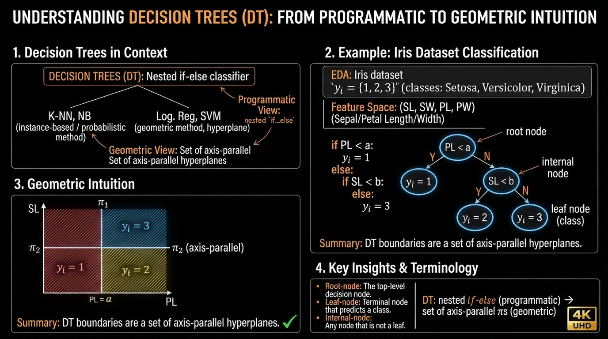  

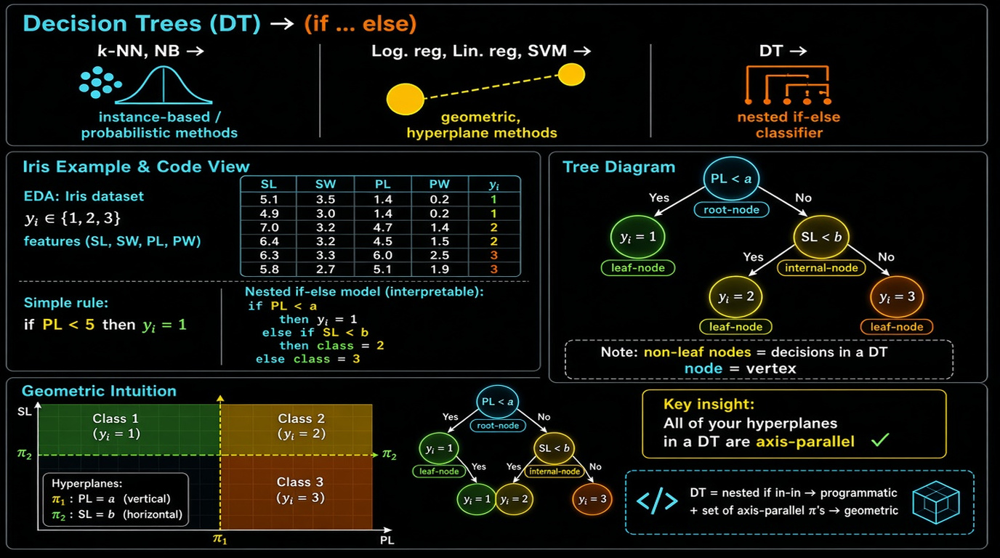  

> **Decision Trees (DT)**

### Positioning among Classifiers

- $k$-NN, Naive Bayes → instance-based / probabilistic methods  
- Logistic Regression, Linear Regression, SVM → geometric (hyperplane) methods  
- **Decision Trees** → nested `if … else` classifier (programmatic)

A Decision Tree is simply a nested if-else classifier.

### Example: Iris Dataset (EDA)

Features:  
$\mathbf{x}_i = \langle SL, SW, PL, PW \rangle$  
Labels: $y_i \in \{1,2,3\}$

Simple rule:

```text
if PL < 5 then y_i = 1
```

Nested if-else (the actual model):

```text
if PL < a then
    y_i = 1
else
    if SL < b then
        class = 2
    else
        class = 3
```

This nested structure is drawn as a **tree**.

### Tree Terminology

- **Root-node** – the first decision  
- **Internal-node** – any non-leaf decision node  
- **Leaf-node** – terminal node that outputs a class label  

Non-leaf nodes = decisions in a DT.  
(Node = vertex)

### Geometric Intuition

A Decision Tree is a set of **axis-parallel hyperplanes**.

- Every split is of the form “feature $j$ ≤ threshold”.  
- All decision boundaries are parallel to the coordinate axes.

Example (Iris):

- First split: $PL < a$ (vertical line)  
- Second split: $SL < b$ (horizontal line)

Regions:

- $y_i=1$ on one side of the first plane  
- $y_i=2$ and $y_i=3$ on the other side, separated by the second plane

### Two Equivalent Views of a DT

1. **Programmatic view** – nested if-else statements  
2. **Geometric view** – set of axis-parallel hyperplanes


## 02. Sample Decision Tree

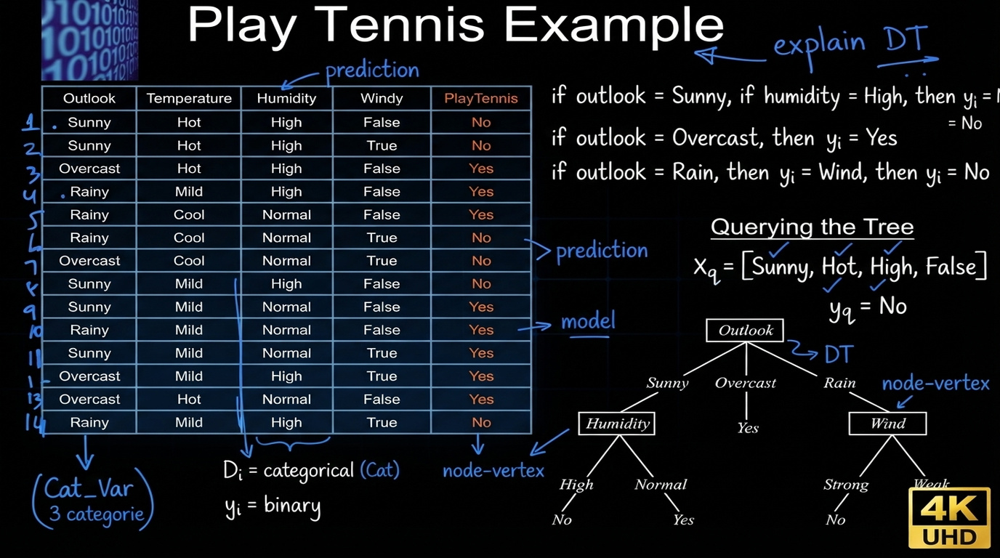  

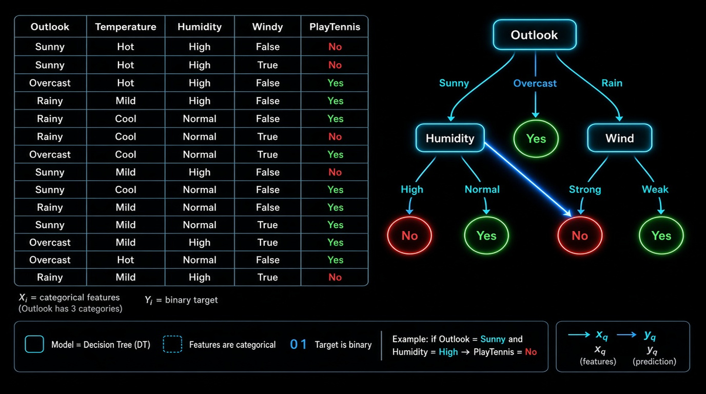  

> **Play Tennis Example (Classic Decision-Tree Illustration)**

### Dataset

| Outlook   | Temperature | Humidity | Windy | PlayTennis |
|-----------|-------------|----------|-------|------------|
| Sunny     | Hot         | High     | False | No         |
| Sunny     | Hot         | High     | True  | No         |
| Overcast  | Hot         | High     | False | Yes        |
| Rainy     | Mild        | High     | False | Yes        |
| Rainy     | Cool        | Normal   | False | Yes        |
| Rainy     | Cool        | Normal   | True  | No         |
| Overcast  | Cool        | Normal   | True  | Yes        |
| Sunny     | Mild        | High     | False | No         |
| Sunny     | Cool        | Normal   | False | Yes        |
| Rainy     | Mild        | Normal   | False | Yes        |
| Sunny     | Mild        | Normal   | True  | Yes        |
| Overcast  | Mild        | High     | True  | Yes        |
| Overcast  | Hot         | Normal   | False | Yes        |
| Rainy     | Mild        | High     | True  | No         |

- All features are **categorical**.  
- Outlook has 3 categories; the target PlayTennis is binary (Yes/No).

### Decision Tree (the model)

```
Outlook
├── Sunny → Humidity
│           ├── High → No
│           └── Normal → Yes
├── Overcast → Yes
└── Rain → Wind
            ├── Strong → No
            └── Weak → Yes
```

### How the Tree Classifies a Query Point

Example query:  
$\mathbf{x}_q = [\text{Sunny},\ \text{Hot},\ \text{High},\ \text{True}]$

1. Root test: Outlook = Sunny → go left  
2. Humidity = High → leaf “No”  

$$
y_q = \text{No}
$$

The tree is simply a nested if-else:

```text
if Outlook == Sunny then
    if Humidity == High then No
    else Yes
else if Outlook == Overcast then Yes
else  // Rain
    if Wind == Strong then No
    else Yes
```

This is the classic “Play Tennis” Decision Tree used to explain how a DT works.


## 03. Building a Decision Tree: Entropy

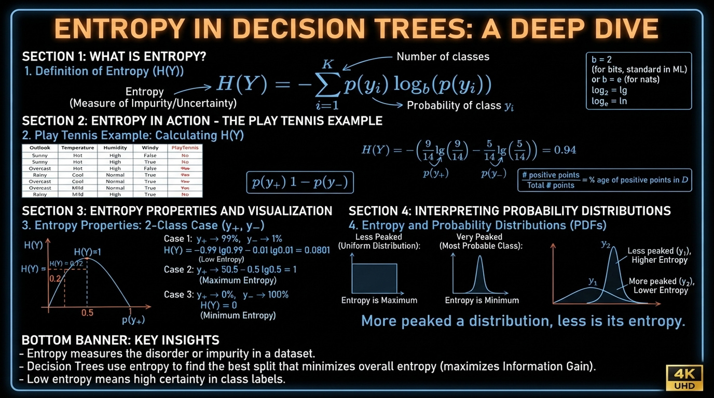  

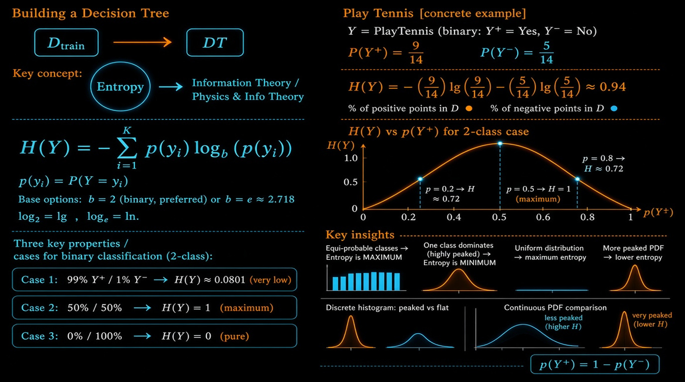  

> **Building a Decision Tree: Entropy**

### From Training Data to Tree

$$
D_{\text{train}} \;\longrightarrow\; \text{DT}
$$

The key quantity used to build the tree is **Entropy** (from Information Theory / Physics).

### Definition of Entropy

Let $Y$ be a discrete random variable that takes values $y_1,y_2,\dots,y_K$.

$$
H(Y) = -\sum_{i=1}^{K} p(y_i)\,\log_b\bigl(p(y_i)\bigr)
$$

- $p(y_i) = P(Y=y_i)$
- Base $b=2$ (bits) or $b=e$ (nats).  
  In ML we almost always use $\log_2$ (written $\lg$).

### Play-Tennis Example

$Y =$ PlayTennis  

- 9 positive examples → $P(Y_+)=\dfrac{9}{14}$  
- 5 negative examples → $P(Y_-)=\dfrac{5}{14}$

$$
H(Y)
= -\frac{9}{14}\lg\frac{9}{14}
-\frac{5}{14}\lg\frac{5}{14}
\approx 0.94
$$

### Properties of Entropy (2-class case)

**Case 1** – almost pure  
$P(Y_+)=0.99$, $P(Y_-)=0.01$

$$
H(Y)\approx 0.0801 \quad\text{(very small)}
$$

**Case 2** – balanced  
$P(Y_+)=P(Y_-)=0.5$

$$
H(Y)=1 \quad\text{(maximum)}
$$

**Case 3** – completely pure  
$P(Y_+)=0$ or $1$

$$
H(Y)=0
$$

### Entropy Curve (2-class)

$H(Y)$ reaches its maximum value of 1 when $P(Y_+)=0.5$ and falls to 0 at the extremes $P=0$ or $P=1$.

### General Intuition

- When the distribution is **equi-probable** → entropy is **maximum**.  
- When the distribution is **highly peaked** (one class dominates) → entropy is **minimum**.

More peaked a distribution is, the smaller its entropy.


## 04. Building a Decision Tree: Information Gain

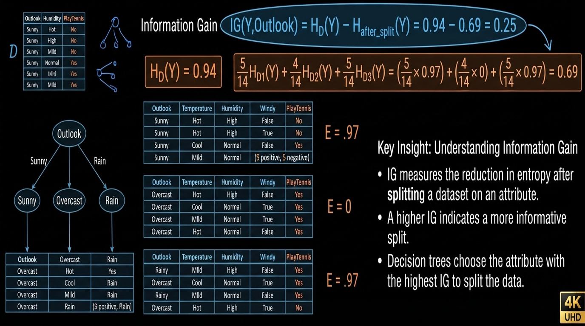  

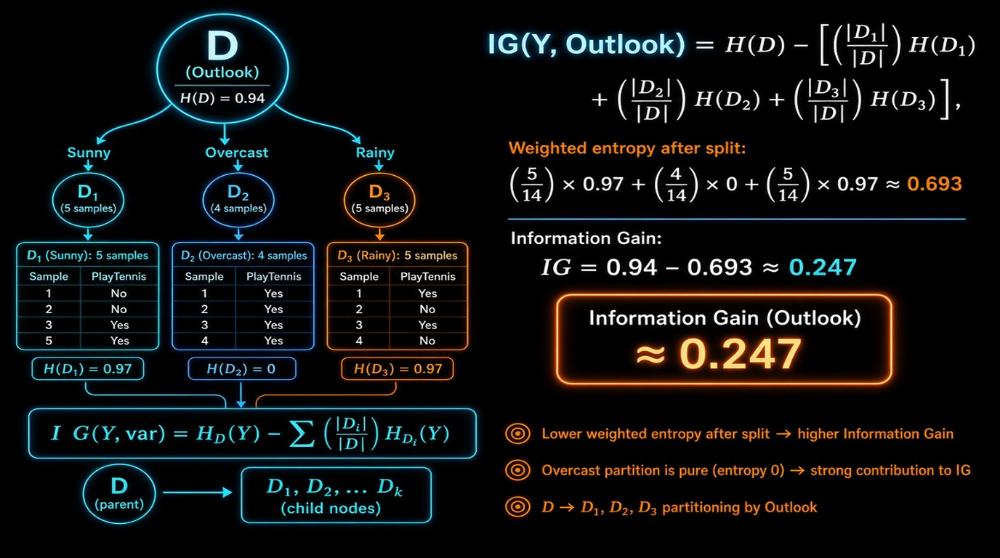  

> **Partitioning the Data Set – Information Gain (IG)**

### Splitting on Outlook

Original data $D$ ($|D|=14$):

$$
H_D(Y) \approx 0.94
$$

After splitting on **Outlook** we obtain three subsets:

| Subset | Size | Entropy |
|--------|------|---------|
| $D_1$ (Sunny)   | 5 | $H_{D_1}(Y)\approx 0.97$ |
| $D_2$ (Overcast)| 4 | $H_{D_2}(Y)=0$          |
| $D_3$ (Rainy)   | 5 | $H_{D_3}(Y)\approx 0.97$ |

### Weighted Average Entropy after the Split

$$
\begin{align*}
\text{Weighted Entropy}
&= \frac{|D_1|}{|D|}H_{D_1}(Y)
+ \frac{|D_2|}{|D|}H_{D_2}(Y)
+ \frac{|D_3|}{|D|}H_{D_3}(Y) \\[6pt]
&= \frac{5}{14}\cdot 0.97
+ \frac{4}{14}\cdot 0
+ \frac{5}{14}\cdot 0.97
\approx 0.69
\end{align*}
$$

(The slide also shows the un-weighted average $\approx 0.64$.)

### Information Gain

$$
\begin{align*}
IG(Y,\text{Outlook})
&= H_D(Y) - \text{Weighted Entropy after split} \\[4pt]
&= 0.94 - 0.69
\approx 0.25
\end{align*}
$$

(The handwritten calculation on the board writes it in the opposite order, but the definition is parent entropy minus child weighted entropy.)

### General Formula

When a feature (var) partitions $D$ into subsets $D_1,D_2,\dots,D_K$:

$$
IG(Y,\text{var})
= H_D(Y)
- \sum_{i=1}^{K}\frac{|D_i|}{|D|}\,H_{D_i}(Y)
$$

- Parent node = $D$  
- Child nodes = $D_1,D_2,\dots,D_K$

Information Gain measures how much uncertainty about $Y$ is reduced by knowing the value of the feature.


## 05. Building a Decision Tree: Gini Impurity

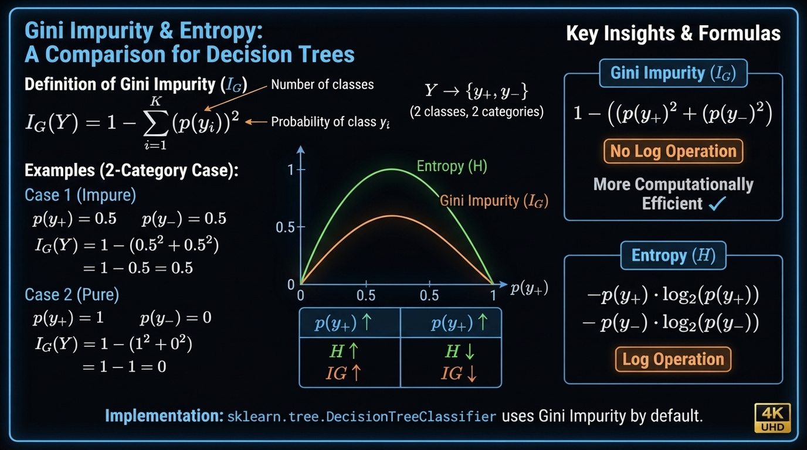  

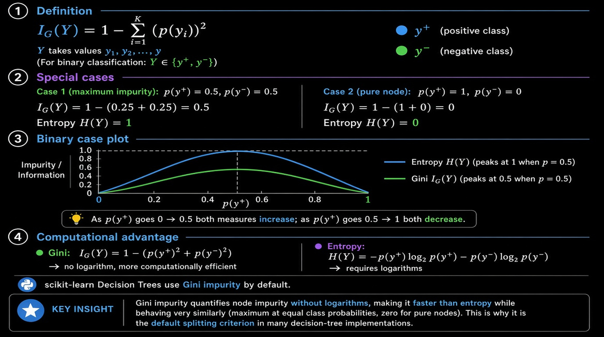  

> **Gini Impurity**

Gini Impurity is very similar to Entropy and is used as an alternative impurity measure when building Decision Trees.

### Definition

For a discrete random variable $Y$ that takes values $y_1,y_2,\dots,y_K$:

$$
I_G(Y) = 1 - \sum_{i=1}^{K}\bigl(p(y_i)\bigr)^2
$$

### Two-class Case ($Y_+$, $Y_-$)

**Case 1** – balanced  
$p(Y_+)=0.5$, $p(Y_-)=0.5$

$$
I_G(Y) = 1 - (0.25+0.25) = 0.5
$$

(Entropy $H(Y)=1$)

**Case 2** – pure  
$p(Y_+)=1$, $p(Y_-)=0$

$$
I_G(Y) = 1 - (1+0) = 0
$$

(Entropy $H(Y)=0$)

### Comparison of the Two Curves (2-class)

Both Entropy and Gini Impurity:

- reach their maximum at $p(Y_+)=0.5$
- fall to 0 at the pure extremes $p=0$ or $p=1$

Gini is a smoother, slightly flatter curve than Entropy.

### Computational Advantage

Gini Impurity needs **no logarithm**:

$$
I_G(Y) = 1 - \bigl(p(Y_+)^2 + p(Y_-)^2\bigr)
$$

Entropy needs a log:

$$
H(Y) = -p(Y_+)\log_2 p(Y_+) - p(Y_-)\log_2 p(Y_-)
$$

→ Gini is more computationally efficient.

**scikit-learn** Decision Trees use Gini Impurity by default.


## 06. Building a Decision Tree: Constructing a DT

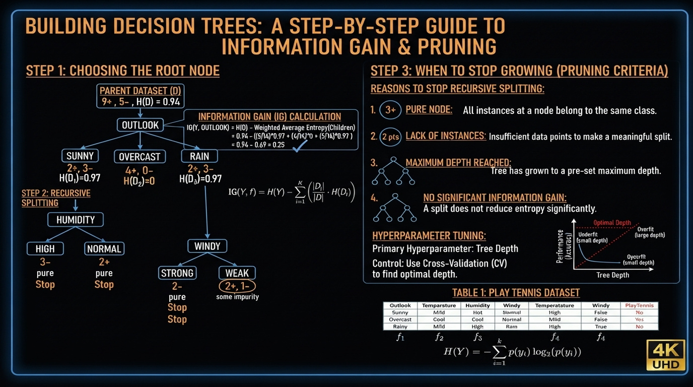  

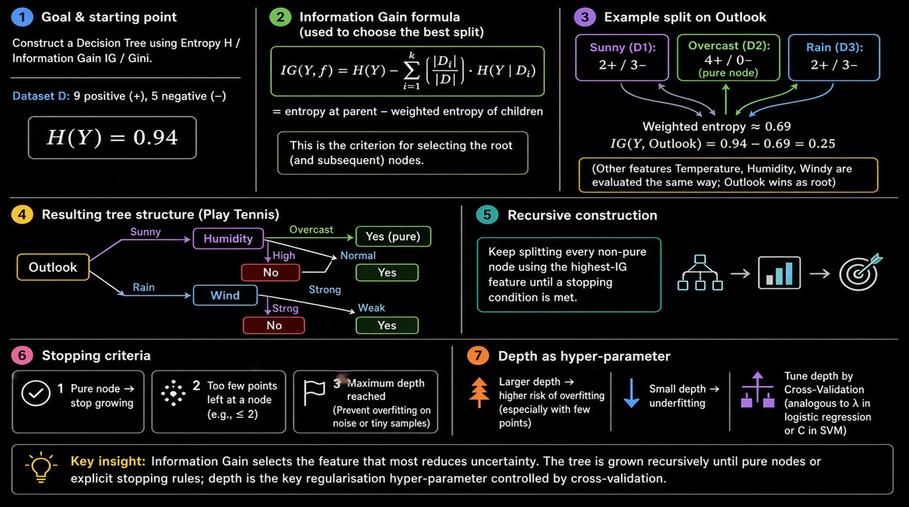  

> **Constructing a Decision Tree**

We use Entropy $H$, Information Gain $IG$, or Gini Impurity $I_G$.

### Step-by-step on Play-Tennis Data

1. Original data $D$: 9 positive, 5 negative  
   $$H_D(Y)\approx 0.94$$

2. Compute Information Gain for every feature and choose the best split (root node).

   - $IG(Y,\text{Outlook})=0.25$ (highest)  
   - $IG(Y,\text{Temperature})$, $IG(Y,\text{Humidity})$, $IG(Y,\text{Windy})$ are smaller.

   → Root node = **Outlook**

3. After the split we obtain three child nodes:

   - Sunny ($D_1$): 2+, 3−  
   - Overcast ($D_2$): 4+, 0−  → **pure node** (stop)  
   - Rainy ($D_3$): 2+, 3−

4. Recursively split the non-pure nodes using the same IG criterion  
   (Humidity on the Sunny branch, Wind on the Rainy branch, …).

### General Formula (choosing any node)

$$
IG(Y,f)
= H_D(Y)
- \sum_{i}\frac{|D_i|}{|D|}\,H_{D_i}(Y)
$$

= entropy at parent − weighted entropy at children.

### Stopping Criteria (when to stop growing a node)

1. The node is **pure** (all examples have the same class).  
2. There are **too few points** left at the node.  
3. The tree has already become **too deep**.

Growing further on very few (or noisy) points leads to overfitting.

### Depth as Hyper-parameter

- Larger depth → higher chance of overfitting (especially when leaves contain few points).  
- Very small depth → underfitting.

Depth is therefore a hyper-parameter of a Decision Tree (analogous to $\lambda$ in logistic regression or $C$ in SVM) and is chosen by cross-validation.


## 07. Building a Decision Tree: Splitting Numerical Features

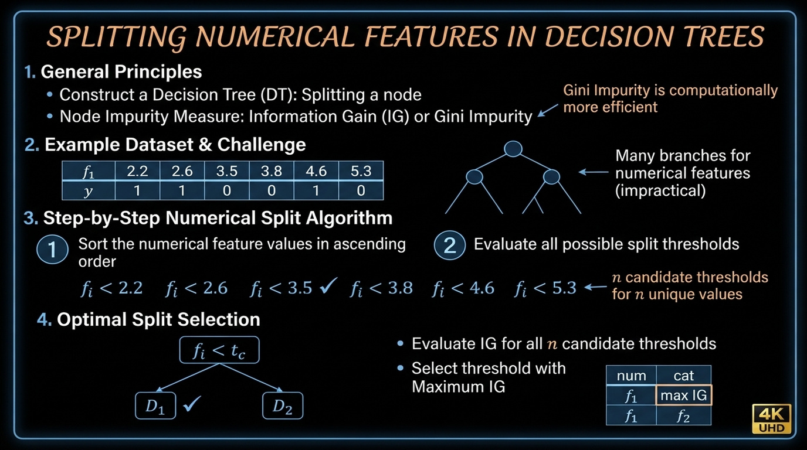  

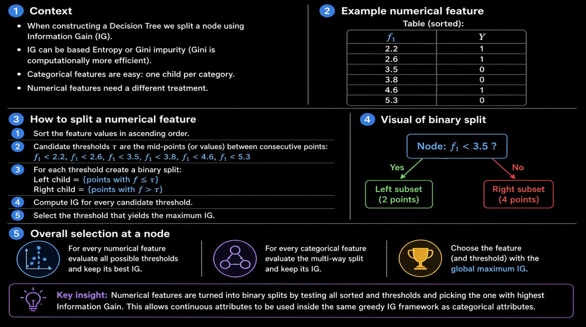  

> **Splitting Numerical Features**

When constructing a Decision Tree we split a node by maximising Information Gain (or Gini impurity).  
So far we have only seen **categorical** features. Now we handle **numerical** features.

### Numerical Feature

A feature $f_1$ can be integer-valued or real-valued.

Example data:

| $f_1$ | $Y$ |
|-------|-----|
| 2.2   | 1   |
| 2.6   | 1   |
| 3.5   | 0   |
| 3.8   | 0   |
| 4.6   | 1   |
| 5.3   | 0   |

### How to Generate Candidate Splits

1. Sort the numerical feature in ascending order.  
2. Consider every possible threshold that lies **between** consecutive distinct values:

$$
\begin{align*}
f_1 &< 2.2 \\
f_1 &< 2.6 \\
f_1 &< 3.5 \\
f_1 &< 3.8 \\
f_1 &< 4.6 \\
f_1 &< 5.3
\end{align*}
$$

Each of these thresholds produces a binary split of the current node into two child sets $D_1$ and $D_2$.

### Choosing the Best Split

- For every candidate threshold compute the Information Gain (or Gini).  
- Select the threshold that gives the **maximum IG**.  
- That threshold becomes the decision at the current node:

$$
\text{if } f_1 < t^* \quad\text{then go left, else go right.}
$$

### Summary

- Categorical feature → one branch per category.  
- Numerical feature → many candidate binary thresholds; pick the one with highest Information Gain.

This is how a Decision Tree handles mixed (categorical + numerical) data.


## 08. Feature Standardization

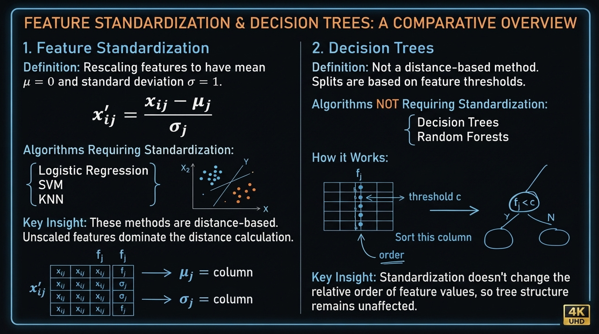  

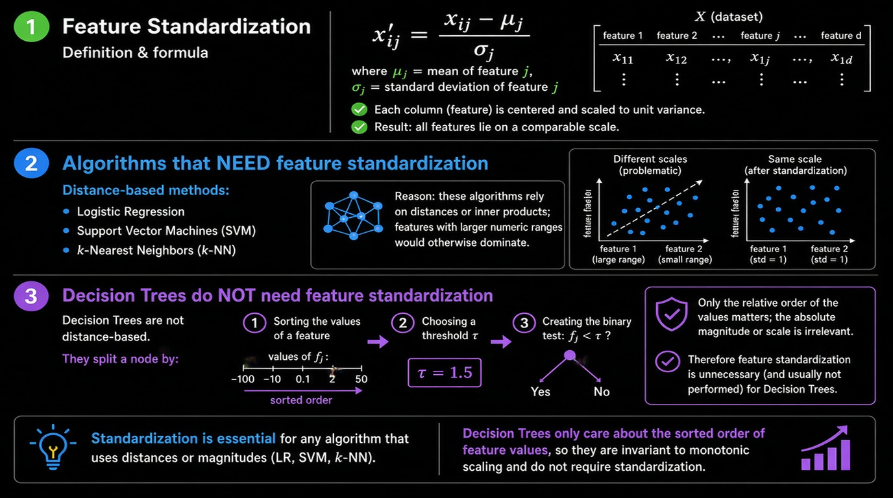  

> **Feature Standardization**

### Distance-based Methods Need Standardization

Models that rely on **distances** require feature standardization:

- Logistic Regression  
- SVM  
- $k$-NN  

For every feature $j$:

$$
x_{ij}' = \frac{x_{ij}-\mu_j}{\sigma_j}
$$

where $\mu_j$ and $\sigma_j$ are the mean and standard deviation of column $j$.

### Decision Trees Do **Not** Need Feature Standardization

A Decision Tree is **not** a distance-based method.

- At each node we only **sort** a single column and pick a threshold $t$.  
- The split is of the form  

$$
\text{if } f_j < t \quad\text{then left, else right.}
$$

- Because we only look at the **order** of the values (not their absolute magnitudes or distances), scaling or centering the features does not change the ordering and therefore does not change the tree.

**Conclusion**  
Feature standardization is unnecessary (and has no effect) for Decision Trees.


## 09. Building a Decision Tree: Categorical Features with Many Possible Values

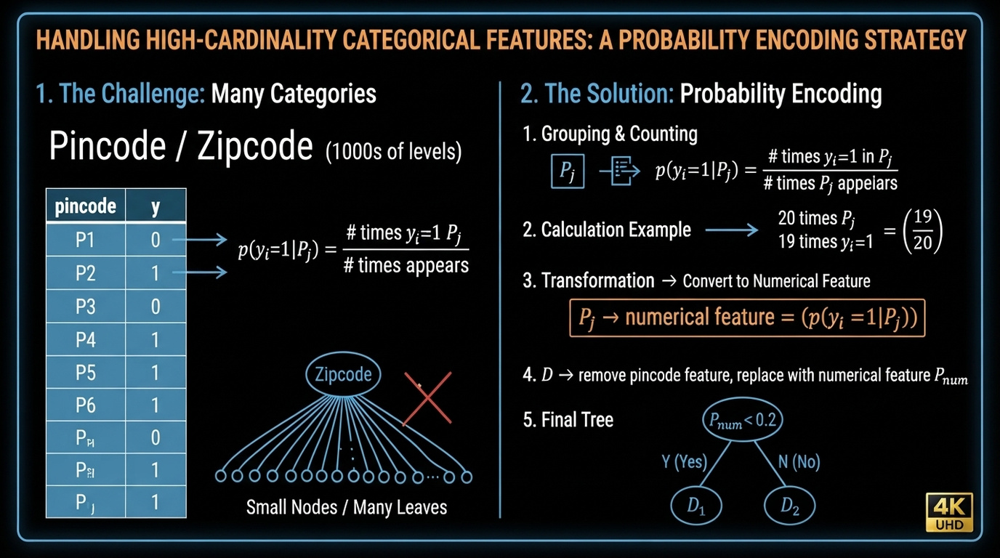  

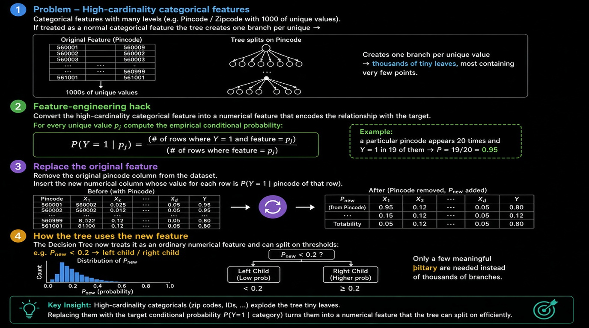  

> **Categorical Features with Many Categories (High Cardinality)**

### The Problem

Features such as **Pincode / Zipcode** can have thousands of distinct levels (e.g. 10 000+).

If we treat them as ordinary categorical features:

- The tree creates one branch per unique value.  
- Most child nodes become extremely small.  
- The split is almost useless and leads to severe overfitting.

### Feature-Engineering Hack

Convert the high-cardinality categorical feature into a **numerical** feature that carries useful signal.

For each pincode $p_j$ compute the empirical probability of the positive class:

$$
p_j \;\longmapsto\; P(Y=1\mid p_j)
= \frac{\#\{y_i=1 \;\text{and}\; p_i=p_j\}}{\#\{p_i=p_j\}}
$$

Example: a particular pincode appears 20 times and 19 of those times $y=1$  

$$
P(Y=1\mid p_j)=\frac{19}{20}=0.95
$$

### What We Do in Practice

1. Remove the original pincode column from $D$.  
2. Replace it by the new numerical column  
   $$
   \text{numerical feature} = P(Y=1\mid\text{pincode})
   $$
3. Now the Decision Tree can split on this numerical feature in the usual way (threshold splits).

### Resulting Tree Behaviour

Instead of creating thousands of tiny pure leaves, the tree makes a few meaningful binary splits such as

$$
\text{if } P(Y=1\mid\text{pincode}) < 0.2 \quad\text{then left, else right.}
$$

This keeps the tree compact and statistically reliable.


## 10. Overfitting and Underfitting

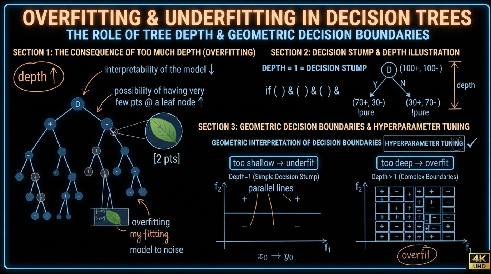  

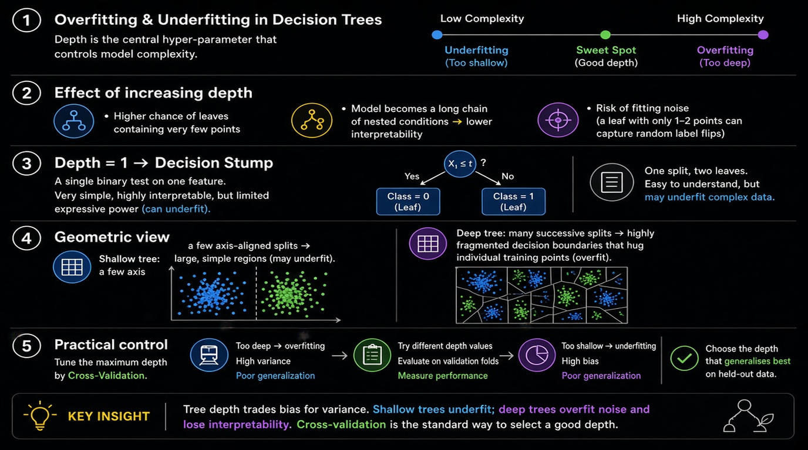  

> **Overfitting & Underfitting in Decision Trees**

### Effect of Depth

- As **depth increases**:
  - Possibility of having very few points at a leaf node increases.
  - Interpretability of the model decreases (long nested if-else chains).
  - The model starts fitting noise → **overfitting**.

- **Depth = 1** is called a **Decision Stump**  
  (only one split, two leaves).

### Geometric View

- Axis-parallel splits.  
- Too deep → many tiny rectangular regions that capture noise → overfitting.  
- Too shallow → under-fitting (the decision boundary is too coarse).

### Controlling Depth

Depth is the main hyper-parameter of a Decision Tree.  
It is chosen by **cross-validation** (exactly like $\lambda$ in logistic regression or $C$ in SVM).

**Summary**

| Depth          | Behaviour              |
|----------------|------------------------|
| too large      | overfitting            |
| too small      | underfitting           |
| chosen by CV   | good bias-variance trade-off |


## 11. Train and Run Time Complexity

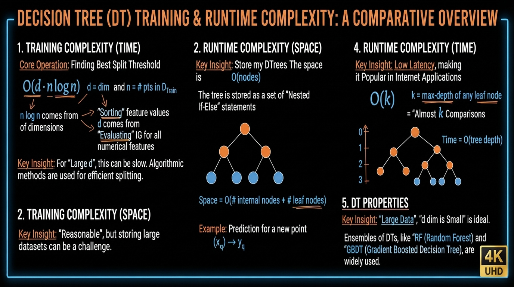  

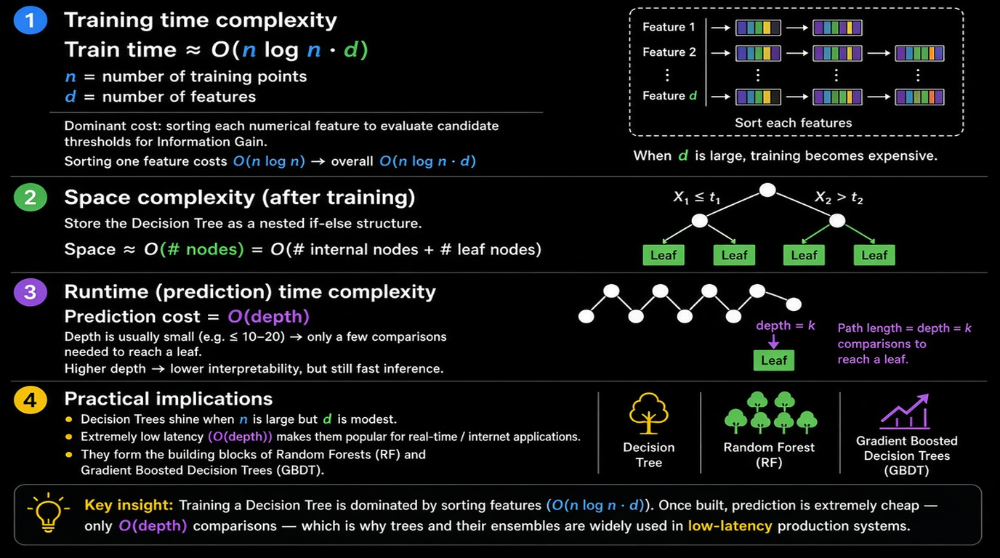  

> **Train & Run-time Complexity of Decision Trees**

### Training Time Complexity

$$
\text{Train time} \;\sim\; O\bigl(n\log n\cdot d\bigr)
$$

- $n$ = number of training points  
- $d$ = dimensionality  

Dominant cost comes from **sorting** each numerical feature (needed to evaluate candidate thresholds for Information Gain / Gini).

For large $d$ the complexity becomes $O(n\log n\cdot d)$.

### Space Complexity (after training)

We only need to store the tree:

- number of internal nodes + number of leaf nodes  
- essentially a nested if-else structure  

Space is proportional to the number of nodes in the tree.

### Run-time (Prediction) Complexity

To classify a query point $\mathbf{x}_q$ we simply walk from the root down to a leaf.

$$
\text{Prediction time} = O(\text{depth})
$$

- At most a few comparisons (one per level).  
- Extremely fast → low-latency prediction.

Example: a tree of depth 3 needs at most 3 comparisons.

### Practical Implications

Decision Trees (and their ensembles RF / GBDT) are very popular in internet applications because:

- They handle large data when dimensionality is not huge.  
- Prediction latency is $O(\text{depth})$ – excellent for real-time systems.


## 12. Regression Using Decision Trees

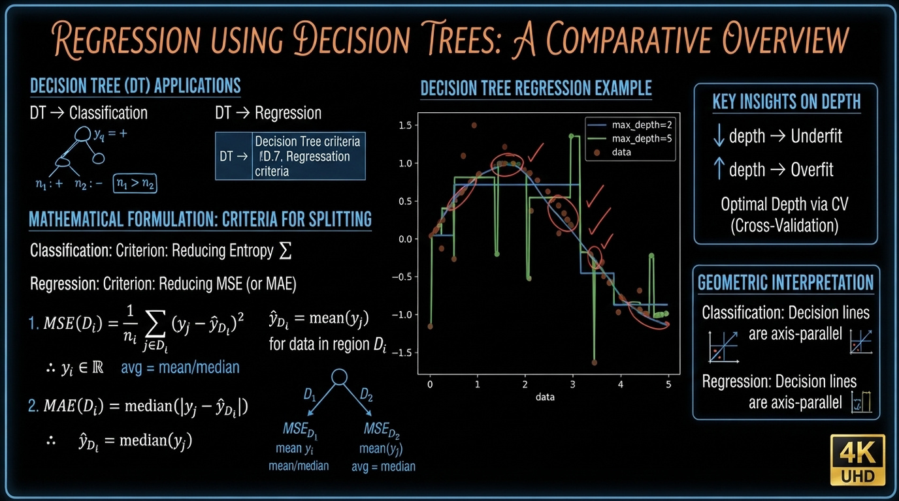  

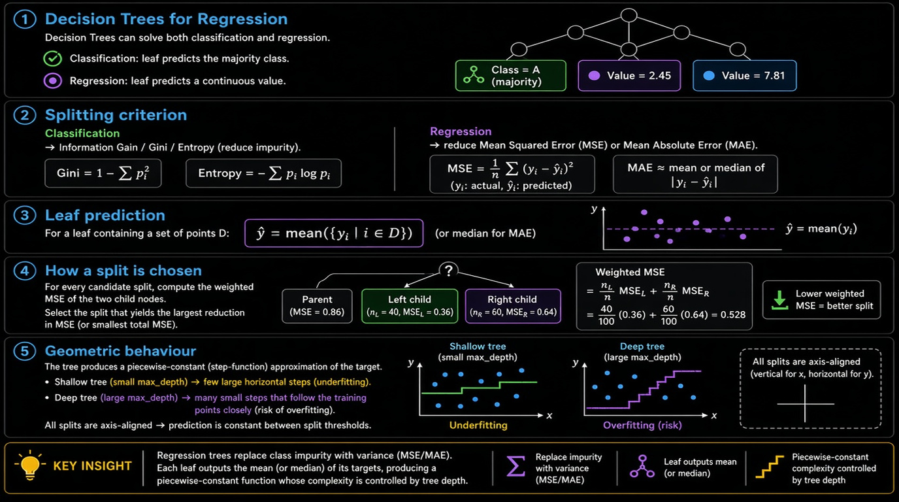  

> **Regression using Decision Trees**

Decision Trees can be used for both **classification** and **regression**.

### Classification vs Regression

| Task          | Splitting Criterion          | Value predicted at a leaf                  |
|---------------|------------------------------|--------------------------------------------|
| Classification | Information Gain / Gini     | Majority class (or class probabilities)    |
| Regression     | MSE or MAE                  | Mean (or median) of the target values      |

### Regression Criterion

We want to reduce the impurity of the real-valued targets $y_i\in\mathbb{R}$.

**Mean Squared Error (MSE)**

$$
\text{MSE} = \frac{1}{n}\sum_{i=1}^{n}(y_i-\hat{y}_i)^2
$$

**Mean Absolute Error (MAE)** (also called Mean Absolute Deviation)

$$
\text{MAE} = \text{median}\bigl(|y_i-\hat{y}_i|\bigr)
$$

When we split a node into two children $D_1$ and $D_2$, we choose the split that minimises the **weighted** MSE (or MAE):

$$
w_1\cdot\text{MSE}_{D_1} + w_2\cdot\text{MSE}_{D_2}
$$

### Prediction at a Leaf

For a leaf node that contains the set of points $D$:

$$
\hat{y} = \text{mean}(y_i)_{i\in D}
\quad\text{or}\quad
\hat{y} = \text{median}(y_i)_{i\in D}
$$

### Geometric View

- Classification → axis-parallel hyperplanes that separate class regions.  
- Regression → axis-parallel **piece-wise constant** function (step function).

### Effect of Depth (same as classification)

- Small depth → under-fitting (coarse step function).  
- Large depth → over-fitting (very wiggly step function that follows noise).

The plots illustrate this clearly:

- `max_depth=2` → smooth, coarse approximation.  
- `max_depth=5` → much more detailed (and potentially over-fit) step function.

Depth is again chosen by cross-validation.


## 13. Cases

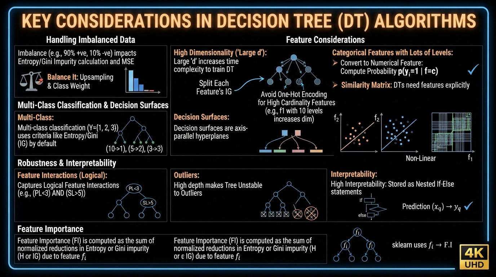  

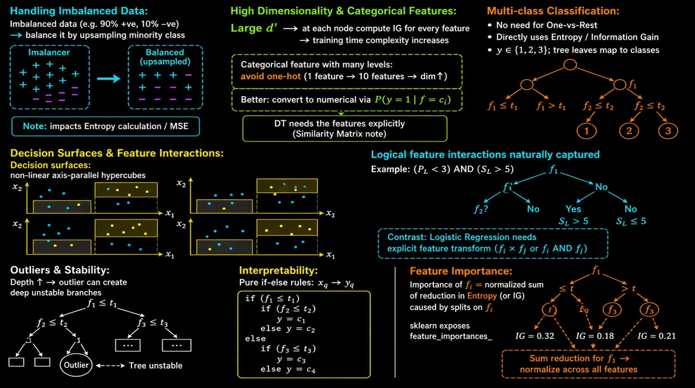  

> **Cases: Decision Trees**

### 1. Imbalanced Data
- Highly imbalanced data (e.g. 90% +ve, 10% –ve) impacts Entropy / MSE calculations.
- Solution: **balance** the data  
  → Upsampling the minority class  
  → or class-weighting / downsampling.

### 2. Large Dimensionality ($d$ large)
- At every node we evaluate Information Gain for **every** feature.
- Training-time complexity increases significantly.
- For categorical features: **avoid one-hot encoding** (it explodes dimensionality).  
  Example: 1 categorical feature with 10 levels → 10 binary features → $d$ increases.

### 3. Categorical Features with Many Levels
- Convert high-cardinality categorical feature into a numerical feature:

$$
P(Y=1 \mid f = c_i)
$$

- Decision Trees need the features **explicitly** (they do **not** work with a similarity / kernel matrix).

### 4. Multi-class Classification
- Decision Trees handle multi-class naturally (no OvR needed).
- Entropy / Gini Impurity work directly with $Y = \{1,2,3,\dots\}$.
- At a leaf the prediction is the majority class (or class distribution).

### 5. Decision Surfaces
- Non-linear.
- Composed of **axis-parallel hyperplanes** (piece-wise constant regions).

### 6. Feature Interactions (Logical)
- Trees naturally capture interactions of the form  
  $$
  (PL < 3) \;\text{AND}\; (SL > 5)
  $$
- Contrast with Logistic Regression / Feature Transforms where we must manually create $f_i\times f_j$ or $f_i \land f_j$.

### 7. Outliers
- When depth is large, outliers can create small pure leaves.
- This makes the tree **unstable**.
- Controlling depth (or min-samples-leaf) mitigates the effect.

### 8. Interpretability
- Extremely high: the model is simply a nested **if-else** rule set.  
  $$
  \mathbf{x}_q \;\longrightarrow\; y_q
  $$

### 9. Feature Importance
- For each feature $f_i$ we accumulate the total reduction in impurity (Entropy or Gini) caused by splits on $f_i$.
- These reductions are normalised to obtain Feature Importance scores.
- Scikit-learn exposes them as `feature_importances_`.


## 14. Code Samples

https://scikit-learn.org/stable/modules/tree.html

https://scikit-learn.org/stable/modules/generated/sklearn.tree.DecisionTreeClassifier.html

https://scikit-learn.org/stable/auto_examples/tree/plot_unveil_tree_structure.html


## 15. Assignment-8: Apply Decision Trees


## 16. Revision Questions

**Questions**

[1. How to Building a decision Tree?](#1-how-to-building-a-decision-tree)  
[2. What is Entropy?](#2-what-is-entropy)  
[3. What is information Gain?](#3-what-is-information-gain)  
[4. What is Gini Impurity?](#4-what-is-gini-impurity)  
[5. How to Constructing a DT?](#5-how-to-constructing-a-dt)  
[6. Importance of Splitting numerical features?](#6-importance-of-splitting-numerical-features)  
[7. How to handle Overfitting and Underfitting in DT?](#7-how-to-handle-overfitting-and-underfitting-in-dt)  
[8. What are Train and Run time complexity for DT?](#8-what-are-train-and-run-time-complexity-for-dt)  
[9. How to implement Regression using Decision Trees?](#9-how-to-implement-regression-using-decision-trees)  

### 1. How to Building a decision Tree?

A Decision Tree is built by recursively partitioning the data using **axis-parallel hyperplanes**.

**Geometric Intuition**:
- Each internal node represents a decision based on one feature
- The split is always parallel to one of the axes (e.g., $ x_j \leq threshold $)
- The tree divides the feature space into rectangular regions
- Each leaf corresponds to one region and makes a prediction (majority class or average value)

**High-level process**:
1. Start with the entire dataset at the root
2. Choose the best feature and split point that maximizes purity
3. Recursively repeat the process on the child nodes
4. Stop when a stopping criterion is met (pure node, max depth, min samples, etc.)

### 2. What is Entropy?

**Entropy** measures the impurity or uncertainty in a set of labels.

For a binary classification problem with proportions $ p $ (positive) and $ 1-p $ (negative):

$ H(S) = -p \log_2(p) - (1-p)\log_2(1-p) $

**Properties**:
- Entropy = 0 when the set is pure (all examples belong to one class)
- Entropy is maximum (= 1 for binary) when classes are equally distributed
- Higher entropy → more impurity → harder to classify

Entropy is the basis for the Information Gain criterion used in ID3 / C4.5 style decision trees.

### 3. What is information Gain?

**Information Gain** measures how much uncertainty is reduced after splitting on a feature.

$ \text{Information Gain}(S, A) = H(S) - \sum_{v \in Values(A)} \frac{|S_v|}{|S|} H(S_v) $

where:
- $ H(S) $ = entropy of the parent node
- $ S_v $ = subset of data where feature $ A $ takes value $ v $

**Interpretation**:
- Higher Information Gain → better feature for splitting
- We choose the feature that gives the maximum Information Gain at each node

Information Gain tends to prefer features with many distinct values (can be biased). This is why Gain Ratio is sometimes used.

### 4. What is Gini Impurity?

**Gini Impurity** is another measure of node impurity, used in CART trees.

For a node with class proportions $ p_k $:

$ \text{Gini}(S) = 1 - \sum_{k} p_k^2 $

**Properties**:
- Gini = 0 when the node is pure
- Gini is maximum when classes are equally mixed
- Computationally cheaper than Entropy (no logarithms)

**Gini Gain** (used for splitting):

$ \text{Gini Gain} = \text{Gini}(parent) - \sum \frac{|S_v|}{|S|} \text{Gini}(S_v) $

CART uses Gini Impurity by default, while ID3/C4.5 use Entropy / Information Gain.

### 5. How to Constructing a DT?

**Step-by-step construction**:

1. **Start** with the full training set at the root
2. **For each possible feature**:
   - Evaluate all possible split points
   - Compute Information Gain or Gini Gain
3. **Select** the feature + threshold with the highest gain
4. **Create** two (or more) child nodes
5. **Recursively** repeat the process on each child
6. **Stopping criteria** (any of these):
   - Node is pure
   - Maximum depth reached
   - Minimum number of samples in a node
   - Minimum gain threshold
   - No more features left

The final tree consists of decision nodes and leaf nodes (predictions).

### 6. Importance of Splitting numerical features?

Numerical features are continuous, so we cannot split on every unique value efficiently.

**How splitting is done**:
- Sort the feature values
- Consider possible thresholds between consecutive values
- For each threshold, compute the impurity reduction (Information Gain or Gini Gain)
- Choose the threshold that gives the best gain

**Importance**:
- Good split points on numerical features can create very pure child nodes
- Axis-parallel splits on numerical features are the main way decision trees partition continuous space
- Efficient algorithms (e.g., sorting once) make this feasible

Without careful handling of numerical features, trees would either be too coarse or computationally expensive.

### 7. How to handle Overfitting and Underfitting in DT?

Decision Trees are prone to **overfitting** because they can keep growing until every leaf is pure.

**Overfitting solutions**:
- **Pre-pruning**: Stop growing early using max_depth, min_samples_split, min_samples_leaf, min_impurity_decrease
- **Post-pruning**: Grow a full tree and then prune back (cost-complexity pruning)
- Limit maximum number of leaf nodes
- Use ensemble methods (Random Forest, Gradient Boosting)

**Underfitting solutions**:
- Allow the tree to grow deeper
- Reduce min_samples_split / min_samples_leaf
- Decrease regularization strength

The most common practical approach is to use cross-validation to tune max_depth and min_samples_leaf.

### 8. What are Train and Run time complexity for DT?

**Training Time Complexity**:
- Roughly $ O(n \cdot d \cdot \log n) $ for balanced trees
  - $ n $ = number of samples
  - $ d $ = number of features
- In the worst case (very unbalanced) it can be higher
- Sorting numerical features dominates the cost

**Prediction (Run-time) Complexity**:
- $ O(depth) $ which is typically $ O(\log n) $ for balanced trees
- Very fast at inference time

**Space Complexity**:
- $ O(number\ of\ nodes) $ which is usually $ O(n) $ in the worst case

Decision Trees are relatively fast to train on medium-sized datasets and extremely fast at prediction.

### 9. How to implement Regression using Decision Trees?

**Decision Tree Regressor** works almost the same way as the classifier, with two key differences:

1. **Impurity measure**:
   - Instead of Entropy or Gini, we use **variance** (or mean squared error)
   - Variance of a node: $ \frac{1}{|S|} \sum (y_i - \bar{y})^2 $

2. **Prediction at leaf**:
   - Instead of majority class, the leaf predicts the **average** of the target values in that leaf

**Splitting criterion**:
- Choose the split that minimizes the weighted variance of the child nodes

**Advantages**:
- Can model non-linear relationships
- Handles mixed feature types
- No need for feature scaling

**Disadvantages**:
- Still prone to overfitting
- Predictions are piecewise constant (staircase-like)