<style>
  @import url("https://fonts.googleapis.com/css2?family=Play:wght@400;700&display=swap");
  @import url("https://cdnjs.cloudflare.com/ajax/libs/latin-modern/1.1.0/css/latinmodern-math.min.css");

  :root {
    --la-ink: #3f6386;
    --la-teal: #3f6386;
    --la-teal-soft: #e8f6f7;
    --la-coral: #9333ea;
    --la-coral-soft: #fff1ed;
    --la-cdf: #17283a;
    --la-line: #5b5c5c;
    --la-surface: #f7faf9;
    --la-text: #c9c9c9;
    --la-panel: #00070e;
    --la-chip: #17283a;
    --la-amber: #9a6b16;
    --la-amber-soft: #fff8e6;
  }

  *,
  *::before,
  *::after {
    font-family: "Play", sans-serif !important;
  }

  pre,
  pre code {
    font-family: Consolas, "Courier New", monospace !important;
  }

  body,
  .markdown-body,
  p,
  li {
    color: var(--la-text) !important;
  }

  h1 {
    color: var(--la-ink);
    border-bottom: 4px solid var(--la-teal);
    padding-bottom: 0.35em;
  }

  h2 {
    color: var(--la-teal);
    border-left: 6px solid var(--la-teal);
    padding-left: 0.55em;
    margin-top: 2em;
  }

  h3,
  h4 {
    color: var(--la-coral);
  }

  a {
    color: var(--la-coral);
    text-decoration: none;
  }

  a:hover {
    text-decoration: underline;
  }

  blockquote {
    background: var(--la-panel);
    border-left: 5px solid var(--la-cdf) !important;
    border-radius: 6px;
    color: var(--la-text);
    padding: 0.75em 1em;
  }

  code {
    background: var(--la-chip);
    border-radius: 4px;
    color: var(--la-text);
    padding: 0.1em 0.3em;
  }

  pre {
    background: var(--la-panel);
    border: 1px solid var(--la-line);
    border-radius: 8px;
    overflow-x: auto;
    padding: 1em;
  }

  table {
    border: 1px solid var(--la-line);
    border-collapse: collapse;
    border-radius: 8px;
    overflow: hidden;
    width: 100%;
  }

  th {
    background: var(--la-panel);
    color: var(--la-text);
    padding: 0.7em 0.8em;
    text-align: left;
  }

  td {
    color: var(--la-text);
    padding: 0.7em 0.8em;
  }

  tr:nth-child(even) {
    background: var(--la-chip);
  }

  hr {
    border: 0;
    border-top: 2px solid var(--la-line);
    margin: 2.2em 0;
  }

  .summary-grid,
  .ml-grid,
  .intuition-grid {
    display: flex;
    gap: 1em;
    margin: 1.25em 0;
  }

  .summary-card,
  .ml-card,
  .intuition-card {
    background: var(--la-panel);
    border-radius: 7px;
    color: var(--la-text);
    flex: 1 1 0;
    min-width: 0;
    padding: 1em;
  }

  .summary-card {
    border-top: 5px solid var(--la-teal);
  }

  .summary-card.pdf,
  .ml-card.diagnostics,
  .intuition-card.pdf {
    border-top-color: var(--la-coral);
  }

  .summary-card.cdf,
  .intuition-card.cdf {
    border-top-color: var(--la-cdf);
  }

  .summary-card h3,
  .ml-card h3,
  .intuition-card h3 {
    margin-top: 0;
  }

  .summary-tag,
  .panel-kicker {
    color: var(--la-teal);
    font-size: 0.82em;
    font-weight: 700;
    letter-spacing: 0.04em;
    text-transform: uppercase;
  }

  .relationship-banner,
  .ml-workflow {
    align-items: center;
    background: var(--la-panel);
    border: 1px solid var(--la-teal);
    border-radius: 7px;
    color: var(--la-text);
    display: flex;
    flex-wrap: wrap;
    gap: 0.6em;
    justify-content: center;
    margin: 1.25em 0;
    padding: 0.85em 1em;
    text-align: center;
  }

  .relationship-banner strong,
  .ml-workflow strong,
  .relationship-item strong,
  .insight-item strong {
    color: var(--la-coral);
  }

  .relationship-banner .arrow {
    color: var(--la-teal);
    font-size: 1.2em;
  }

  .relationship-item,
  .insight-item {
    background: var(--la-panel);
    border-left: 5px solid var(--la-teal);
    border-radius: 5px;
    color: var(--la-text);
    margin: 0.65em 0;
    padding: 0.55em 0.85em;
  }

  .insight-item {
    border-left-color: var(--la-coral);
  }

  .insight-list,
  .feature-chips {
    display: flex;
    flex-wrap: wrap;
    gap: 0.55em;
    list-style: none;
    margin: 0.5em 0 1em;
    padding: 0;
  }

  .insight-list li,
  .feature-chips li {
    background: var(--la-chip);
    border: 1px solid var(--la-teal);
    border-radius: 999px;
    color: var(--la-text);
    padding: 0.35em 0.75em;
  }

  .feature-chips li {
    border-radius: 4px;
    border-left: 3px solid var(--la-coral);
    border-right: none;
    border-top: none;
    border-bottom: none;
    flex: 1 1 calc(50% - 0.45em);
  }

  .concept-flow {
    align-items: center;
    display: flex;
    flex-direction: column;
    margin: 1.25em 0;
  }

  .concept-flow .flow-step {
    background: var(--la-panel);
    border: 1px solid var(--la-teal);
    border-radius: 7px;
    color: var(--la-text);
    max-width: 22em;
    padding: 0.7em 1.2em;
    text-align: center;
    width: 100%;
  }

  .concept-flow .flow-step strong {
    color: var(--la-coral);
  }

  .concept-flow .flow-arrow {
    color: var(--la-teal);
    font-size: 1.35em;
    line-height: 1.25;
  }

  .percentile-callout {
    background: var(--la-panel);
    border-left: 5px solid var(--la-cdf);
    border-radius: 7px;
    color: var(--la-text);
    margin: 1.25em 0;
    padding: 1em;
  }

  .percentile-callout strong {
    color: var(--la-cdf);
  }

  .katex-display,
  .math,
  .math-block {
    background: #00070e;
    border-left: 6px solid #2f005c;
    border-radius: 6px;
    padding: 0.6em 0.8em;
    overflow-x: auto;
    color: #c9c9c9 !important;
    font-family: "Latin Modern Math", "Cambria Math", "STIX Two Math", serif !important;
  }

  .katex,
  .katex * {
    color: #9b9a9a !important;
    font-family: "Latin Modern Math", "Cambria Math", "STIX Two Math", serif !important;
  }

  @media (max-width: 700px) {
    .summary-grid,
    .ml-grid,
    .intuition-grid {
      flex-direction: column;
    }
  }
</style>


# Ensemble Models

> # Ensemble Learning

## Table of Contents

[01. What Are Ensembles](#01-what-are-ensembles)

[02. Bootstrapped Aggregation (Bagging) Intuition](#02-bootstrapped-aggregation-bagging-intuition)

[03. Random Forest and Their Construction](#03-random-forest-and-their-construction)

[04. Bias-Variance Tradeoff](#04-bias-variance-tradeoff)

[05. Train and Run Time Complexity](#05-train-and-run-time-complexity)

[06. Bagging Code Sample](#06-bagging-code-sample)

[07. Extremely Randomized Trees](#07-extremely-randomized-trees)

[08. Random Tree Cases](#08-random-tree-cases)

[09. Boosting Intuition](#09-boosting-intuition)

[10. Residuals, Loss Functions and Gradients](#10-residuals-loss-functions-and-gradients)

[11. Pseudo Residuals for Log-Loss and Classification](#11-pseudo-residuals-for-log-loss-and-classification)  

[12. Mathematical Reasoning for using Pseudo Residuals](#12-mathematical-reasoning-for-using-pseudo-residuals)  

[13. Gradient Boosting](#13-gradient-boosting)

[14. Regularization by Shrinkage](#14-regularization-by-shrinkage)

[15. Train and Run Time Complexity](#15-train-and-run-time-complexity)

[16. XGBoost: Boosting + Randomization](#16-xgboost-boosting-randomization)

[17. AdaBoost Geometric Intuition](#17-adaboost-geometric-intuition)

[18. Stacking Models](#18-stacking-models)

[19. Cascading Classifiers](#19-cascading-classifiers)

[20. Kaggle Competitions vs Real World](#20-kaggle-competitions-vs-real-world)

[21. Assignment-9: Apply Random Forests & GBDT](#21-assignment-9-apply-random-forests-gbdt)

[22. Revision Questions](#22-revision-questions)


> # Ensemble Learning

## 01. What Are Ensembles

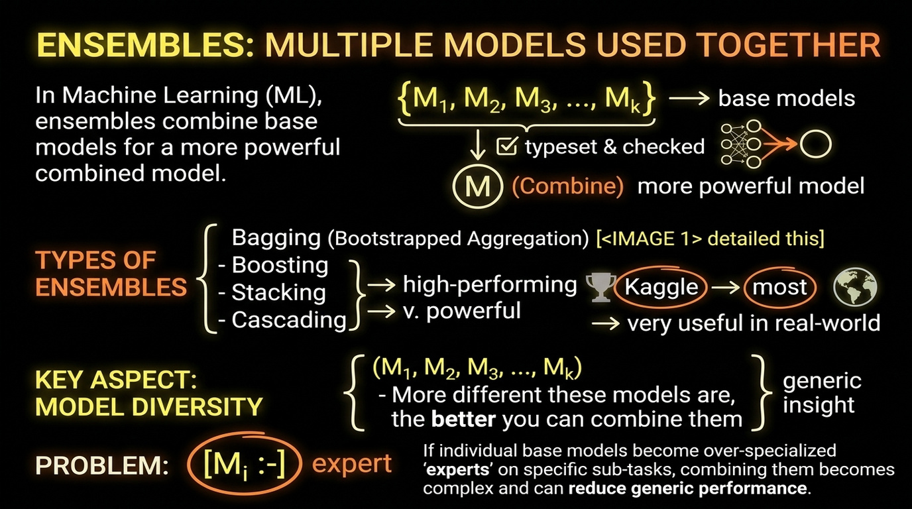  

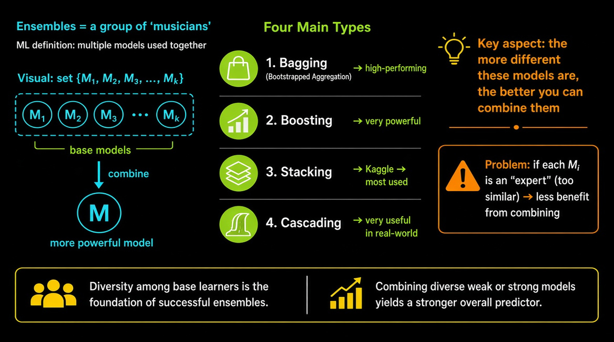  

> **Ensembles**

Analogy: a group of “musicians”.

In Machine Learning: **multiple models used together**.

$$
\{M_1, M_2, M_3, \dots, M_K\} \quad \text{base models}
$$

They are combined to produce a more powerful model $M$.

### Four Main Types

1. **Bagging** (Bootstrap Aggregating)
2. **Boosting**
3. **Stacking**
4. **Cascading**

These techniques are:
- high-performing
- very powerful
- extremely popular on Kaggle
- very useful in real-world applications

### Key Aspect

The more **different** the base models $M_1, M_2, \dots, M_K$ are,  
the better you can combine them.

This is a **generic** principle.

**Problem**: each individual model $M_i$ is only an “expert” on part of the problem; the ensemble tries to overcome that limitation.


## 02. Bootstrapped Aggregation (Bagging) Intuition

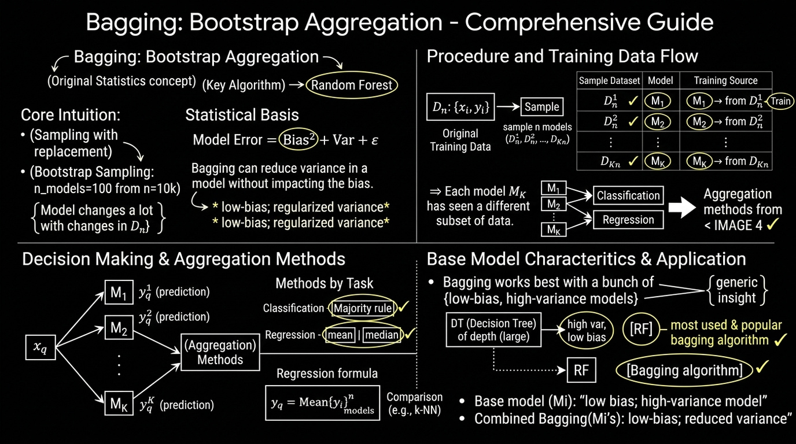  

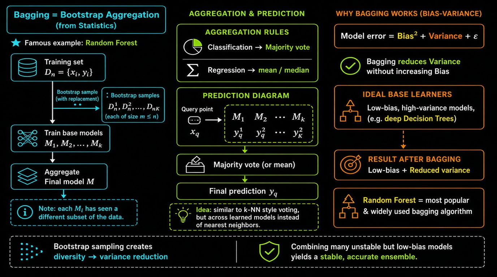  

> **Bagging (Bootstrap Aggregation)**

Also known as the foundation of **Random Forest**.

### Intuition

Given the original training set $D_n = \{(x_i,y_i)\}$ of size $n$:

1. Create $K$ **bootstrap samples** $D_n^1, D_n^2, \dots, D_n^K$  
   (sampling **with replacement**, each of size $m \le n$).

2. Train one base model on each bootstrap sample:
   $$
   M_1 \text{ on } D_n^1,\;
   M_2 \text{ on } D_n^2,\;
   \dots,\;
   M_K \text{ on } D_n^K
   $$

3. Aggregate the $K$ models into a final model $M$.

Each model $M_i$ has seen a slightly different subset of the data.

### Aggregation

- **Classification** → Majority vote  
- **Regression** → Mean or Median

For a query point $x_q$:

$$
\begin{align*}
y_q^1 &= M_1(x_q) \\
y_q^2 &= M_2(x_q) \\
&\vdots \\
y_q^K &= M_K(x_q)
\end{align*}
$$

Final prediction:
- Classification: majority of $\{y_q^1,\dots,y_q^K\}$
- Regression: $y_q = \text{mean}\{y_q^i\}$ (or median)

### Bootstrap Sampling & Variance

Because each bootstrap sample is slightly different, each base model changes a little.  
This is exactly the definition of **variance** of a model.

### Bias-Variance View

Model error = Bias² + Variance + ε

- Base models $M_i$ are typically **low-bias, high-variance** models  
  (e.g. deep Decision Trees).

- Bagging keeps the low bias and **reduces the variance**.

Result of bagging low-bias / high-variance models:
→ still low bias, but **reduced variance**.

### Connection to Random Forest

- A deep Decision Tree = low-bias, high-variance model.  
- Bagging many such trees → **Random Forest** (the most popular and widely used bagging method).


## 03. Random Forest and Their Construction

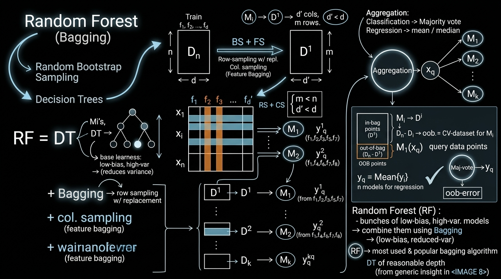  

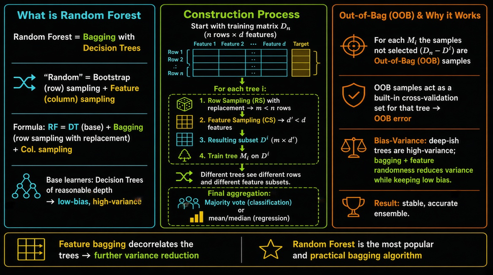  

> **Random Forest (Bagging)**

Random Forest = Decision Trees + Bagging + Column Sampling

### Core Idea

- Base learners: Decision Trees of **reasonable depth** (low-bias, high-variance models).
- Two types of randomness:
  1. **Row sampling** (Bootstrap Sampling) – sampling with replacement
  2. **Column / Feature sampling** (Feature Bagging)

$$
\text{RF} = \text{DT} + \text{Bagging} + \text{Col. Sampling}
$$

### How a Bootstrap + Feature Sample is Created

Original training matrix $D_n$ has shape $n \times d$.

For each base model $M_i$ we create a smaller matrix $D^i$:

- $m$ rows sampled with replacement ($m \le n$)
- $d'$ columns sampled without replacement ($d' < d$)

$$
D^i \;\text{has shape}\; m \times d'
$$

Each tree therefore sees:
- a different subset of the points, and
- a different subset of the features.

### Aggregation

- Classification → Majority vote
- Regression → Mean or Median

### Out-of-Bag (OOB) Samples

For every tree $M_i$ trained on $D^i$:

$$
D_n - D^i = \text{Out-of-Bag (OOB) samples}
$$

These OOB points can be used as a **built-in cross-validation set** for that tree → **OOB error**.

### Summary of Random Forest

$$
\begin{align*}
\text{RF} &= \text{Decision Trees of reasonable depth} \\
&\quad + \text{Row sampling with replacement} \\
&\quad + \text{Column sampling} \\
&\quad + \text{Aggregation (majority / mean / median)}
\end{align*}
$$

Result: low-bias models whose high variance has been reduced by bagging and feature randomness.


## 04. Bias-Variance Tradeoff

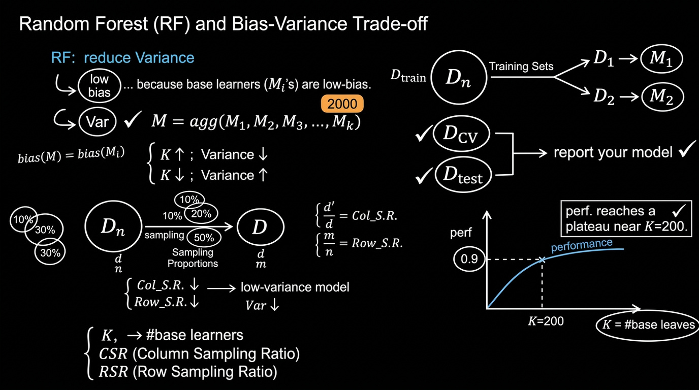  

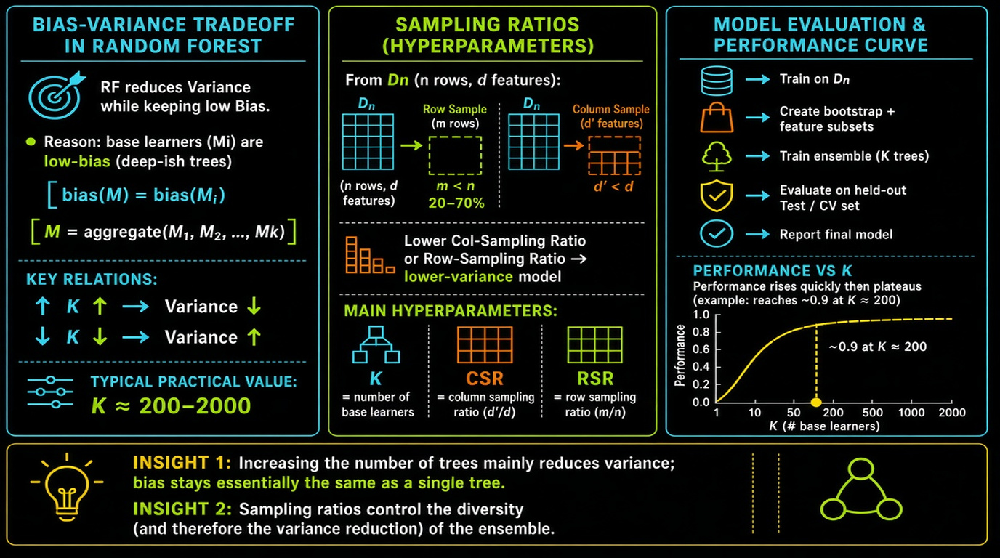  

> **Bias–Variance Trade-off in Random Forest**

### Random Forest Properties

- Base learners $M_i$ are **low-bias** models (deep / reasonably deep Decision Trees).
- Therefore the final aggregated model $M$ also has **low bias**:

$$
\text{bias}(M) = \text{bias}(M_i)
$$

- Random Forest’s main job is to **reduce variance**.

$$
M = \text{agg}(M_1, M_2, \dots, M_K)
$$

Effect of the number of trees $K$:

- $K \uparrow$ → Variance $\downarrow$
- $K \downarrow$ → Variance $\uparrow$

(Typical practical values: a few hundred to a few thousand trees, e.g. 200–2000.)

### Row & Column Sampling Ratios

From the original data $D_n$ ($n$ rows, $d$ columns) we create each bootstrap matrix $D^i$:

- Row sampling ratio (RSR) = $m/n$ (often ≈ 100 % or slightly less)
- Column sampling ratio (CSR) = $d'/d$ (often $\sqrt{d}$ or 20–50 %)

Lower sampling ratios → more diversity among trees → lower variance of the ensemble.

Hyper-parameters that control variance:
- $K$ (number of base learners)
- Column Sampling Ratio (CSR)
- Row Sampling Ratio (RSR)

### Model Selection Practice

1. Train many Random Forests with different $K$ (and different sampling ratios).
2. Evaluate on a validation / CV set.
3. Performance typically rises quickly and then saturates (e.g. around $K=200$).
4. Finally report the performance of the chosen model on a held-out **test set**.

This is how we control the bias–variance trade-off in practice for Random Forests.


## 05. Train and Run Time Complexity

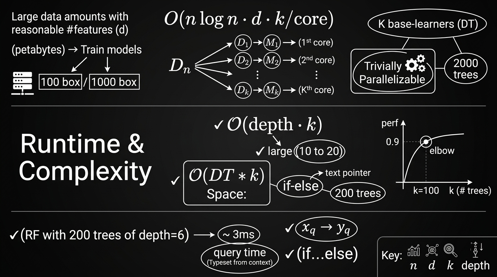  

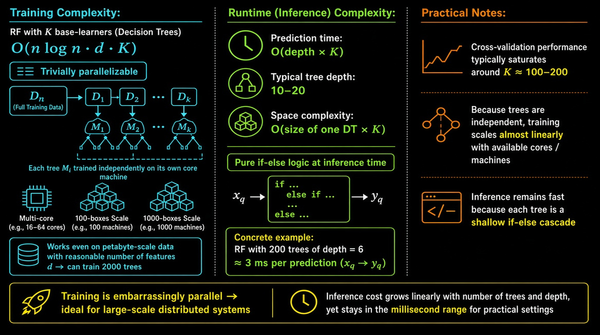  


> **Train & Runtime Complexity of Random Forest**

### Training Complexity

Random Forest with $K$ base learners (Decision Trees):

$$
\text{Train time} \;\sim\; O\bigl(n\log n\cdot d\cdot K\bigr)
$$

- Extremely **embarrassingly parallel**: each tree can be trained independently on a different core / machine.
- Easily scales to multi-core machines or large clusters (100 boxes, etc.).
- Suitable for very large data (even petabyte scale) as long as the number of features $d$ is reasonable.
- Typical ensemble size: a few hundred to a couple of thousand trees (e.g. 200–2000).

### Runtime (Prediction) Complexity

To predict a single point we must evaluate all $K$ trees:

$$
\text{Prediction time} = O(\text{depth}\times K)
$$

- Each tree is a simple nested if-else.
- For reasonable depths (10–20) and a few hundred trees the latency stays very low.
- Example: RF with 200 trees of depth 6 → roughly **3 ms** prediction time.

### Space Complexity

We need to store all $K$ trees:

$$
\text{Space} = O(\text{size of one DT}\times K)
$$

### Practical Takeaway

Random Forests offer an excellent trade-off:
- Training is parallel and scales well.
- Prediction remains fast enough for most real-time / low-latency applications.


## 06. Bagging Code Sample

https://scikit-learn.org/stable/modules/generated/sklearn.ensemble.RandomForestClassifier.html


## 07. Extremely Randomized Trees

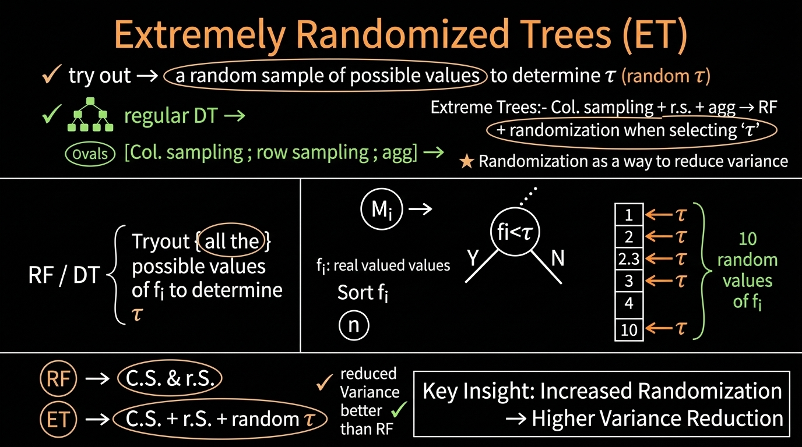  

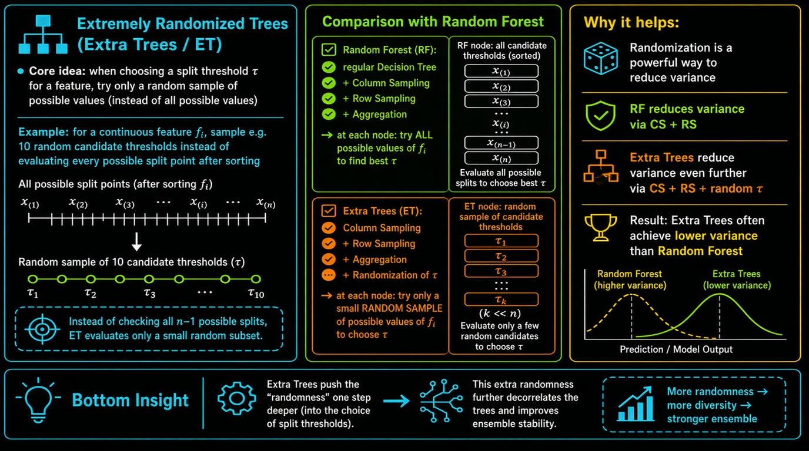  

> **Extremely Randomized Trees (Extra Trees)**

### Difference from ordinary Random Forest

In a regular Decision Tree / Random Forest:

- For a numerical feature $f_i$ we **sort** all its values and try **all possible thresholds** $\tau$ to find the best split.

In **Extremely Randomized Trees**:

- We only try a **random sample** of possible threshold values (e.g. 10 random candidate thresholds) instead of exhaustively searching all of them.

### How Extra Trees work

Extra Trees = Column Sampling + Row Sampling + Aggregation  
**+ randomization when selecting the threshold $\tau$**

$$
\begin{align*}
\text{RF} &\rightarrow \text{C.S. + R.S.} \\
\text{ET} &\rightarrow \text{C.S. + R.S. + random }\tau
\end{align*}
$$

### Why extra randomization?

Randomization is used as a way to **further reduce variance**.

- Extra Trees introduce even more randomness than Random Forest (by randomizing the split thresholds).
- Consequently they often achieve **lower variance** than a standard Random Forest (sometimes at a small cost in bias).

### Summary

| Method              | Randomness sources                          | Effect on variance |
|---------------------|---------------------------------------------|--------------------|
| Ordinary DT         | none                                        | high               |
| Random Forest       | row sampling + column sampling              | reduced            |
| Extremely Randomized Trees | row sampling + column sampling + random $\tau$ | reduced even more |


## 08. Random Tree Cases

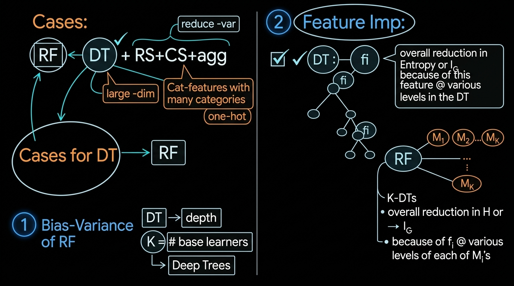  

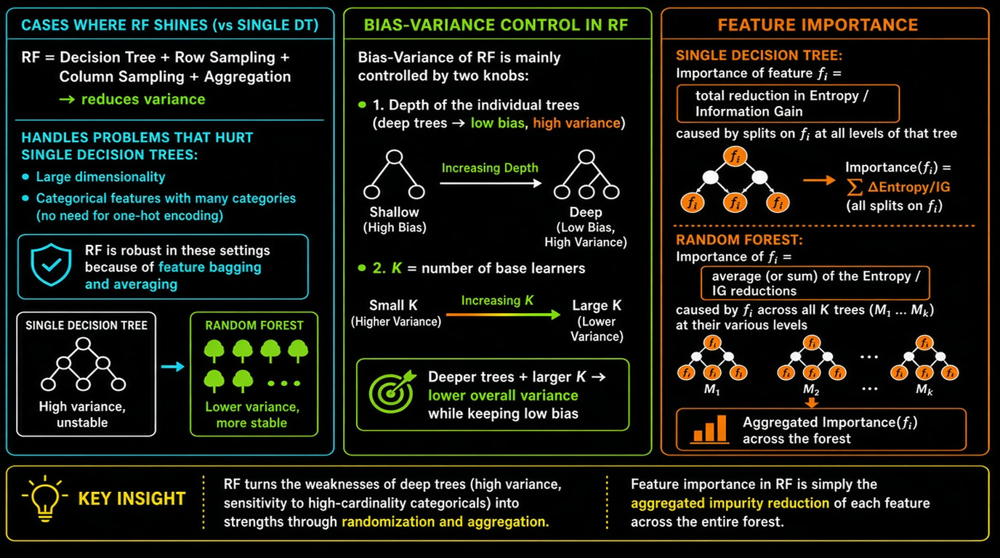  

> **Cases for Random Forest**

Random Forest inherits most of the cases/advantages of Decision Trees and adds the variance-reduction benefits of bagging + column sampling.

$$
\text{RF} = \text{DT} + \text{Row Sampling} + \text{Column Sampling} + \text{Aggregation}
$$

### 1. Bias–Variance Behaviour

- Base learners are deep Decision Trees → **low bias**.
- The ensemble reduces variance through randomization and aggregation.
- Main hyper-parameters that control the bias–variance trade-off:
  - Depth of the individual trees
  - Number of base learners $K$

### Large Dimensionality & High-Cardinality Categorical Features

- Random Forest handles high-dimensional data well because of column sampling.
- For categorical features with many levels we still prefer **not** to one-hot encode (same reason as for ordinary DTs).  
  Convert them to a numerical probability feature or use native categorical support when available.

### 2. Feature Importance in Random Forest

In a single Decision Tree the importance of a feature $f_i$ is the total reduction in impurity (Entropy / Information Gain / Gini) that $f_i$ produces across all the nodes where it is used.

In a Random Forest we simply **average** this quantity over all $K$ trees:

$$
\text{Importance}(f_i) = \text{average over } M_1,\dots,M_K \text{ of the total impurity reduction caused by } f_i
$$

This gives a more stable and reliable feature-importance ranking than a single tree.


## 09. Boosting Intuition

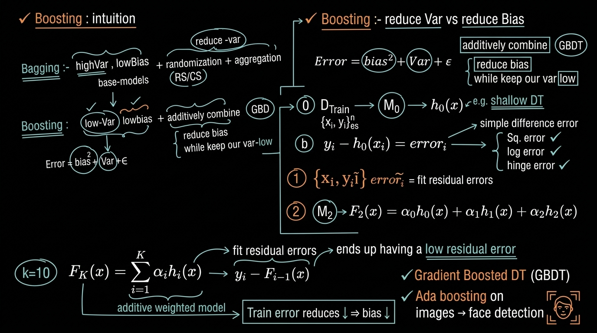  

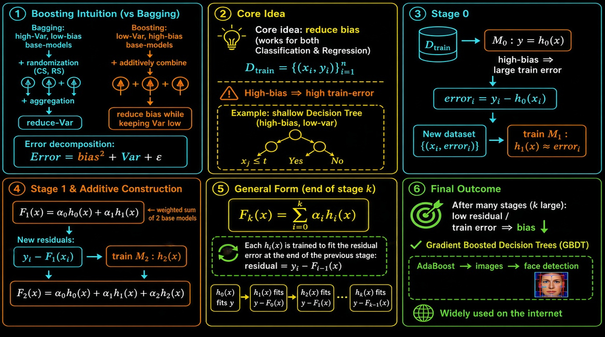  


> **Boosting – Intuition**

### Bagging vs Boosting

| Method   | Base models              | What we do                          | Goal                          |
|----------|--------------------------|-------------------------------------|-------------------------------|
| Bagging  | high-variance, low-bias | randomize + aggregate (RS + CS)    | reduce variance               |
| Boosting | low-variance, high-bias  | additively combine the models     | reduce bias while keeping variance low |

Error = Bias² + Variance + ε

### Core Idea of Boosting

Start with a simple (high-bias) model and successively correct its residual errors.

1. Train an initial model $h_0(x)$ on the original data  
   (typically a weak learner – e.g. a shallow Decision Tree).  
   High bias → high training error.

2. Compute the residual / error of this model:
   $$
   \text{error}_i = y_i - h_0(x_i)
   $$
   (can be squared error, log-loss, hinge, etc.)

3. Train the next model $h_1(x)$ on the residuals:
   $$
   \{x_i,\; \text{error}_i\}
   $$
   so that $h_1(x) \approx y_i - h_0(x_i)$.

4. Form the stage-1 model:
   $$
   F_1(x) = \alpha_0 h_0(x) + \alpha_1 h_1(x)
   $$

5. Repeat: at stage $k$ we fit $h_k$ to the residual error of $F_{k-1}$:
   $$
   \text{residual}_i = y_i - F_{k-1}(x_i)
   $$
   and obtain
   $$
   F_k(x) = \sum_{i=0}^{k} \alpha_i h_i(x)
   $$

### Final Model

After $K$ stages we have an **additive weighted model**:

$$
F_K(x) = \sum_{i=0}^{K} \alpha_i h_i(x)
$$

Each new base learner is trained to fit the residual error left by the previous ensemble → training error (and therefore bias) steadily decreases while the variance stays under control.

### Popular Instances

- **Gradient Boosted Decision Trees (GBDT)** – extremely popular on the internet
- **AdaBoost** – historically important (especially for face detection)


## 10. Residuals, Loss Functions and Gradients

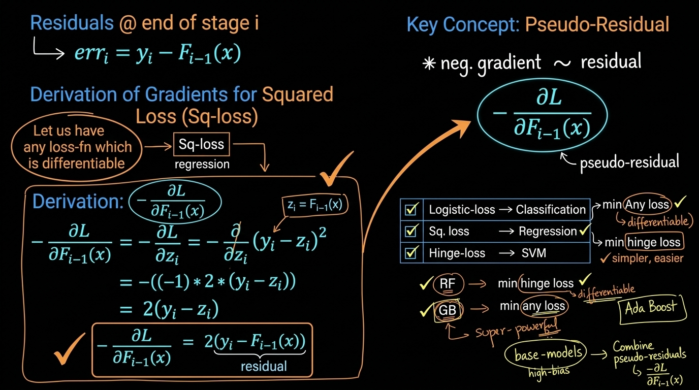  

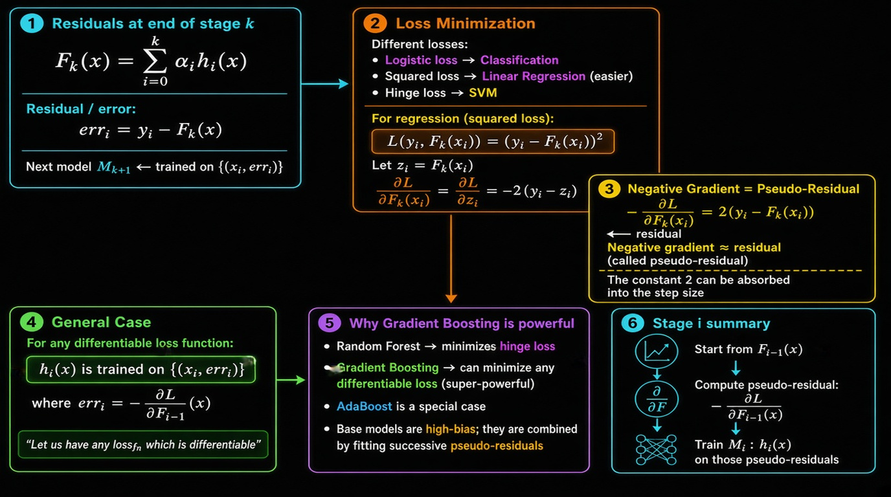  

> **Residuals, Loss Functions & Gradients → Gradient Boosting**

### Additive Model

$$
F_K(x) = \sum_{i=0}^{K} \alpha_i h_i(x)
$$

At the end of stage $k$ the residual (or error) is

$$
\text{err}_i = y_i - F_k(x_i)
$$

The next base learner $M_{k+1}$ (i.e. $h_{k+1}$) is trained on the pairs $\{(x_i, \text{err}_i)\}$.

### Loss Minimization View

Different problems use different loss functions:

| Task              | Typical Loss          |
|-------------------|-----------------------|
| Classification    | Logistic loss         |
| Regression        | Squared loss          |
| SVM-style         | Hinge loss            |

**Squared loss (regression)** – the easiest case:

$$
\mathcal{L}\bigl(y_i, F_k(x_i)\bigr) = \bigl(y_i - F_k(x_i)\bigr)^2
$$

Let $z_i = F_k(x_i)$. Then

$$
\frac{\partial\mathcal{L}}{\partial z_i} = -2(y_i - z_i)
$$

Hence the **negative gradient** is

$$
-\frac{\partial\mathcal{L}}{\partial F_k(x_i)} = 2(y_i - F_k(x_i))
$$

which is exactly proportional to the residual.

### Pseudo-residuals

In general, for **any differentiable loss**, we define the **pseudo-residual** as the negative gradient of the loss with respect to the current prediction:

$$
\text{pseudo-residual}_i = -\frac{\partial\mathcal{L}}{\partial F_{i-1}(x_i)}
$$

The next weak learner $h_i$ is fitted to these pseudo-residuals.

### Key Insight

- Random Forest minimises a fixed loss (usually 0-1 / Gini / impurity).
- Gradient Boosting can minimise **any differentiable loss** by repeatedly fitting the negative gradient (pseudo-residuals).

This is what makes Gradient Boosting extremely flexible and powerful.

### Stage-$i$ Picture

$$
\begin{align*}
&\text{Current model: } F_{i-1}(x) \\
&\text{Pseudo-residuals: } -\frac{\partial\mathcal{L}}{\partial F_{i-1}(x_i)} \\
&\text{Fit } h_i(x) \text{ to the pairs } \bigl(x_i,\;\text{pseudo-residual}_i\bigr)
\end{align*}
$$


## 11. Pseudo Residuals for Log-Loss and Classification

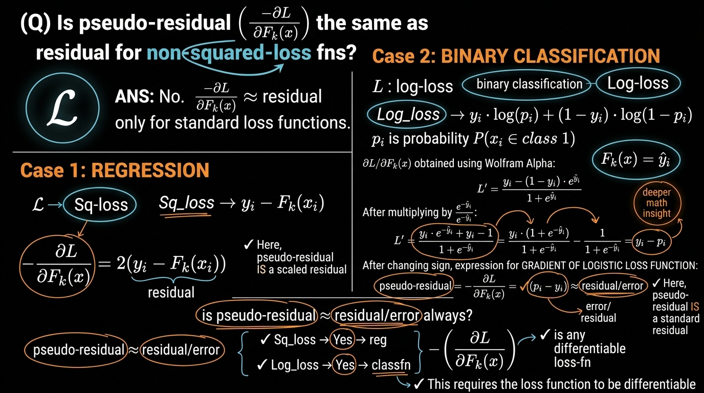  

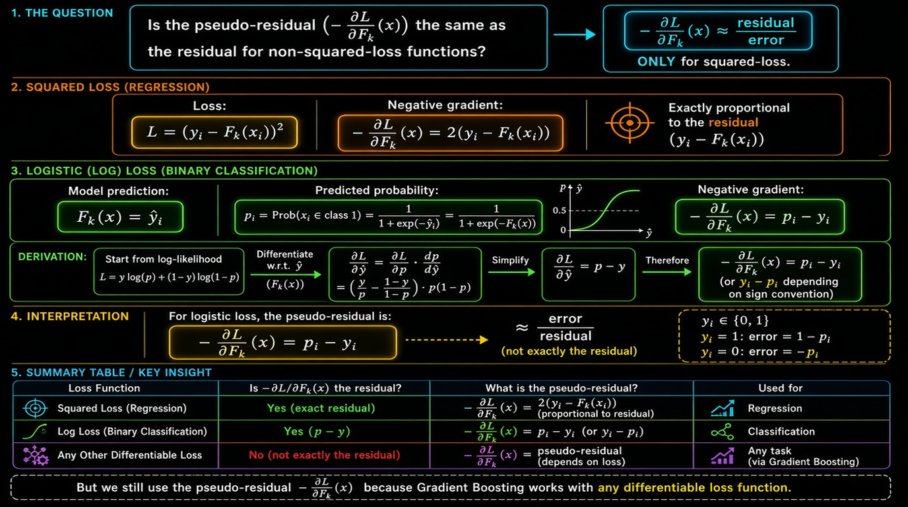

> **Pseudo-residuals for Different Loss Functions**

### Question
Is the pseudo-residual $\Bigl(-\dfrac{\partial\mathcal{L}}{\partial F_k(x)}\Bigr)$ the same as the ordinary residual for non-squared-loss functions?

### Answer

Only for **squared loss** is the negative gradient exactly proportional to the residual:

$$
-\frac{\partial\mathcal{L}}{\partial F_k(x_i)} = 2\bigl(y_i - F_k(x_i)\bigr)
$$

For other losses the negative gradient is a **generalised residual** (pseudo-residual).

### Logistic Loss (Binary Classification)

$$
F_k(x) = \hat{y}_i \qquad\text{(log-odds)}
$$

$$
p_i = \frac{1}{1+\exp(-F_k(x_i))} = \text{probability that } x_i\text{ belongs to class 1}
$$

The negative gradient of the logistic loss is

$$
-\frac{\partial\mathcal{L}}{\partial F_k(x_i)} = p_i - y_i
$$

(Derivation shown in the notes leads to $p_i - y_i$.)

Thus the pseudo-residual is simply

$$
\text{pseudo-residual}_i = p_i - y_i
$$

### Summary

| Loss          | Pseudo-residual equals ordinary residual? | Task          |
|---------------|-------------------------------------------|---------------|
| Squared loss  | Yes                                       | Regression    |
| Logistic loss | Yes (it is $p_i - y_i$)                   | Classification|
| Any other differentiable loss | No – it is the negative gradient | General       |

### Why do we use pseudo-residuals?

Because Gradient Boosting can optimise **any differentiable loss** by repeatedly fitting the negative gradient of that loss.  
The ordinary residual only coincides with the negative gradient for squared loss; for every other loss we must use the true gradient (pseudo-residual).

## 12. Mathematical Reasoning for using Pseudo Residuals

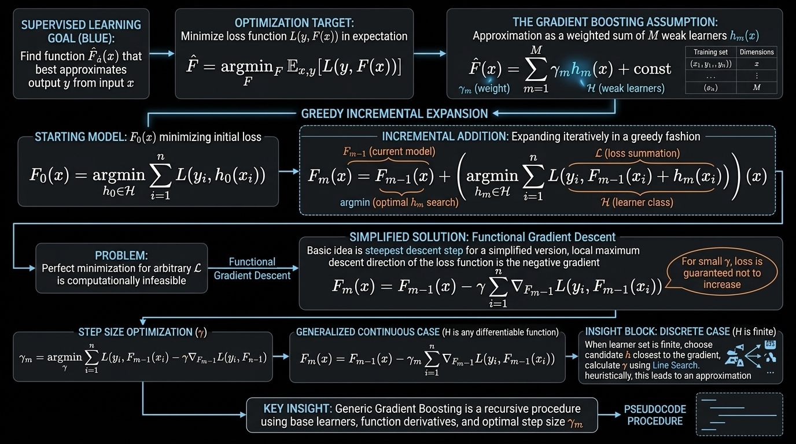  

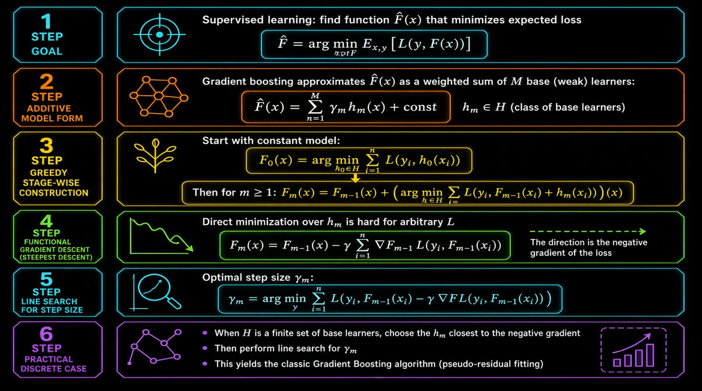 

https://en.wikipedia.org/wiki/Gradient_boosting#Algorithm

> **Gradient Boosting – Formal Algorithm**

### Goal

Find a function $\hat{F}(x)$ that minimises the expected loss:

$$
\hat{F} = \arg\min_F\;\mathbb{E}_{x,y}\bigl[L\bigl(y,F(x)\bigr)\bigr]
$$

We look for an additive expansion of weak learners:

$$
\hat{F}(x) = \sum_{m=1}^{M}\gamma_m h_m(x) + \text{const}
$$

where each $h_m\in\mathcal{H}$ is a base (weak) learner and $\gamma_m$ is its weight.

### Greedy Stage-wise Construction

Start with a constant model

$$
F_0(x) = \arg\min_{h_0}\sum_{i=1}^n L\bigl(y_i,h_0(x_i)\bigr)
$$

Then, for $m=1,2,\dots,M$:

$$
F_m(x) = F_{m-1}(x) + \gamma_m h_m(x)
$$

where the new base learner is chosen by

$$
h_m = \arg\min_{h\in\mathcal{H}}\sum_{i=1}^n L\bigl(y_i,F_{m-1}(x_i)+h(x_i)\bigr)
$$

and the step size (weight) is

$$
\gamma_m = \arg\min_{\gamma}\sum_{i=1}^n L\bigl(y_i,F_{m-1}(x_i)+\gamma h_m(x_i)\bigr)
$$

### Functional Gradient Descent View

Directly minimising the above is hard for an arbitrary loss.  
Instead we take a steepest-descent step in function space.  
The direction of steepest descent is the **negative gradient** of the loss:

$$
-\nabla_{F_{m-1}}L\bigl(y_i,F_{m-1}(x_i)\bigr)
$$

We therefore fit the next weak learner $h_m$ to the **pseudo-residuals**

$$
r_{im} = -\frac{\partial L\bigl(y_i,F_{m-1}(x_i)\bigr)}{\partial F_{m-1}(x_i)}
$$

and then perform a line search for the optimal step size $\gamma_m$.

### Generic Gradient-Boosting Pseudocode

1. Initialise $F_0(x)$  
2. For $m=1$ to $M$:  
   a. Compute pseudo-residuals  
      $$r_{im}=-\partial L(y_i,F_{m-1}(x_i))/\partial F_{m-1}(x_i)$$  
   b. Fit a base learner $h_m$ to the pairs $\{(x_i,r_{im})\}$  
   c. Choose step size  
      $$\gamma_m=\arg\min_\gamma\sum_i L\bigl(y_i,F_{m-1}(x_i)+\gamma h_m(x_i)\bigr)$$  
   d. Update  
      $$F_m(x)=F_{m-1}(x)+\gamma_m h_m(x)$$  
3. Output the final model $F_M(x)$

## 13. Gradient Boosting

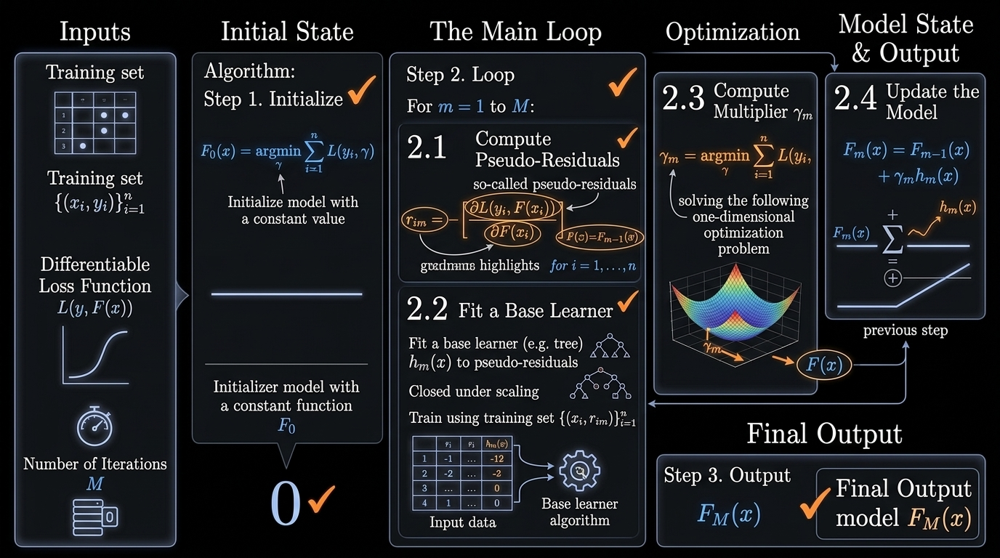  

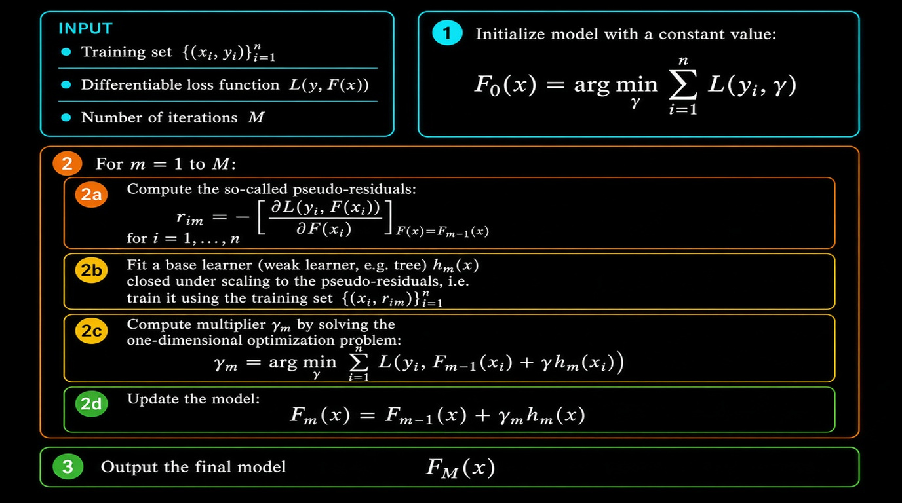  

https://en.wikipedia.org/wiki/Gradient_boosting#Algorithm

> **Gradient Boosting – Algorithm (Pseudocode)**

**Input**  
- Training set $\{(x_i,y_i)\}_{i=1}^n$  
- Differentiable loss function $L(y,F(x))$  
- Number of iterations $M$

**Algorithm**

1. **Initialise** the model with a constant value:

$$
F_0(x) = \arg\min_{\gamma}\sum_{i=1}^n L(y_i,\gamma)
$$

2. **For** $m = 1$ **to** $M$:

   a. Compute the **pseudo-residuals**

   $$
   r_{im} = -\left[\frac{\partial L(y_i,F(x_i))}{\partial F(x_i)}\right]_{F(x)=F_{m-1}(x)}
   \qquad\text{for }i=1,\dots,n
   $$

   b. Fit a base learner (weak learner) $h_m(x)$ to the pseudo-residuals,  
      i.e. train it on the set $\{(x_i,r_{im})\}_{i=1}^n$.

   c. Compute the multiplier (step size) $\gamma_m$ by solving the one-dimensional optimisation problem

   $$
   \gamma_m = \arg\min_{\gamma}\sum_{i=1}^n L\bigl(y_i,F_{m-1}(x_i)+\gamma\,h_m(x_i)\bigr)
   $$

   d. **Update** the model

   $$
   F_m(x) = F_{m-1}(x) + \gamma_m h_m(x)
   $$

3. **Output** the final model $F_M(x)$.

## 14. Regularization by Shrinkage

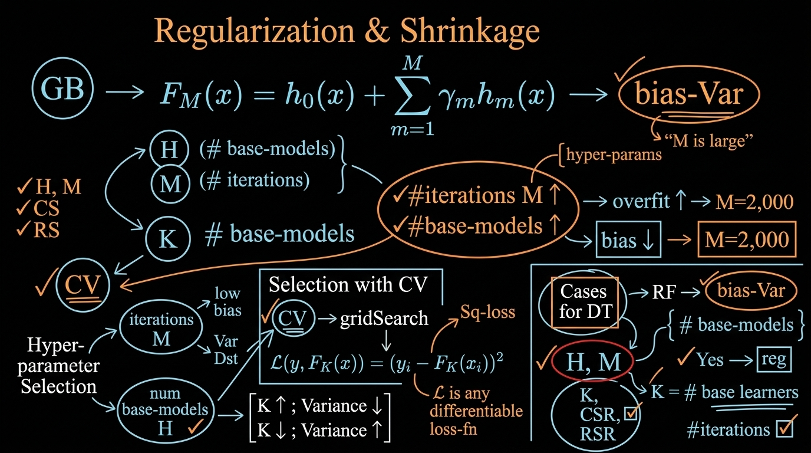  

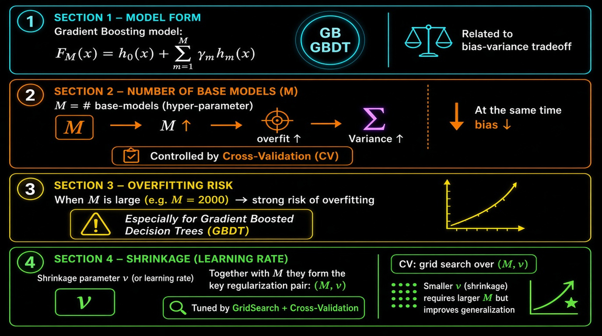  

https://en.wikipedia.org/wiki/Gradient_boosting#Regularization

> **Regularization & Shrinkage in Gradient Boosting**

### Additive Model

$$
F_M(x) = h_0(x) + \sum_{m=1}^{M} \gamma_m h_m(x)
$$

- $M$ = number of base models (boosting stages)

### Bias–Variance Behaviour

- Increasing $M$ (more base learners)  
  → bias decreases  
  → but risk of **overfitting** increases → variance increases

- Therefore $M$ is an important **hyper-parameter** that must be chosen carefully (usually by cross-validation).

### Practical Observation

Gradient Boosting / GBDT can easily overfit when $M$ becomes large  
(typical dangerous values: $M = 1000$–$2000$ or more).

### Shrinkage (Learning-rate)

To control overfitting we introduce a **shrinkage** (learning-rate) parameter $v$ (or $\eta$):

$$
F_m(x) = F_{m-1}(x) + v\cdot\gamma_m h_m(x)
$$

- $0 < v \le 1$ (typical values: 0.01 – 0.1)
- Smaller $v$ → slower learning → need larger $M$, but much better generalisation.

### Hyper-parameter Tuning

We perform a **grid search** (or random search) over the pair

$$
(M,\; v)
$$

using cross-validation to find the best trade-off between bias and variance.

## 15. Train and Run Time Complexity

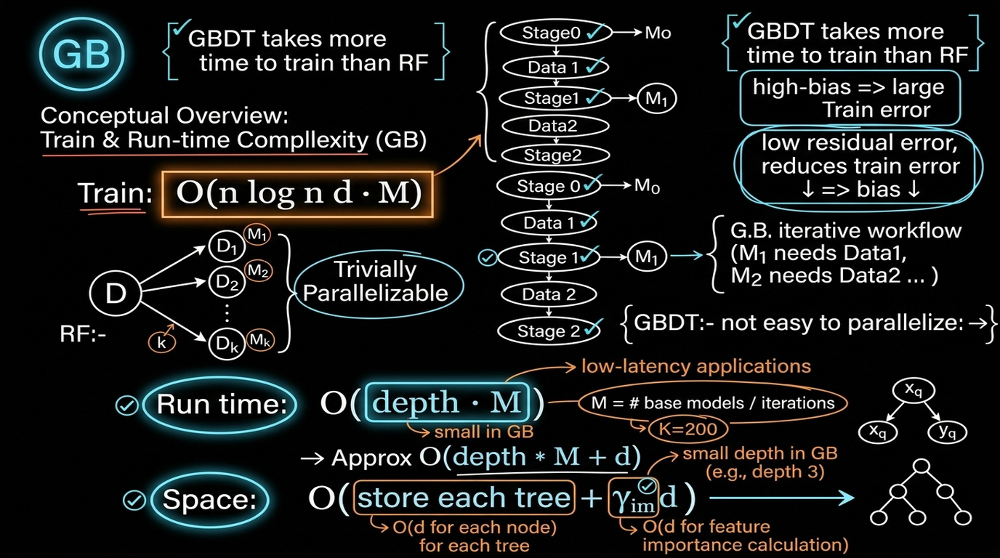  

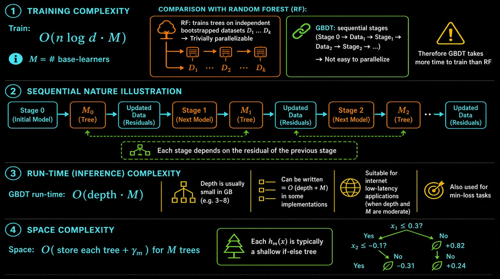  

> **Train & Runtime Complexity of Gradient Boosting (GB / GBDT)**

### Training Complexity

$$
\text{Train time} \;\sim\; O(n\log n\cdot d\cdot M)
$$

where $M$ = number of base learners (boosting stages).

**Important difference from Random Forest**

- Random Forest trees are independent → **trivially parallelisable**.
- Gradient Boosting is **sequential**: each stage depends on the residuals of the previous stage.  
  → much harder to parallelise.  
  → GBDT typically takes **more wall-clock time** to train than a Random Forest of similar size.

### Runtime (Prediction) Complexity

To predict a single point we evaluate all $M$ trees:

$$
\text{Prediction time} = O(\text{depth}\times M)
$$

- Depth of each tree is usually kept **small** in GBDT (often 3–8).
- Therefore even with a few hundred trees the latency stays acceptable for many internet / low-latency applications.

### Space Complexity

We need to store every tree together with its weight $\gamma_m$:

$$
\text{Space} = O\bigl(\text{size of one tree}\times M\bigr)
$$

### Practical Take-away

| Aspect          | Random Forest              | Gradient Boosting (GBDT)          |
|-----------------|----------------------------|-----------------------------------|
| Training        | Embarrassingly parallel    | Sequential (harder to parallelise)|
| Training speed  | Faster                     | Slower                            |
| Prediction      | $O(\text{depth}\times K)$  | $O(\text{depth}\times M)$ (depth usually smaller) |
| Typical use     | Fast training, good baseline | Highest accuracy when carefully tuned |


## 16. XGBoost: Boosting + Randomization

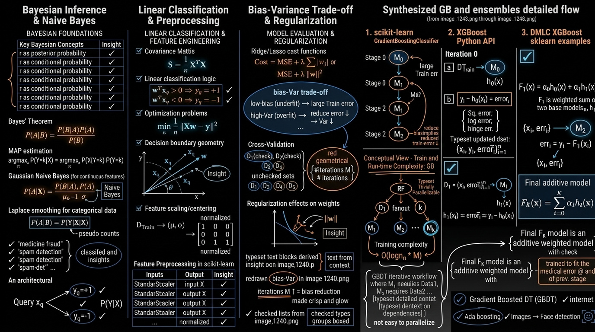  

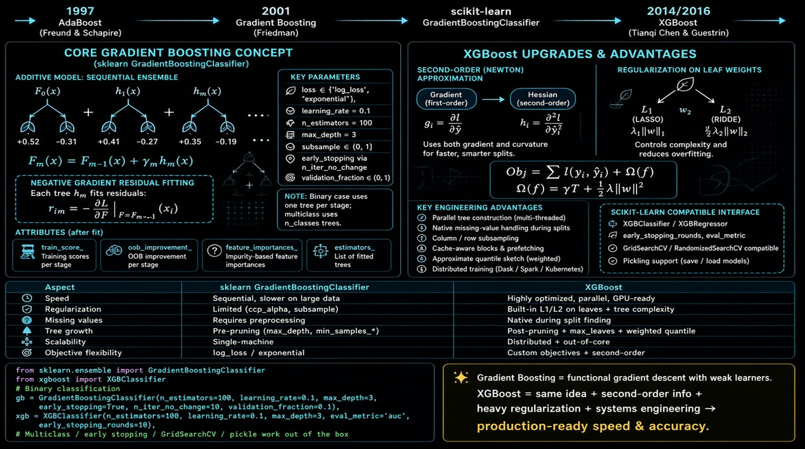  

https://scikit-learn.org/stable/modules/generated/sklearn.ensemble.GradientBoostingClassifier.html

https://xgboost.readthedocs.io/en/stable/python/python_api.html


https://github.com/dmlc/xgboost/blob/master/demo/guide-python/sklearn_examples.py


## 17. AdaBoost Geometric Intuition

[Ensemble-Adaboost.pdf](./Ensemble-Adaboost.pdf) 


## 18. Stacking Models

https://rasbt.github.io/mlxtend/user_guide/classifier/StackingClassifier/


## 19. Cascading Classifiers

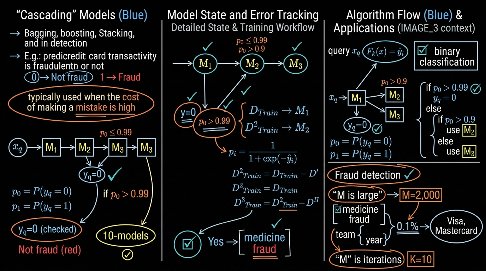  

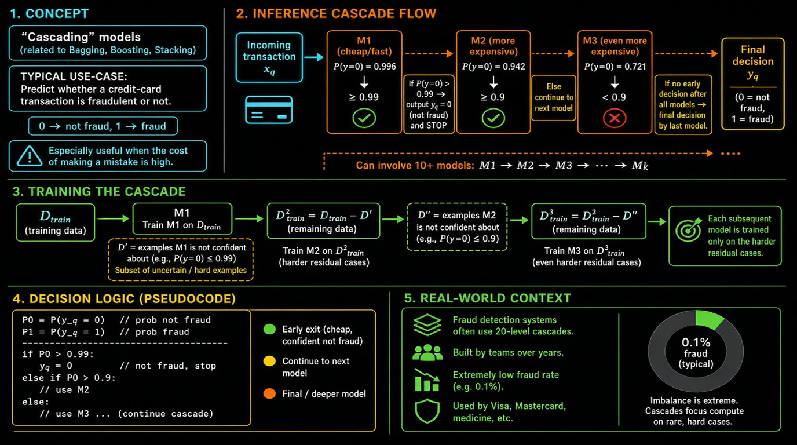  

> **Cascading Models**

Cascading is another ensemble technique (alongside Bagging, Boosting and Stacking).

### Typical Use-Case

Used when the **cost of making a mistake is very high**  
(e.g. fraud detection, medical diagnosis, security systems).

### Credit-Card Fraud Example

Goal: decide whether a transaction $x_q$ is fraudulent ($y_q=1$) or not ($y_q=0$).

A cascade of models is applied:

1. Model $M_1$ looks at the transaction.  
   - If $P(y_q=0) > 0.99$ → confidently declare **“not fraud”** and stop.  
   - Otherwise pass the transaction to $M_2$.

2. Model $M_2$ does the same with a (usually higher) confidence threshold.  
   - If still unsure → pass to $M_3$, and so on.

3. Only the hardest / most suspicious cases reach the final models.

Typical cascade depth: 10–20 models.

### How the Training Sets Are Built

- $D^1_{\text{train}}$ = full training set → train $M_1$
- $D^2_{\text{train}} = D^1_{\text{train}} - D'$  
  (where $D'$ are the points that $M_1$ already classifies with high confidence as non-fraud)
- $D^3_{\text{train}} = D^2_{\text{train}} - D''$  
  and so on.

Each subsequent model is trained only on the harder examples that the previous models could not confidently reject.

### Decision Logic (simplified)

```
if P₀ > 0.99:
    yq = 0          # not fraud
else if P₀ > 0.9:
    use M₂
else:
    use M₃
```

### Real-World Impact

- Fraud detection systems at Visa / Mastercard often use multi-level cascades (20+ levels).
- Similar cascaded architectures appear in medical diagnosis pipelines where false negatives are extremely costly.

Cascading lets us trade a little extra computation on the hard cases for a dramatic reduction in costly mistakes.


## 20. Kaggle Competitions vs Real World

Watch Lecture Video

## 21. Assignment-9: Apply Random Forests & GBDT


## 22. Revision Questions

**Questions**

[1. What are ensembles?](#1-what-are-ensembles)  
[2. What is Bootstrapped Aggregation (Bagging)?](#2-what-is-bootstrapped-aggregation-bagging)  
[3. Explain about Random Forest and their construction?](#3-explain-about-random-forest-and-their-construction)  
[4. Explain about Boosting?](#4-explain-about-boosting)  
[5. What are Residuals, Loss functions and gradients?](#5-what-are-residuals-loss-functions-and-gradients)  
[6. Explain about Gradient Boosting?](#6-explain-about-gradient-boosting)  
[7. What is Regularization by Shrinkage?](#7-what-is-regularization-by-shrinkage)  
[8. Explain about XGBoost?](#8-explain-about-xgboost)  
[9. Explain about AdaBoost?](#9-explain-about-adaboost)  
[10. How do you implement Stacking models?](#10-how-do-you-implement-stacking-models)  
[11. Explain about cascading classifiers?](#11-explain-about-cascading-classifiers)

### 1. What are ensembles?

**Ensembles** are methods that combine multiple individual models (base learners) to produce a stronger overall model.

**Core idea**:  
Many weak or moderately strong models, when combined properly, can outperform a single model.

**Main types**:
- **Bagging** → reduces variance (e.g., Random Forest)
- **Boosting** → reduces bias (e.g., AdaBoost, Gradient Boosting, XGBoost)
- **Stacking** → combines different types of models using a meta-learner
- **Cascading** → sequential combination with rejection options

Ensembles generally give better accuracy, robustness, and generalization than single models.

### 2. What is Bootstrapped Aggregation (Bagging)?

**Bagging** = Bootstrap Aggregating.

**How it works**:
1. Create multiple bootstrap samples (random sampling with replacement) from the training data.
2. Train one base model on each bootstrap sample.
3. Aggregate the predictions:
   - Classification → majority vote
   - Regression → average

**Key benefits**:
- Reduces variance
- Helps avoid overfitting
- Works especially well with high-variance models (e.g., deep decision trees)

Random Forest is the most popular extension of bagging.

### 3. Explain about Random Forest and their construction?

**Random Forest** is a bagging ensemble of decision trees with an extra source of randomness.

**Construction steps**:
1. Create many bootstrap samples of the training data.
2. For each sample, grow a decision tree.
3. At each split, instead of considering all features, randomly select a subset of features (usually $ \sqrt{d} $ or $ \log_2 d $).
4. Grow the trees fully (or with minimal pruning).
5. Aggregate predictions by majority vote (classification) or averaging (regression).

**Why it works**:
- Bagging reduces variance
- Random feature selection decorrelates the trees → further reduces variance
- Very robust and hard to overfit when the number of trees is large

### 4. Explain about Boosting?

**Boosting** is an ensemble technique that builds models **sequentially**.

**Core idea**:
- Each new model focuses on the mistakes made by the previous models.
- Later models try to correct the errors of earlier ones.

**Key characteristics**:
- Reduces bias
- Models are dependent (unlike bagging)
- Final prediction is a weighted combination of all weak learners

Popular boosting algorithms:
- AdaBoost
- Gradient Boosting
- XGBoost, LightGBM, CatBoost

### 5. What are Residuals, Loss functions and gradients?

**Residuals**:  
The difference between the actual target and the current prediction:  
$ r_i = y_i - \hat{y}_i $

**Loss function**:  
A function that measures how good the current predictions are (e.g., Squared Error, Logistic Loss, Huber Loss).

**Gradients**:  
In Gradient Boosting, we use the **negative gradient** of the loss function with respect to the current predictions as the target for the next weak learner.

This is why it is called **Gradient** Boosting — each tree is fitted to the gradient (pseudo-residuals) of the loss.

### 6. Explain about Gradient Boosting?

**Gradient Boosting** builds an additive model in a forward stage-wise manner.

**Algorithm**:
1. Start with an initial model $ F_0(x) $ (usually the mean for regression).
2. For $ m = 1 $ to $ M $:
   - Compute the negative gradients (pseudo-residuals) of the loss.
   - Fit a weak learner $ h_m(x) $ (usually a shallow tree) to these residuals.
   - Update the model: $ F_m(x) = F_{m-1}(x) + \nu \cdot h_m(x) $
3. Final model = sum of all weak learners.

**Important hyperparameters**:
- Number of trees $ M $
- Learning rate $ \nu $ (shrinkage)
- Tree depth / complexity
- Subsampling

### 7. What is Regularization by Shrinkage?

**Shrinkage** (also called learning rate) is a regularization technique used in boosting.

Instead of adding the full contribution of a new tree, we add only a small fraction:

$ F_m(x) = F_{m-1}(x) + \nu \cdot h_m(x) $

where $ 0 < \nu \leq 1 $ (typical values: 0.01 to 0.3)

**Effect**:
- Slows down the learning process
- Reduces overfitting
- Usually requires more trees to reach the same performance
- Almost always improves generalization

Shrinkage is one of the most important regularization techniques in Gradient Boosting and XGBoost.

### 8. Explain about XGBoost?

**XGBoost** (Extreme Gradient Boosting) is an optimized and regularized implementation of Gradient Boosting.

**Key improvements over standard Gradient Boosting**:
- Second-order approximation of the loss (uses both gradient and Hessian)
- Built-in L1 and L2 regularization on leaf weights
- Column (feature) subsampling
- Row subsampling
- Handling of missing values
- Parallel and distributed computing
- Tree pruning (max depth + min child weight + gamma)
- Cache-aware and hardware-optimized implementation

XGBoost is one of the most successful algorithms in machine learning competitions.

### 9. Explain about AdaBoost?

**AdaBoost** (Adaptive Boosting) was one of the first successful boosting algorithms.

**How it works**:
1. Start with equal weights on all training points.
2. Train a weak learner (usually a decision stump).
3. Increase the weights of misclassified points.
4. Train the next weak learner on the re-weighted data.
5. Repeat.
6. Final prediction is a weighted majority vote of all weak learners (weights depend on the accuracy of each learner).

**Geometric intuition**:  
AdaBoost focuses more and more on the hard-to-classify examples by increasing their weights.

It is sensitive to outliers and noise because it keeps increasing the weight of difficult points.

### 10. How do you implement Stacking models?

**Stacking** (Stacked Generalization) combines multiple different models using a meta-learner.

**Typical implementation**:
1. Split the training data into two parts (or use cross-validation).
2. Train several base models (Level-0 models) on the first part.
3. Generate predictions from these base models on the second part (out-of-fold predictions).
4. Train a meta-model (Level-1 model) on these predictions as features.
5. For final prediction:  
   - Base models make predictions on test data  
   - Meta-model combines them

**Common choices**:
- Base models: Random Forest, XGBoost, LightGBM, Logistic Regression, k-NN, etc.
- Meta-model: Logistic Regression or a simple neural network (to avoid overfitting)

Stacking often gives the best performance when models are diverse.

### 11. Explain about cascading classifiers?

**Cascading** is a sequential ensemble technique where models are arranged in stages.

**How it works**:
1. The first classifier makes a prediction.
2. If it is very confident, it outputs the prediction and stops.
3. If it is not confident (uncertain region), the example is passed to the next, more complex classifier.
4. This continues through multiple stages.

**Advantages**:
- Very fast on easy examples (most examples are handled by the early simple models)
- More accurate on difficult examples (handled by later powerful models)
- Popular in real-time systems (e.g., face detection – Viola-Jones cascade)

Cascading is different from boosting because models are not combined by voting/averaging; instead, they form a rejection chain.